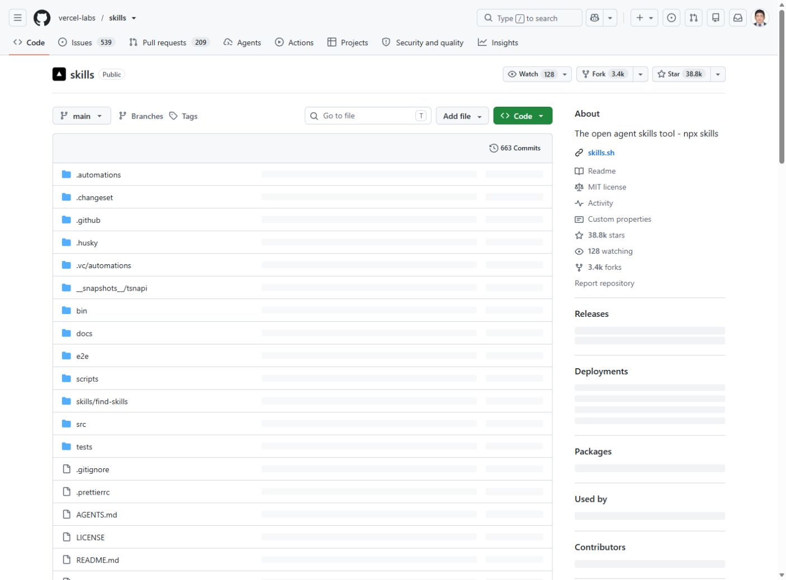

# 모듈 5. GitHub와 find-skills 사용

기준일 2026-11-10 · 예상 50분 · 교사용

## 1. 학습 목표

원본 저장소를 확인하고 프로젝트 범위에서 스킬을 탐색·설치한다.

## 2. 핵심 개념

GitHub 저장소는 코드·문서의 원본 위치다. README는 안내, SKILL.md는 에이전트 지침, LICENSE는 이용 조건이다. Skills CLI와 find-skills 스킬은 관련이 있지만 같은 실행 파일이 아니다.

## 3. 준비물과 이용 조건

현재 CLI 문서 기준 Node.js 22.20 이상, npm, Git. 제작 PC Node.js v24.18.0, npm 11.16.0. 교사 PC에서 한 번 검증하고 수업 전 배포한다.

## 4. 실제 웹 경로와 화면

**이동 경로:** vercel-labs/skills → skills → find-skills → SKILL.md

**직접 주소:** [https://github.com/vercel-labs/skills](https://github.com/vercel-labs/skills)

<figure><a href="../08_화면캡처/05_findskills_원본.jpg"></a><figcaption>그림 5-1. 직접 접속한 공식 웹페이지 화면. 새 설치·로그인 성공 화면과 구분한다. · 실제 캡처 2026-11-10<br>출처: <a href="https://github.com/vercel-labs/skills">https://github.com/vercel-labs/skills</a> · 클릭하면 원본 크기로 열림</figcaption></figure>

## 5. 단계별 실습

### 단계 1. 원본 읽기

저장소 소유자와 주소를 확인하고 README, SKILL.md, 라이선스, 수정 내역을 읽는다. 인기 수치만으로 안전성을 단정하지 않는다.

### 단계 2. ZIP과 clone

Code 메뉴의 Download ZIP은 특정 시점의 사본을 받는다. git clone은 저장소 이력과 업데이트 관리에 적합하다. 다운로드만 했다고 에이전트에 설치된 것은 아니다.

### 단계 3. Node 확인

node --version과 npm --version을 실행한다. 학교 정책에 맞는 설치본을 사용하고 CLI 문서의 최소 버전을 확인한다.

### 단계 4. 프로젝트 설치

실습 폴더에서 find-skills를 두 대상 에이전트에 설치한다. -g를 쓰지 않으면 프로젝트 범위를 우선한다. 실제 선택 화면이 나오면 대상과 경로를 읽는다.

### 단계 5. 검색

phaser 또는 platformer로 검색하고 실제 결과의 원본 저장소를 연다. 이번 검색에서는 Phaser 공식 저장소와 두 커뮤니티 후보가 확인되었다.

### 단계 6. 인식과 제거

npx skills list와 파일 위치를 확인한다. 제거는 현재 도움말을 확인하고 프로젝트 스킬에만 적용한다. 업데이트는 전체 학급 실습 전에 교사가 먼저 검증한다.

**입력 위치: Windows PowerShell.** 주석과 경로를 읽고 필요한 명령만 실행한다. `/help` 등 세션 명령은 설명된 에이전트 안에서 입력한다.

```powershell
node --version
npm --version
npx skills add vercel-labs/skills --skill find-skills -a codex -a claude-code
npx skills find "phaser"
npx skills find "platformer"
npx skills list
npx skills --help
```

## 6. 복사 가능한 프롬프트 입력 예시

입력 위치는 이용이 허용된 Codex 또는 교사의 Claude Code 세션이다. 스킬 이름이 들어간 예시는 해당 스킬이 인식된 상태에서 사용한다. 아래는 입력 예시이며 실제 서비스에서 자동으로 실행된 응답을 뜻하지 않는다.

### 예시 5-1. 기본 요청

```text
find-skills를 사용해 2D 횡스크롤 게임에 도움이 되는 스킬을 찾아줘. 원본 저장소, 라이선스, 지원 에이전트, 설치 방법을 비교하고 자동으로 전역 설치하지 마.
```

확인: 요청한 파일 또는 비교 결과가 실제로 나왔는지 확인한다.

### 예시 5-2. 수정·보완 요청

```text
검색 결과 중 공식 Phaser 저장소의 game-setup-and-config가 실제로 있는지 확인하고 어떤 버전과 작업을 다루는지 SKILL.md를 읽어 정리해줘.
```

확인: 기존 요구사항이 유지되고 추가 조건이 반영되었는지 확인한다.

### 예시 5-3. 확인·검증 요청

```text
설치된 find-skills의 파일 위치와 이름을 확인해줘. 파일 존재, 새 세션에서의 인식, 실제 검색 실행 여부를 구분해서 알려줘.
```

확인: 기대 결과와 실제 실행 여부가 구분되었는지 확인한다.

## 7. 정상 결과와 확인 방법

프로젝트 .agents/skills/find-skills에 SKILL.md가 있고 Claude Code용 연결이 있다. 본 제작에서 CLI 설치는 성공했으며 로그를 07_검증및출처/install-find.txt에 보관했다.

## 8. 오류와 해결

검색 결과가 없으면 엔진명·기능명으로 좁힌다. 저장소가 바뀌었으면 원본에서 현재 위치를 확인한다. npx 설치 확인 대화와 에이전트 권한 승인을 혼동하지 않는다.

## 9. 과제와 확인 문항

기본: 후보 2개 비교표. 확장: 게임 외 보고서·접근성 관련 스킬 탐색.

질문: ZIP 파일을 내려받았으면 스킬 설치 완료인가? 답: 올바른 경로에 SKILL.md와 자원을 두고 에이전트가 인식해야 한다.

## 10. 교사 시연과 설명

명령의 각 옵션을 읽게 한다. -g의 의미를 모른 채 전체 PC에 설치하는 습관을 피한다.

시연 순서는 목표 안내 5분 → 작업과 설명 15분 → 학생 활동·관찰 20분 → 결과 비교 7분 → 기록 3분을 기본으로 한다. 장시간 모듈은 각 차시마다 이를 반복한다. 막힌 학생은 계정 공유 대신 실행 예제와 요청문 비교 활동을 사용한다.

관찰 기록: 목표 달성 여부 / 학생이 확인한 근거 / 발생 오류 / 다음 시간 보완 사항. 수업 실시 전에는 실제 학생 반응을 채우지 않는다.

## 출처

- [https://github.com/vercel-labs/skills](https://github.com/vercel-labs/skills) · 확인일 2026-11-10
- 상세 실행 상태: [검증 현황](../07_검증및출처/검증현황.md)
