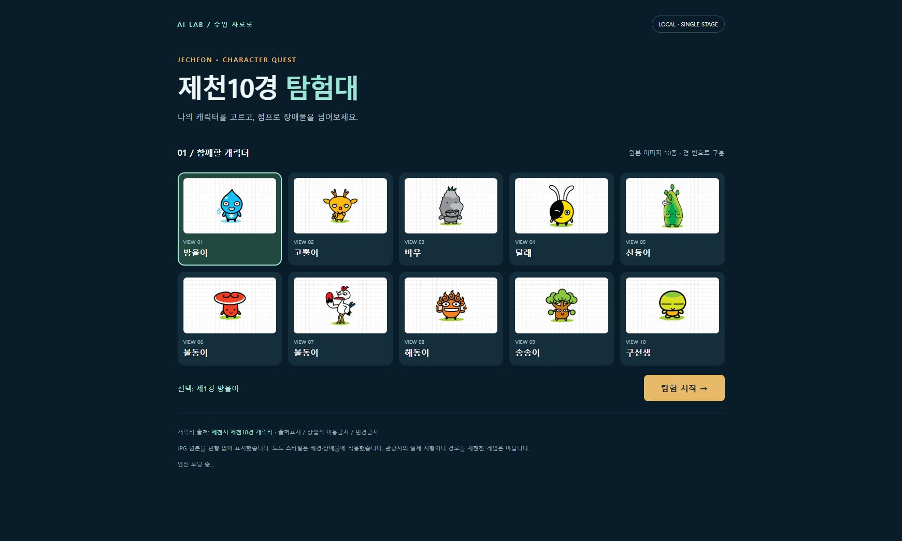
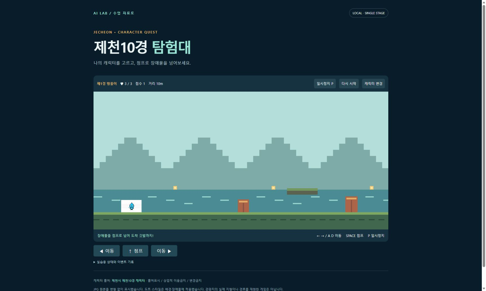
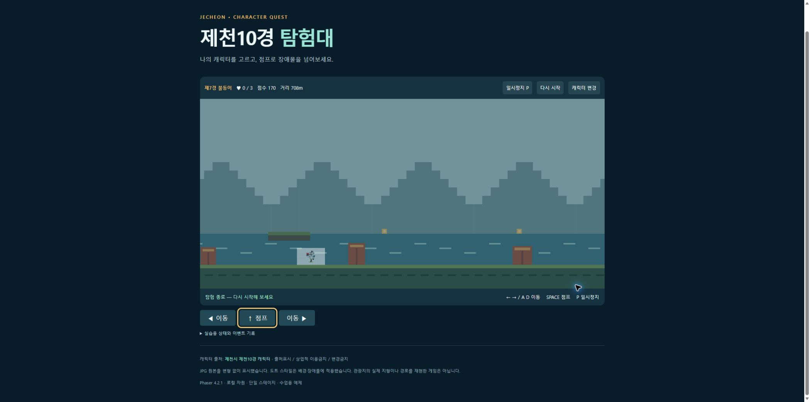
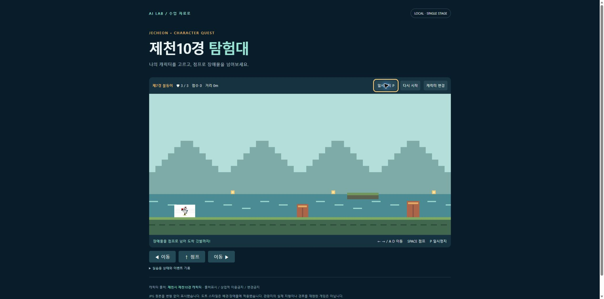

> 공용 설치 개정: 스킬은 사용자 .agents의 단일 원본, 플러그인은 양쪽 별도 등록, MCP는 공용 목록으로 관리함. https://youngwoo-m.github.io/highschool-ai-prompt-master/shared-install/

# 모듈 7. 제천10경 캐릭터 게임 제작

기준일 2026-11-10 · 예상 150분 / 3차시 · 교사용

## 1. 학습 목표

캐릭터 10개를 구분하고 이동·점프·충돌·점수·종료를 갖춘 한 스테이지를 완성한다.

## 2. 핵심 개념

요구사항은 기능의 목록이며 시험 기준은 그 기능이 작동했는지 판단하는 조건이다. 경 번호는 고유 ID다. 같은 이름의 제6경·제7경을 구분하는 데 사용한다. 스프라이트는 화면 오브젝트이며 정지 JPG가 자동으로 자세별 애니메이션이 되는 것은 아니다.

## 3. 준비물과 이용 조건

사용자 제공 제천10경케릭터 JPG 10개, 공식 페이지와 이용 조건, 완성 예제. 원본 바이트는 그대로 복사하고 크롭·배경 제거·도트 변환을 하지 않았다. 출처표시·상업적 이용금지·변경금지 조건을 교재와 게임에 표시한다.

## 4. 실제 웹 경로와 화면

**이동 경로:** 제천시 → 제천소개 → 제천시소개 → 공공저작물 → 제천시 홍보 디자인 → 제천10경 캐릭터

**직접 주소:** [https://www.jecheon.go.kr/www/contents.do?key=48579](https://www.jecheon.go.kr/www/contents.do?key=48579)

<figure><a href="../08_화면캡처/07_게임_캐릭터선택.jpg"></a><figcaption>그림 7-1. 직접 실행한 게임 화면 · 실제 캡처 2026-11-10<br>출처: <a href="http://127.0.0.1:18465/05_게임실습/완성게임/index.html">http://127.0.0.1:18465/05_게임실습/완성게임/index.html</a> · 클릭하면 원본 크기로 열림</figcaption></figure>

<figure><a href="../08_화면캡처/07_게임_플레이.jpg"></a><figcaption>그림 7-2. 제1경 캐릭터가 반영된 실제 초기 플레이 화면 · 실제 캡처 2026-11-10<br>출처: <a href="http://127.0.0.1:18465/05_게임실습/완성게임/index.html">http://127.0.0.1:18465/05_게임실습/완성게임/index.html</a> · 클릭하면 원본 크기로 열림</figcaption></figure>

<figure><a href="../08_화면캡처/07_게임_점프.jpg"></a><figcaption>그림 7-3. 점프 입력 직후 실제 게임 화면 · 실제 캡처 2026-11-10<br>출처: <a href="http://127.0.0.1:18465/05_게임실습/완성게임/index.html">http://127.0.0.1:18465/05_게임실습/완성게임/index.html</a> · 클릭하면 원본 크기로 열림</figcaption></figure>

<figure><a href="../08_화면캡처/07_게임_충돌종료.jpg"></a><figcaption>그림 7-4. 실제 플레이 중 3회 피격 후 체력 0과 탐험 종료를 확인한 화면 · 실제 캡처 2026-11-10<br>출처: <a href="http://127.0.0.1:18465/05_게임실습/완성게임/index.html">http://127.0.0.1:18465/05_게임실습/완성게임/index.html</a> · 클릭하면 원본 크기로 열림</figcaption></figure>

<figure><a href="../08_화면캡처/07_게임_재시작.jpg"></a><figcaption>그림 7-5. 제7경을 유지하면서 체력과 점수가 초기화된 실제 재시작 화면 · 실제 캡처 2026-11-10<br>출처: <a href="http://127.0.0.1:18465/05_게임실습/완성게임/index.html">http://127.0.0.1:18465/05_게임실습/완성게임/index.html</a> · 클릭하면 원본 크기로 열림</figcaption></figure>

## 5. 단계별 실습

### 단계 1. 자산 조사

원본 JPG 10개의 크기는 각각 275×165다. 파일명을 경 번호 순서로 정리하고 ID 1~10을 부여한다. 제6경·제7경 모두 불동이라는 파일명을 그대로 보존한다.

### 단계 2. 선택 화면

10개 선택 카드 중 하나만 강조되게 하고 선택 ID를 플레이 상태에 전달한다. 같은 이름 대신 ID로 이미지 파일을 찾는다.

### 단계 3. 규칙 분리

rules.js는 위치·속도·중력·체력·점수를 계산한다. game.js는 Phaser 화면, 키 입력, 버튼, 화면 상태를 담당한다. 화면과 규칙을 분리하면 같은 조건으로 시험하기 쉽다.

### 단계 4. 장애물·발판

장애물 6개와 발판 3개를 배치한다. 점프 중 장애물 위를 지나갈 수 있고 발판은 위에서 내려올 때만 착지한다. 체력 3, 피격 후 1.25초 보호, 체력 소진 시 종료다.

### 단계 5. 점수와 종료

이동 거리에 따라 점수를 늘리고 스탬프를 수집한다. 오른쪽 끝에 도착하면 성공이다. 일시정지·재시작·캐릭터 변경을 별도 상태로 구현한다.

### 단계 6. 검증과 기록

각 캐릭터의 선택 상태를 확인하고 게임에 전달되는 ID를 상태 기록에서 확인한다. 공중 점프 방지, 피격, 종료, 재시작은 규칙 시험표와 실제 화면 점검을 구분한다. 새로운 창으로 전환하면 게임은 자동 일시정지한다.

**입력 위치: Windows PowerShell.** 주석과 경로를 읽고 필요한 명령만 실행한다. `/help` 등 세션 명령은 설명된 에이전트 안에서 입력한다.

```powershell
# 프로젝트 루트에서 규칙 시험
node '.\09_제작도구\test_rules.cjs'
# 완성 게임 주소
# http://127.0.0.1:18465/05_게임실습/완성게임/index.html
# 단계2: ?lesson=2 / 도형+충돌
# 단계3: ?lesson=3 / 원본 캐릭터+완성 기능
```

## 6. 복사 가능한 프롬프트 입력 예시

입력 위치는 이용이 허용된 Codex 또는 교사의 Claude Code 세션이다. 스킬 이름이 들어간 예시는 해당 스킬이 인식된 상태에서 사용한다. 아래는 입력 예시이며 실제 서비스에서 자동으로 실행된 응답을 뜻하지 않는다.

### 예시 7-1. 기본 요청

```text
제천10경케릭터 폴더의 JPG 10개를 원본 그대로 사용해 선택 화면을 만들어줘. 제6경과 제7경 이름이 같아도 ID로 구분하고 원본 파일을 덮어쓰지 마. 선택한 ID가 실제 플레이에 반영되게 해줘.
```

확인: 요청한 파일 또는 비교 결과가 실제로 나왔는지 확인한다.

### 예시 7-2. 수정·보완 요청

```text
장애물과 발판을 넣어줘. 지상에서만 점프하고 발판 위에서 다시 점프할 수 있게 해줘. 피격 시 체력을 1 줄이고 잠시 중복 피해를 막아줘. 체력 소진 시 이동을 멈추고 재시작 버튼을 제공해줘.
```

확인: 기존 요구사항이 유지되고 추가 조건이 반영되었는지 확인한다.

### 예시 7-3. 확인·검증 요청

```text
캐릭터 선택 전달, 점프·착지, 장애물 충돌, 일시정지, 재시작 초기화, 도착 성공을 시험표로 확인해줘. 실제 수행한 시험의 방법과 결과를 적고 화면 미확인 항목은 따로 표시해줘.
```

확인: 기대 결과와 실제 실행 여부가 구분되었는지 확인한다.

## 7. 정상 결과와 확인 방법

브라우저에서 10종 각각의 선택 ID가 게임에 전달됨을 확인했다. 제7경으로 이동·점프·피격 후 체력 0 및 종료, 재시작 후 ID 유지·체력 3·점수 0, 일시정지 중 위치 유지·재개를 확인했다. Node 규칙 시험은 17/17 통과했다. 도착 성공까지의 브라우저 전체 플레이는 미실행이며 해당 판정은 규칙 시험에서 확인했다.

## 8. 오류와 해결

이미지가 안 보이면 assets.js의 상대경로와 대소문자, 서버 요청을 확인한다. JPG 격자 배경은 원본의 일부로 제거하지 않았다. 빠른 이동에서 충돌이 누락되면 시간 간격과 속도·경계 판정을 함께 살핀다.

## 9. 과제와 확인 문항

기본: 시험표를 직접 채운다. 확장: 이용 허락을 받은 별도 이미지 또는 직접 그린 캐릭터로 자세별 프레임을 제작한다. 10개 스테이지는 추가 과제이다.

질문: 파일명이 같은 이름이면 하나로 합쳐도 되는가? 답: 경 번호가 다른 별도 자료다. ID를 유지한다.

## 10. 교사 시연과 설명

3차시는 규칙·도형, 캐릭터·화면, 검증·개선으로 나눈다. 공식 관광지의 지형을 구현한 게임이라고 설명하지 않는다.

시연 순서는 목표 안내 5분 → 작업과 설명 15분 → 학생 활동·관찰 20분 → 결과 비교 7분 → 기록 3분을 기본으로 한다. 장시간 모듈은 각 차시마다 이를 반복한다. 막힌 학생은 계정 공유 대신 실행 예제와 요청문 비교 활동을 사용한다.

관찰 기록: 목표 달성 여부 / 학생이 확인한 근거 / 발생 오류 / 다음 시간 보완 사항. 수업 실시 전에는 실제 학생 반응을 채우지 않는다.

## 출처

- [https://www.jecheon.go.kr/www/contents.do?key=48579](https://www.jecheon.go.kr/www/contents.do?key=48579) · 확인일 2026-11-10
- 상세 실행 상태: [검증 현황](../07_검증및출처/검증현황.md)
