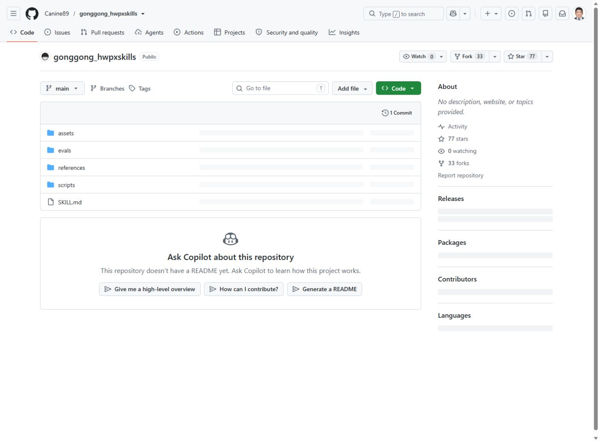
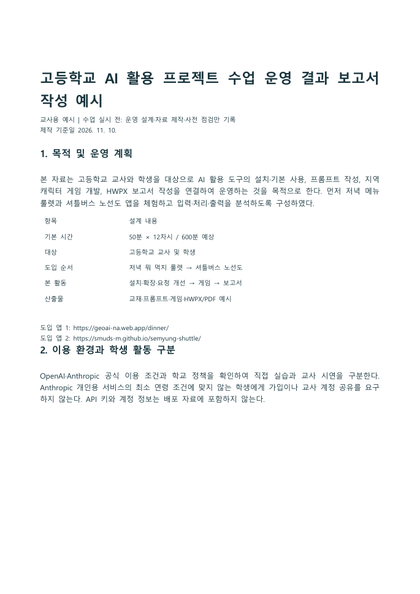
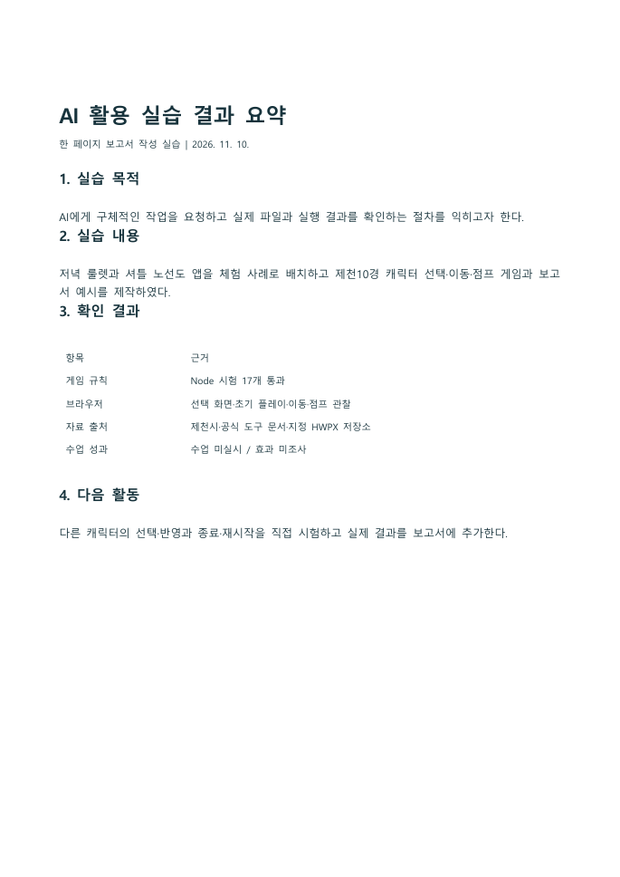
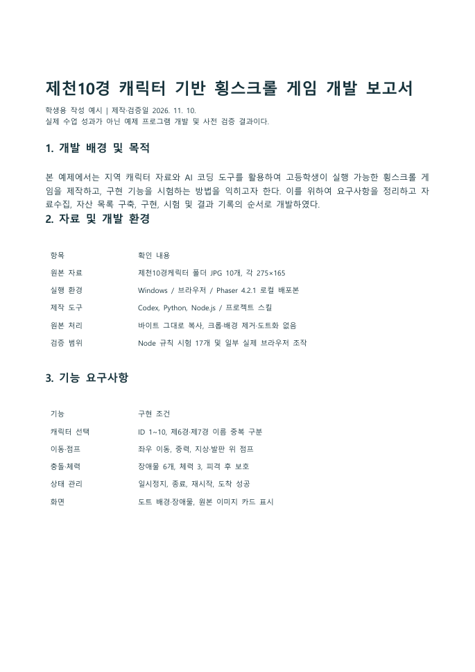

> 공용 설치 개정: 스킬은 사용자 .agents의 단일 원본, 플러그인은 양쪽 별도 등록, MCP는 공용 목록으로 관리함. https://youngwoo-m.github.io/highschool-ai-prompt-master/shared-install/

# 모듈 8. 지정 HWPX 스킬 설치와 첫 문서

기준일 2026-11-10 · 예상 50분 · 교사용

## 1. 학습 목표

사용자 지정 스킬과 템플릿으로 실제 HWPX 문서를 생성한다.

## 2. 핵심 개념

HWP는 기존 바이너리 형식이며 HWPX는 XML 등으로 구성된 ZIP 패키지다. 확장자를 바꾸는 것으로 변환되지 않는다. 양식 편집에서는 문단·표·스타일·이미지 관계를 유지해야 한다.

## 3. 준비물과 이용 조건

Python, 지정 저장소의 assets/report-template.hwpx, 프로젝트 가상환경과 python-hwpx. 한컴오피스 한글이 설치된 교사 PC에서는 실제 열림·PDF 내보내기까지 확인한다.

## 4. 실제 웹 경로와 화면

**이동 경로:** Canine89/gonggong_hwpxskills → SKILL.md / assets / scripts

**직접 주소:** [https://github.com/Canine89/gonggong_hwpxskills](https://github.com/Canine89/gonggong_hwpxskills)

<figure><a href="../08_화면캡처/08_HWPX_지정저장소.jpg"></a><figcaption>그림 8-1. 직접 접속한 공식 웹페이지 화면. 새 설치·로그인 성공 화면과 구분한다. · 실제 캡처 2026-11-10<br>출처: <a href="https://github.com/Canine89/gonggong_hwpxskills">https://github.com/Canine89/gonggong_hwpxskills</a> · 클릭하면 원본 크기로 열림</figcaption></figure>

## 5. 단계별 실습

### 단계 1. 출처 고정

다른 hwpx 스킬과 혼동하지 않고 사용자가 지정한 저장소를 확인한다. 본 프로젝트에는 원본 전체를 09_제작도구/sources/gonggong_hwpxskills에 보관했다.

### 단계 2. 공용 원본 설치

.agents/skills/hwpx와 .claude/skills/hwpx에 자원을 복사했다. 같은 이름의 전역 스킬은 수정하지 않았다. 새 세션에서는 출처 경로까지 명시한다.

### 단계 3. 가상환경

실습용 venv를 만들고 해당 Python으로 의존성을 설치한다. Linux의 --break-system-packages를 Windows 기본 명령에 넣지 않는다.

### 단계 4. 양식 선택

사용자 제공 양식이 있으면 우선 사용하고 없으면 저장소의 report-template.hwpx를 복사한다. 이번 예제는 이 보고서 템플릿의 스타일·페이지 설정을 유지하고 내용을 재구성했다.

### 단계 5. 입력과 생성

목적·활동·확인 결과를 구분해 첫 보고서를 작성한다. 한 페이지 예제는 수업 목표와 파일·시험 기록 등 확인 가능한 내용만 넣는다.

### 단계 6. 열림·서식 검사

ZIP/XML 구조, 실제 한글 열림, PDF 페이지·표·그림을 별도로 확인한다. 본 제작의 보고서 검증 결과는 별도 JSON 기록과 PDF에 제공한다.

**입력 위치: Windows PowerShell.** 주석과 경로를 읽고 필요한 명령만 실행한다. `/help` 등 세션 명령은 설명된 에이전트 안에서 입력한다.

```powershell
# 공용 원본이 없는 경우에만 설치함
$skillRoot = Join-Path $env:USERPROFILE '.agents\skills'
New-Item -ItemType Directory -Force -Path $skillRoot | Out-Null
if (-not (Test-Path (Join-Path $skillRoot 'hwpx'))) {
    git clone https://github.com/Canine89/gonggong_hwpxskills (Join-Path $skillRoot 'hwpx')
}
python "$env:USERPROFILE\.agents\tools\consolidate_skills.py"
# 계획과 백업을 확인한 뒤 적용함
python "$env:USERPROFILE\.agents\tools\consolidate_skills.py" --apply
# 문서 생성에 필요한 Python 패키지는 실습별 가상환경에 설치함
python -m venv .venv-hwpx
.\.venv-hwpx\Scripts\python.exe -m pip install python-hwpx
```

## 6. 복사 가능한 프롬프트 입력 예시

입력 위치는 이용이 허용된 Codex 또는 교사의 Claude Code 세션이다. 스킬 이름이 들어간 예시는 해당 스킬이 인식된 상태에서 사용한다. 아래는 입력 예시이며 실제 서비스에서 자동으로 실행된 응답을 뜻하지 않는다.

### 예시 8-1. 기본 요청

```text
이 프로젝트의 .agents/skills/hwpx가 Canine89/gonggong_hwpxskills 출처인지 확인하고 그 스킬을 사용해줘. 제공 양식이 없으면 assets/report-template.hwpx를 사용해 AI 활용 실습 결과 한 페이지 보고서를 만들어줘. 실제 확인한 파일과 활동만 적어줘.
```

확인: 요청한 파일 또는 비교 결과가 실제로 나왔는지 확인한다.

### 예시 8-2. 수정·보완 요청

```text
보고서의 제목, 목적, 활동 내용, 결과를 구분하고 날짜를 제작일로 표시해줘. 아직 수업이 열리지 않았다면 학생 만족도나 학습 효과를 만들지 마.
```

확인: 기존 요구사항이 유지되고 추가 조건이 반영되었는지 확인한다.

### 예시 8-3. 확인·검증 요청

```text
생성한 HWPX의 ZIP/XML 구조를 검사하고 실제 한글 또는 뷰어에서 열리는지도 확인해줘. 구조 검사와 화면 검증을 구분해서 결과를 알려줘.
```

확인: 기대 결과와 실제 실행 여부가 구분되었는지 확인한다.

## 7. 정상 결과와 확인 방법

원본 양식과 생성된 실제 HWPX가 존재해야 한다. 문서 열림과 PDF 렌더 검증 결과를 07_검증및출처에서 확인한다.

## 8. 오류와 해결

텍스트가 끊겨 있으면 단순 문자열 치환으로 누락될 수 있다. 표 안 텍스트와 분할된 run을 조사한다. 빈 문서처럼 보이면 네임스페이스·관계·프로그램 열림 결과를 순서대로 확인한다.

## 9. 과제와 확인 문항

기본: 한 페이지 보고서에 실제 파일명 추가. 확장: 제공 양식에 동일 내용을 넣되 원본 서식을 유지.

질문: ZIP 검사가 통과하면 한글 화면도 정상인가? 답: 아니다. 실제 프로그램 열림과 레이아웃 검사가 필요하다.

## 10. 교사 시연과 설명

원본 양식, 입력 자료, 생성 코드, 출력 HWPX를 함께 보여준다. 문서를 다시 생성해도 동일 결과를 추적할 수 있게 한다.

시연 순서는 목표 안내 5분 → 작업과 설명 15분 → 학생 활동·관찰 20분 → 결과 비교 7분 → 기록 3분을 기본으로 한다. 장시간 모듈은 각 차시마다 이를 반복한다. 막힌 학생은 계정 공유 대신 실행 예제와 요청문 비교 활동을 사용한다.

관찰 기록: 목표 달성 여부 / 학생이 확인한 근거 / 발생 오류 / 다음 시간 보완 사항. 수업 실시 전에는 실제 학생 반응을 채우지 않는다.

## 출처

- [https://github.com/Canine89/gonggong_hwpxskills](https://github.com/Canine89/gonggong_hwpxskills) · 확인일 2026-11-10
- 상세 실행 상태: [검증 현황](../07_검증및출처/검증현황.md)


## 부록: 실제 HWPX 작성 예시 열람

[HWPX·PDF 3종과 전체 페이지 보기](../06_HWPX보고서예시/보고서_안내.html)

<figure><a href="../08_화면캡처/09_보고서_교사용_AI수업운영_보고서작성예시_p01.png"></a><figcaption>실제 한글에서 열어 PDF로 내보낸 보고서 첫 페이지: 교사용_AI수업운영_보고서작성예시.hwpx · 실제 캡처 2026-11-10<br>출처: <a href="../06_HWPX보고서예시/교사용_AI수업운영_보고서작성예시.pdf">../06_HWPX보고서예시/교사용_AI수업운영_보고서작성예시.pdf</a> · 클릭하면 원본 크기로 열림</figcaption></figure>

<figure><a href="../08_화면캡처/09_보고서_첫실습_AI활용결과_한페이지_p01.png"></a><figcaption>실제 한글에서 열어 PDF로 내보낸 보고서 첫 페이지: 첫실습_AI활용결과_한페이지.hwpx · 실제 캡처 2026-11-10<br>출처: <a href="../06_HWPX보고서예시/첫실습_AI활용결과_한페이지.pdf">../06_HWPX보고서예시/첫실습_AI활용결과_한페이지.pdf</a> · 클릭하면 원본 크기로 열림</figcaption></figure>

<figure><a href="../08_화면캡처/09_보고서_학생용_제천10경게임_개발보고서_p01.png"></a><figcaption>실제 한글에서 열어 PDF로 내보낸 보고서 첫 페이지: 학생용_제천10경게임_개발보고서.hwpx · 실제 캡처 2026-11-10<br>출처: <a href="../06_HWPX보고서예시/학생용_제천10경게임_개발보고서.pdf">../06_HWPX보고서예시/학생용_제천10경게임_개발보고서.pdf</a> · 클릭하면 원본 크기로 열림</figcaption></figure>
