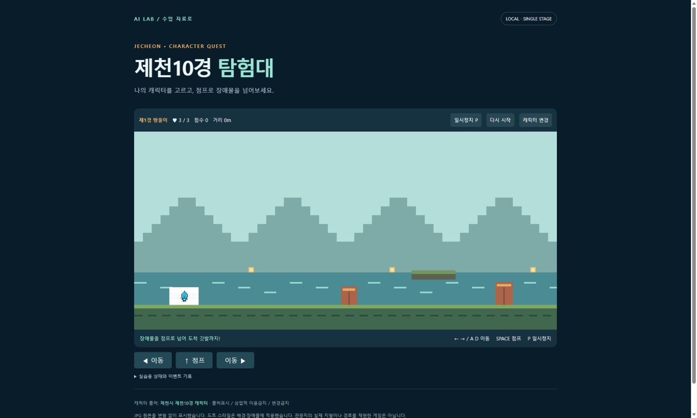
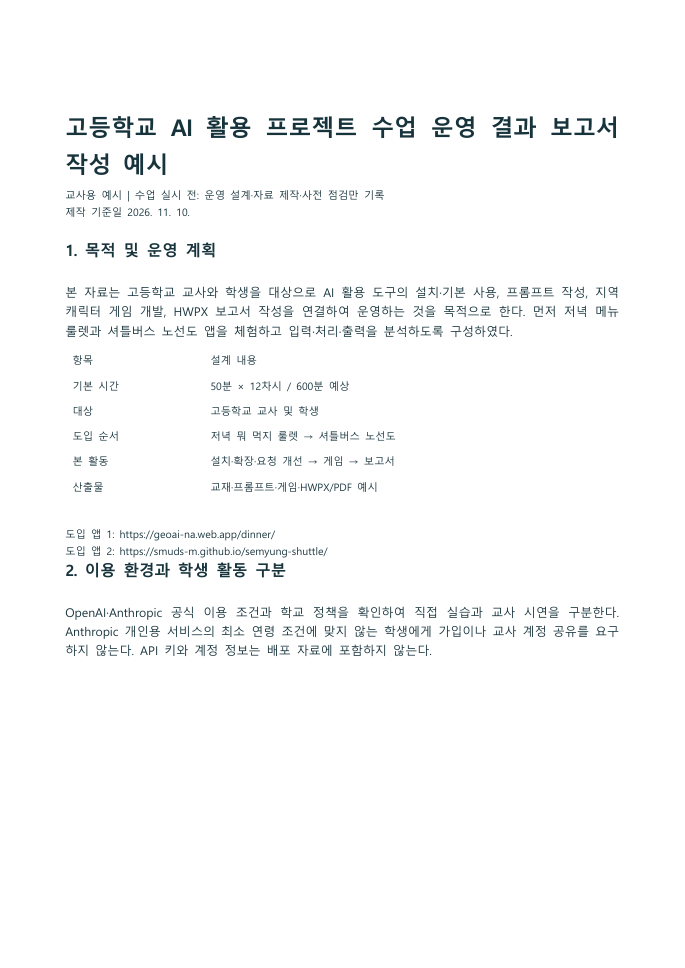
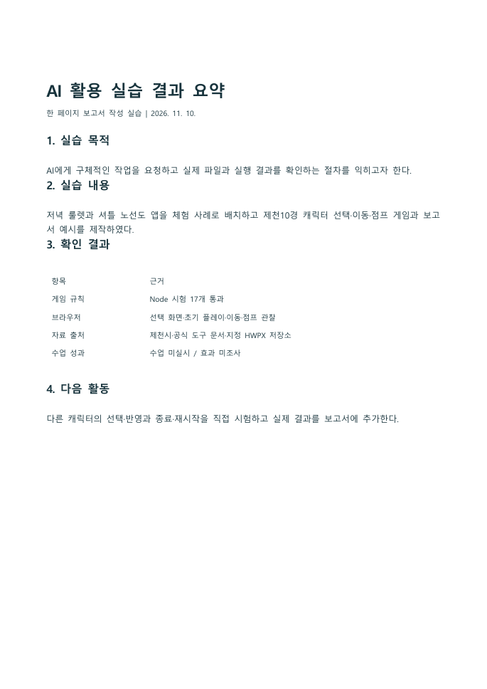
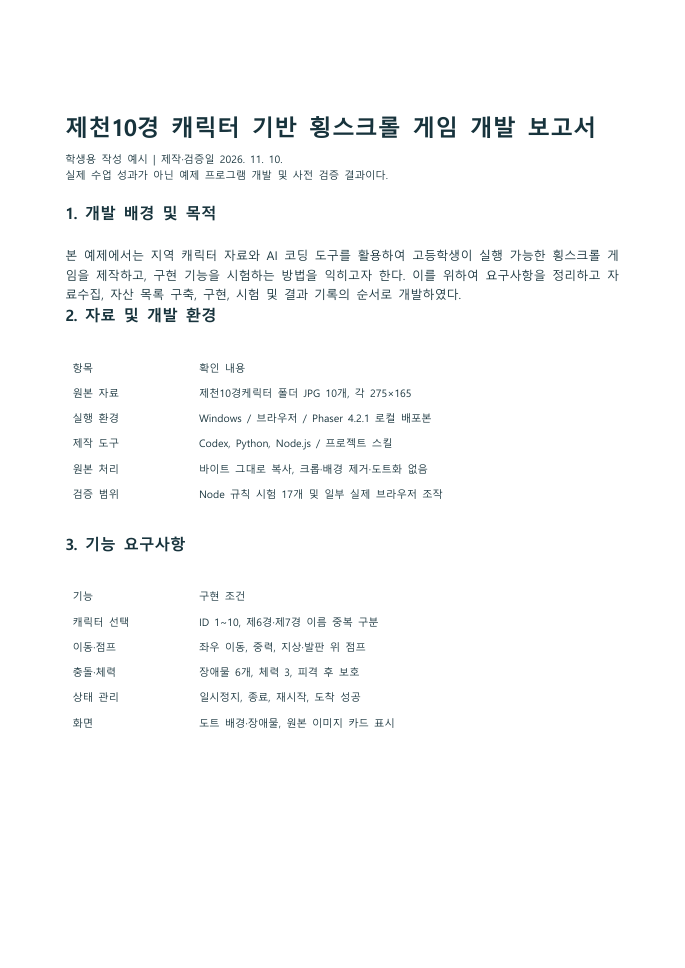

> 공용 설치 개정: 스킬은 사용자 .agents의 단일 원본, 플러그인은 양쪽 별도 등록, MCP는 공용 목록으로 관리함. https://youngwoo-m.github.io/highschool-ai-prompt-master/shared-install/

# 모듈 9. 게임 개발·수업 운영 보고서 작성

기준일 2026-11-10 · 예상 50분 · 교사용

## 1. 학습 목표

근거 자료와 시험 기록을 바탕으로 편집 가능한 HWPX 보고서를 작성한다.

## 2. 핵심 개념

개발 보고서는 무엇을 만들었고 어떻게 확인했는지 설명한다. 수업 운영 전에는 운영 결과를 확정할 수 없다. 교사용 예시는 운영 설계와 제작·사전 점검 결과를 적고 실제 수업 결과 입력란을 분리한다.

## 3. 준비물과 이용 조건

게임 코드·자산출처.json·game-rule-tests.json·실제 캡처. 학생용 개발 보고서와 교사용 운영 결과 보고서 작성 예시를 제공한다. 실제 수업 관찰과 만족도는 입력하지 않았다.

## 4. 실제 웹 경로와 화면

**이동 경로:** 지정 스킬 → 보고서 템플릿 → 입력 자료 조사 → 생성 → 열림·렌더 검사

**직접 주소:** [https://github.com/Canine89/gonggong_hwpxskills/blob/main/SKILL.md](https://github.com/Canine89/gonggong_hwpxskills/blob/main/SKILL.md)

<figure><a href="../08_화면캡처/07_게임_플레이.jpg"></a><figcaption>그림 9-1. 직접 실행한 게임 화면 · 실제 캡처 2026-11-10<br>출처: <a href="http://127.0.0.1:18465/05_게임실습/완성게임/index.html">http://127.0.0.1:18465/05_게임실습/완성게임/index.html</a> · 클릭하면 원본 크기로 열림</figcaption></figure>

## 5. 단계별 실습

### 단계 1. 자료수집

개발 목적·요구사항·파일 목록·실제 시험 로그를 모은다. 캡처는 문서의 주장과 연결한다.

### 단계 2. 분류

확인된 사실, 설계값, 실제 시험, 미검증 항목, 향후 계획을 구분한다. 예: 체력 3은 설계값이며 학생 만족도는 미조사다.

### 단계 3. 학생 보고서

배경·목적→자료 및 환경→설계·구현→시험 방법과 결과→한계·개선→결론→참고자료·AI 활용 내역으로 작성한다.

### 단계 4. 교사 보고서

수업 목적과 차시, 준비·운영 방법, 산출물 평가, 제작·사전 점검 결과를 기록한다. 실제 학생 수·운영일·만족도는 실시 후 작성란으로 남긴다.

### 단계 5. 표와 그림

기능 시험표, 10종 자산 목록, 실제 선택·플레이 화면을 넣는다. 개념도와 실제 실행 캡처를 구분하고 출처를 달아준다.

### 단계 6. 검증과 제출

HWPX·PDF·원문·입력 자료를 대조한다. 원문에 없는 수치가 문서에 추가되지 않았는지 확인하고 실제 열림·페이지 결과를 기록한다.

**입력 위치: Windows PowerShell.** 주석과 경로를 읽고 필요한 명령만 실행한다. `/help` 등 세션 명령은 설명된 에이전트 안에서 입력한다.

```powershell
# 실제 시험 기록 확인
Get-Content -LiteralPath '.\07_검증및출처\game-rule-tests.json' -Encoding UTF8
# 생성 보고서 폴더
Get-ChildItem -LiteralPath '.\06_HWPX보고서예시' 
```

## 6. 복사 가능한 프롬프트 입력 예시

입력 위치는 이용이 허용된 Codex 또는 교사의 Claude Code 세션이다. 스킬 이름이 들어간 예시는 해당 스킬이 인식된 상태에서 사용한다. 아래는 입력 예시이며 실제 서비스에서 자동으로 실행된 응답을 뜻하지 않는다.

### 예시 9-1. 기본 요청

```text
지정 HWPX 스킬과 보고서 템플릿으로 ‘제천10경 캐릭터 기반 횡스크롤 게임 개발 보고서’를 작성해줘. 실제 코드, 자산 목록, 시험 로그, 캡처를 근거로 작성하고 실제 시험과 계획을 구분해줘.
```

확인: 요청한 파일 또는 비교 결과가 실제로 나왔는지 확인한다.

### 예시 9-2. 수정·보완 요청

```text
기능, 시험 방법, 기대 결과, 실제 결과, 판정 열로 시험 결과표를 넣어줘. Node 규칙 시험과 브라우저 화면 시험을 구분하고 미실행 항목을 통과로 표시하지 마.
```

확인: 기존 요구사항이 유지되고 추가 조건이 반영되었는지 확인한다.

### 예시 9-3. 확인·검증 요청

```text
교사용 수업 운영 보고서 작성 예시를 만들어줘. 아직 수업이 열리지 않았으므로 사전 준비·제작·검증 결과를 작성하고 실제 운영일·학생 수·학습 효과는 실시 후 기록란으로 남겨줘. HWPX와 PDF의 표·그림을 확인해줘.
```

확인: 기대 결과와 실제 실행 여부가 구분되었는지 확인한다.

## 7. 정상 결과와 확인 방법

보고서 원문과 HWPX·PDF가 일치하고 캡처·시험 근거를 추적할 수 있다. 실제 수업 성과는 포함하지 않는다.

## 8. 오류와 해결

표가 길어지면 글자를 무리하게 줄이지 말고 열 수·문장 길이·페이지 배치를 조정한다. 예시 데이터는 본문과 표 모두에서 표시한다.

## 9. 과제와 확인 문항

기본: 자신의 수정 사항과 시험 1개를 추가. 확장: 다른 모둠의 재현 시험 결과를 별도 표로 추가.

질문: 통과 17/17이면 학생 학습 효과도 검증된 것인가? 답: 게임 규칙 시험 결과일 뿐이다. 별도의 수업 평가 자료가 필요하다.

## 10. 교사 시연과 설명

결과 보고서가 좋아 보이는 것보다 근거와 주장 범위가 일치하는지를 평가한다. AI 활용 내역과 학생의 직접 검토 내용을 분리한다.

시연 순서는 목표 안내 5분 → 작업과 설명 15분 → 학생 활동·관찰 20분 → 결과 비교 7분 → 기록 3분을 기본으로 한다. 장시간 모듈은 각 차시마다 이를 반복한다. 막힌 학생은 계정 공유 대신 실행 예제와 요청문 비교 활동을 사용한다.

관찰 기록: 목표 달성 여부 / 학생이 확인한 근거 / 발생 오류 / 다음 시간 보완 사항. 수업 실시 전에는 실제 학생 반응을 채우지 않는다.

## 출처

- [https://github.com/Canine89/gonggong_hwpxskills/blob/main/SKILL.md](https://github.com/Canine89/gonggong_hwpxskills/blob/main/SKILL.md) · 확인일 2026-11-10
- 상세 실행 상태: [검증 현황](../07_검증및출처/검증현황.md)


## 부록: 실제 HWPX 작성 예시 열람

[HWPX·PDF 3종과 전체 페이지 보기](../06_HWPX보고서예시/보고서_안내.html)

<figure><a href="../08_화면캡처/09_보고서_교사용_AI수업운영_보고서작성예시_p01.png"></a><figcaption>실제 한글에서 열어 PDF로 내보낸 보고서 첫 페이지: 교사용_AI수업운영_보고서작성예시.hwpx · 실제 캡처 2026-11-10<br>출처: <a href="../06_HWPX보고서예시/교사용_AI수업운영_보고서작성예시.pdf">../06_HWPX보고서예시/교사용_AI수업운영_보고서작성예시.pdf</a> · 클릭하면 원본 크기로 열림</figcaption></figure>

<figure><a href="../08_화면캡처/09_보고서_첫실습_AI활용결과_한페이지_p01.png"></a><figcaption>실제 한글에서 열어 PDF로 내보낸 보고서 첫 페이지: 첫실습_AI활용결과_한페이지.hwpx · 실제 캡처 2026-11-10<br>출처: <a href="../06_HWPX보고서예시/첫실습_AI활용결과_한페이지.pdf">../06_HWPX보고서예시/첫실습_AI활용결과_한페이지.pdf</a> · 클릭하면 원본 크기로 열림</figcaption></figure>

<figure><a href="../08_화면캡처/09_보고서_학생용_제천10경게임_개발보고서_p01.png"></a><figcaption>실제 한글에서 열어 PDF로 내보낸 보고서 첫 페이지: 학생용_제천10경게임_개발보고서.hwpx · 실제 캡처 2026-11-10<br>출처: <a href="../06_HWPX보고서예시/학생용_제천10경게임_개발보고서.pdf">../06_HWPX보고서예시/학생용_제천10경게임_개발보고서.pdf</a> · 클릭하면 원본 크기로 열림</figcaption></figure>
