> 공용 설치 개정: 스킬은 사용자 .agents의 단일 원본, 플러그인은 양쪽 별도 등록, MCP는 공용 목록으로 관리함. https://youngwoo-m.github.io/highschool-ai-prompt-master/shared-install/

# 먼저 체험하기: 우리가 만들 수 있는 앱

두 앱을 먼저 사용하고 ‘무엇을 입력하면 무엇이 나오는가’를 관찰한다. 이후 AI로 작은 기능을 구현하고 검증하는 과정을 배운다. 기존 운영 앱을 수정하거나 새로 배포하는 실습은 포함하지 않는다.

## 체험 1. 저녁 뭐 먹지 룰렛 · 5분

1. 아래 주소로 접속하고 룰렛과 메뉴 선택 영역을 찾는다.
2. 메뉴 선택 동작을 한 번 실행한다. 외부 주문·결제는 진행하지 않는다.
3. 입력, 처리, 출력을 활동지에 적는다. 예: 메뉴 후보 → 임의 선택 → 선택된 메뉴 표시.
4. ‘같은 메뉴가 너무 자주 나오지 않게 하려면 무엇을 기록해야 할까?’를 이야기한다. 실제 확률이나 추천 효과를 측정하지 않고 단정하지 않는다.

**하단 웹주소: [https://geoai-na.web.app/dinner/](https://geoai-na.web.app/dinner/)**

<figure><a href="../08_화면캡처/00_저녁뭐먹지_룰렛.jpg">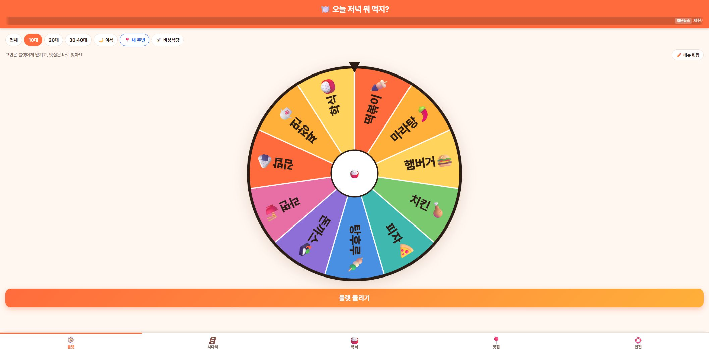</a><figcaption>그림 0-1. 운영 중인 저녁 메뉴 룰렛의 실제 접속 화면. 기능 분석을 위한 체험 사례이며 성능 검증 결과가 아니다. · 실제 캡처 2026-11-10<br>출처: <a href="https://geoai-na.web.app/dinner/">https://geoai-na.web.app/dinner/</a> · 클릭하면 원본 크기로 열림</figcaption></figure>

AI 채팅 입력 예시:

```text
저녁 메뉴를 고르는 작은 룰렛 웹페이지를 만들어줘. 후보는 김밥, 비빔밥, 돈가스, 우동, 볶음밥, 샌드위치 6개야. 버튼을 누르면 하나를 무작위로 고르고 글자로도 결과를 보여줘. 외부 주문이나 결제 기능은 넣지 말고 HTML 파일 하나로 실행되게 해줘.
```

```text
룰렛 결과가 나왔을 때 어떤 후보에서 선택했는지 함께 표시해줘. 결과를 다시 뽑기 전에 후보를 편집할 수 있게 하고, 후보가 비어 있으면 안내문을 보여줘.
```

```text
후보가 0개, 1개, 6개인 경우를 구분해서 확인할 시험표를 만들어줘. 실제 실행한 결과만 기록하고 무작위 선택이 공정하다는 결론은 충분한 시험 없이 내리지 마.
```

## 체험 2. 셔틀버스 노선도 앱 · 7분

1. 아래 주소로 접속하여 학교 셔틀, 노선 또는 정류장 정보 영역을 찾는다.
2. 노선과 정류장을 선택했을 때 표시가 어떻게 바뀌는지 관찰한다. 위치 권한은 이 수업에 필수가 아니다.
3. 지도에 표시되는 위치, 시간표, 실시간 정보의 차이를 구분한다. 통학 전에는 학교의 최신 공지와 시간표를 확인한다.
4. ‘정류장 목록과 지도 표시를 일치시키려면 어떤 ID가 필요할까?’를 생각한다. 이것을 이후 캐릭터 ID와 연결한다.

**하단 웹주소: [https://smuds-m.github.io/semyung-shuttle/](https://smuds-m.github.io/semyung-shuttle/)**

<figure><a href="../08_화면캡처/00_셔틀버스_노선도앱.jpg">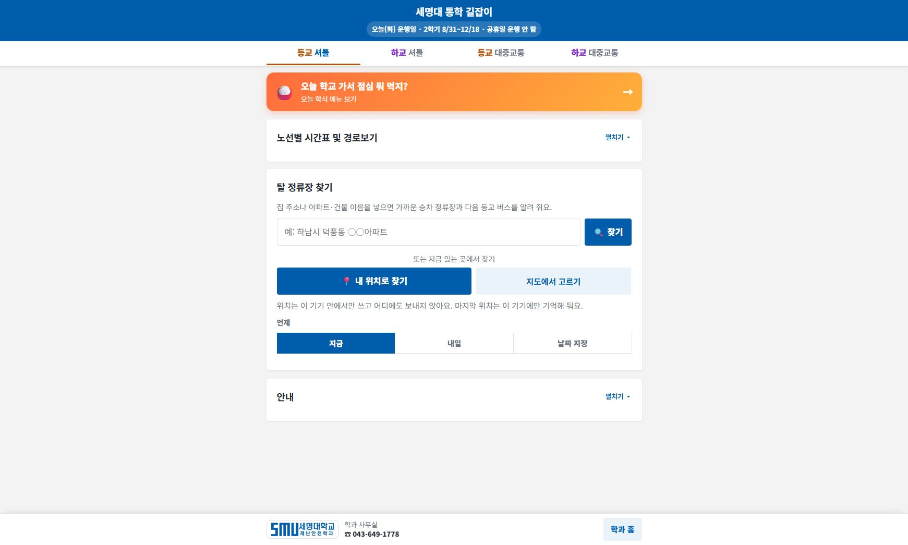</a><figcaption>그림 0-2. 세명대 통학 길잡이의 실제 접속 화면. 버스 도착·위치·시간표 전체의 정확성을 검증한 결과는 아니다. · 실제 캡처 2026-11-10<br>출처: <a href="https://smuds-m.github.io/semyung-shuttle/">https://smuds-m.github.io/semyung-shuttle/</a> · 클릭하면 원본 크기로 열림</figcaption></figure>

AI 채팅 입력 예시:

```text
가상의 학교 셔틀 노선도 연습 앱을 만들어줘. 정류장은 학교, 도서관, 터미널 3개이고 각각 고유 ID를 부여해줘. 정류장을 선택하면 노선도에서 강조하고 옆에 설명을 보여줘. 데이터는 모두 교육용 가상 자료라고 표시하고 실제 위치·시간표로 오해되지 않게 해줘.
```

```text
정류장 이름이 같아도 ID가 다르면 별도로 선택되게 수정해줘. 이름으로만 비교하는 코드가 있는지 확인하고 수정한 이유를 설명해줘.
```

```text
정류장 선택, 선택 해제, 데이터 없음, 잘못된 ID를 시험해줘. 기대 결과와 실제 결과를 분리해서 표로 작성해줘. 실제 운영 셔틀 앱은 수정하지 마.
```

## 체험 기록

|앱|내가 조작한 입력|화면에서 관찰한 출력|AI로 바꾸고 싶은 기능|확인할 시험|
|---|---|---|---|---|
|메뉴 룰렛|직접 작성|직접 작성|직접 작성|직접 작성|
|셔틀 노선도|직접 작성|직접 작성|직접 작성|직접 작성|

이후 학습은 설치 → 작은 요청 → 확장 기능 → 게임 → 보고서 순서로 진행한다.


---

# 모듈 1. Codex 설치와 첫 웹페이지

기준일 2026-11-10 · 예상 50분 · 교사용

## 1. 학습 목표

작업 폴더를 지정하고 AI가 생성한 실제 파일을 실행·수정한다.

## 2. 핵심 개념

채팅은 요청을 전달하는 곳이고, 프로젝트 폴더는 파일을 저장하는 곳이다. Codex 앱·CLI·IDE는 같은 목적의 서로 다른 사용 경로이다. 이 수업은 설치된 앱에서 폴더를 선택하는 경로를 우선하고 CLI를 함께 안내한다.

## 3. 준비물과 이용 조건

교사 PC 또는 이용 조건에 맞는 학습자 계정, Windows PowerShell, 브라우저. OpenAI 개인용 서비스는 원칙적으로 13세 이상이며 18세 미만은 보호자 허락이 필요하다. 국가별 최소 연령과 학교 정책을 추가로 확인한다. API 키 입력은 기본 실습에 필요하지 않다.

## 4. 실제 웹 경로와 화면

**이동 경로:** 공식 문서 → Codex → CLI 또는 Desktop 안내 → 해당 운영체제 설치

**직접 주소:** [https://learn.chatgpt.com/docs/codex/cli](https://learn.chatgpt.com/docs/codex/cli)

<figure><a href="../08_화면캡처/01_Codex_공식CLI안내.jpg">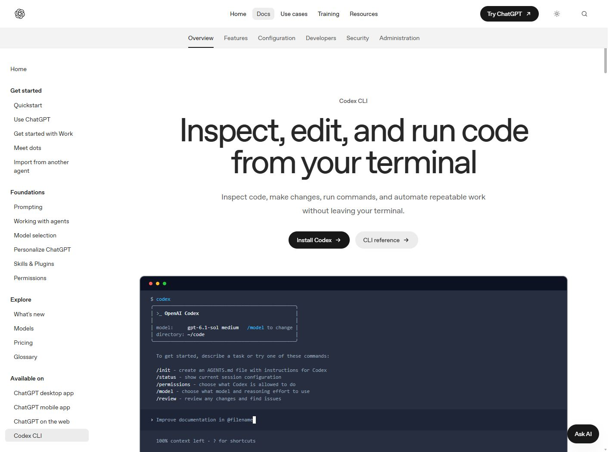</a><figcaption>그림 1-1. 직접 접속한 공식 웹페이지 화면. 새 설치·로그인 성공 화면과 구분한다. · 실제 캡처 2026-11-10<br>출처: <a href="https://learn.chatgpt.com/docs/codex/cli">https://learn.chatgpt.com/docs/codex/cli</a> · 클릭하면 원본 크기로 열림</figcaption></figure>

## 5. 단계별 실습

### 단계 1. 설치 경로 선택

https://openai.com/codex/ 에서 제공하는 공식 앱 진입 경로를 확인한다. 학교 PC에 이미 설치되어 있으면 중복 설치하지 않는다. 이 제작 PC에는 앱과 CLI가 이미 설치되어 있어 새 설치 화면은 확보하지 않았다.

### 단계 2. PowerShell과 실습 폴더

시작 메뉴에서 PowerShell을 연다. 아래 명령으로 문서 폴더 안에 실습 폴더를 만들고 이동한다. 경로는 작은따옴표 또는 큰따옴표로 감싼다.

### 단계 3. CLI 보조 경로

Node.js와 npm을 이용하는 경로를 선택한 경우 공식 패키지 @openai/codex를 설치하고 새 터미널에서 codex --version을 확인한다. 설치 방식별 선행 조건은 공식 문서를 따른다.

### 단계 4. 첫 세션

앱에서는 새 작업에서 실습 폴더를 선택한다. CLI는 해당 폴더에서 codex를 실행하고 본인에게 허용된 방식으로 로그인한다. 계정 화면·인증 코드는 교재에 캡처하지 않는다.

### 단계 5. 요청과 확인

자기소개 페이지 요청문을 입력한다. 생성된 index.html을 브라우저로 열어 제목·본문·관심 분야가 있는지 확인한다. 설명만 받았으면 실제 파일 생성과 저장 위치를 요청한다.

### 단계 6. 수정과 검토

수정 요청을 입력하고 변경 파일을 확인한다. 원본을 보존하려면 수정 전 복사본을 만들거나 Git의 변경 내역을 사용한다. 터미널 작업 중단은 Ctrl+C, 세션 재시작은 같은 폴더에서 실행한다.

**입력 위치: Windows PowerShell.** 주석과 경로를 읽고 필요한 명령만 실행한다. `/help` 등 세션 명령은 설명된 에이전트 안에서 입력한다.

```powershell
$lessonRoot = Join-Path ([Environment]::GetFolderPath('MyDocuments')) '고교AI실습'
New-Item -ItemType Directory -Path $lessonRoot -Force
Set-Location -LiteralPath $lessonRoot
Get-Location
# CLI 보조 설치 경로를 선택한 교사만 실행
npm install -g @openai/codex
codex --version
codex
```

## 6. 복사 가능한 프롬프트 입력 예시

입력 위치는 이용이 허용된 Codex 또는 교사의 Claude Code 세션이다. 스킬 이름이 들어간 예시는 해당 스킬이 인식된 상태에서 사용한다. 아래는 입력 예시이며 실제 서비스에서 자동으로 실행된 응답을 뜻하지 않는다.

### 예시 1-1. 기본 요청

```text
현재 실습 폴더 안에 index.html과 style.css로 자기소개 페이지를 만들어줘. 이름은 AI 탐험가로 하고 관심 분야 3개와 배우고 싶은 것을 넣어줘. 실명이나 연락처는 넣지 마. 만든 파일과 실행 방법을 알려줘.
```

확인: 요청한 파일 또는 비교 결과가 실제로 나왔는지 확인한다.

### 예시 1-2. 수정·보완 요청

```text
기존 자기소개 내용은 유지하고 글씨 크기를 18px 이상으로 조정해줘. 휴대전화 폭에서도 가로 스크롤 없이 읽을 수 있게 수정하고 변경 파일을 알려줘.
```

확인: 기존 요구사항이 유지되고 추가 조건이 반영되었는지 확인한다.

### 예시 1-3. 확인·검증 요청

```text
파일을 실제로 열어 제목, 본문, 관심 분야가 표시되는지 확인해줘. 직접 화면을 확인할 수 없으면 실행 방법과 내가 확인할 항목을 알려주고 완료로 단정하지 마.
```

확인: 기대 결과와 실제 실행 여부가 구분되었는지 확인한다.

## 7. 정상 결과와 확인 방법

index.html이 실제로 존재하고 브라우저에서 내용이 표시된다. 제작 PC 버전 확인: codex-cli 0.167.0-alpha.3.2. 학생 PC와 버전이 다를 수 있다.

## 8. 오류와 해결

명령을 찾지 못하면 설치 완료 후 터미널을 다시 열고 PATH와 설치 경로를 확인한다. PowerShell 정책 오류는 무조건 정책을 낮추지 말고 npm.cmd 등 실제 설치된 명령 경로와 학교 정책을 확인한다.

## 9. 과제와 확인 문항

기본: 관심 분야 한 개 추가. 확장: 배경색 변경 버튼과 클릭 횟수 표시.

질문: 설명만 나온 것과 파일이 생성된 것은 어떻게 구분하는가? 답: 저장 위치와 파일 존재를 확인한 뒤 실제 브라우저 출력을 확인한다.

## 10. 교사 시연과 설명

먼저 폴더를 열어 파일이 없는 상태를 보여준다. 요청문 입력 후 새 파일을 찾아 실행한다. 학생이 계정 로그인에서 막히면 교사 시연을 관찰하고 파일 실행 실습으로 전환한다.

시연 순서는 목표 안내 5분 → 작업과 설명 15분 → 학생 활동·관찰 20분 → 결과 비교 7분 → 기록 3분을 기본으로 한다. 장시간 모듈은 각 차시마다 이를 반복한다. 막힌 학생은 계정 공유 대신 실행 예제와 요청문 비교 활동을 사용한다.

관찰 기록: 목표 달성 여부 / 학생이 확인한 근거 / 발생 오류 / 다음 시간 보완 사항. 수업 실시 전에는 실제 학생 반응을 채우지 않는다.

## 출처

- [https://learn.chatgpt.com/docs/codex/cli](https://learn.chatgpt.com/docs/codex/cli) · 확인일 2026-11-10
- 상세 실행 상태: [검증 현황](../07_검증및출처/검증현황.md)


---

# 모듈 2. Claude Code 설치와 수정 요청

기준일 2026-11-10 · 예상 50분 · 교사용

## 1. 학습 목표

Claude Code의 터미널 세션에서 프로젝트를 읽고 수정한다.

## 2. 핵심 개념

Claude 웹 채팅과 Claude Code는 사용 환경이 다르다. Claude Code는 프로젝트의 파일을 읽고 도구를 실행한다. CLAUDE.md는 Claude Code의 프로젝트 지침이며 Codex의 AGENTS.md와 적용 범위가 다르다.

## 3. 준비물과 이용 조건

Windows PowerShell과 학교가 허용한 교사 계정. Anthropic 개인용 서비스는 18세 이상을 요구한다. 연령 조건에 맞지 않는 학생에게 가입·계정 공유를 시키지 않는다. 해당 단원은 교사 시연과 프롬프트 설계 활동으로 운영한다. Claude Code의 지원 구독 또는 API 비용 경로는 별도로 확인한다.

## 4. 실제 웹 경로와 화면

**이동 경로:** Claude Code Docs → Getting started → Quickstart → Step 1: Install Claude Code

**직접 주소:** [https://code.claude.com/docs/en/quickstart](https://code.claude.com/docs/en/quickstart)

<figure><a href="../08_화면캡처/02_ClaudeCode_공식설치.jpg">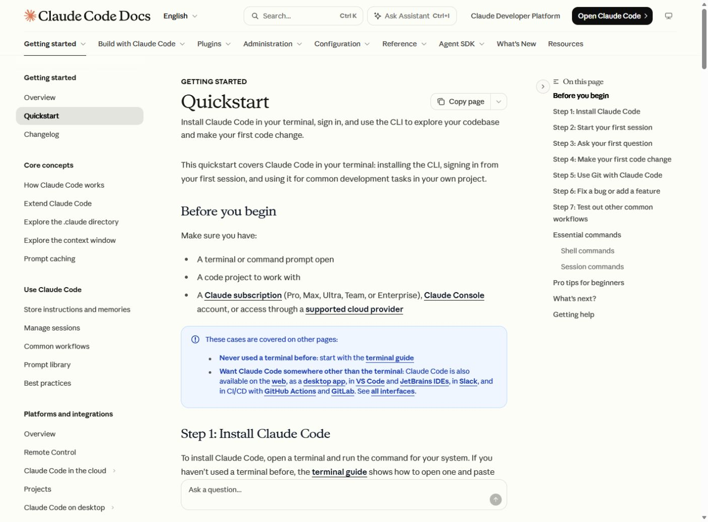</a><figcaption>그림 2-1. 직접 접속한 공식 웹페이지 화면. 새 설치·로그인 성공 화면과 구분한다. · 실제 캡처 2026-11-10<br>출처: <a href="https://code.claude.com/docs/en/quickstart">https://code.claude.com/docs/en/quickstart</a> · 클릭하면 원본 크기로 열림</figcaption></figure>

## 5. 단계별 실습

### 단계 1. 공식 설치 안내 열기

PowerShell용 명령과 CMD·WSL용 명령을 구분한다. 아래 명령은 교사가 출처를 확인한 후 실행한다. 설치된 PC에서는 버전 확인부터 진행한다.

### 단계 2. 설치 확인

새 PowerShell에서 claude --version을 실행한다. 이 제작 PC에는 2.1.316이 설치되어 있었다. 명령어가 인식되는 것과 로그인·요청 성공은 별도이다.

### 단계 3. 프로젝트 시작

모듈 1의 실습 폴더로 이동해 claude를 실행한다. 첫 인증은 교사가 직접 완료한다. /help로 현재 세션의 도움말을 확인한다.

### 단계 4. 읽기부터 요청

어떤 파일이 있고 각 파일이 무슨 역할인지 먼저 물어본다. 아직 수정하지 않도록 범위를 명시한다.

### 단계 5. 한 가지 변경

색상·글자 크기 등 한 가지 목표를 요청한다. 승인창이 있으면 작업 경로와 실행 명령을 읽고 판단한다.

### 단계 6. 검토와 종료

수정 전후 페이지를 비교한다. 세션 안에서 /exit를 입력하거나 현재 도움말의 종료 방법을 따른다. 저장된 파일이 유지되는지 확인한다.

**입력 위치: Windows PowerShell.** 주석과 경로를 읽고 필요한 명령만 실행한다. `/help` 등 세션 명령은 설명된 에이전트 안에서 입력한다.

```powershell
# 새 설치가 필요한 교사가 공식 주소 확인 후 실행
irm https://claude.ai/install.ps1 | iex
# 설치 후 새 터미널에서
claude --version
Set-Location -LiteralPath $lessonRoot
claude
# 아래는 Claude Code 세션 안에서 입력
/help
```

## 6. 복사 가능한 프롬프트 입력 예시

입력 위치는 이용이 허용된 Codex 또는 교사의 Claude Code 세션이다. 스킬 이름이 들어간 예시는 해당 스킬이 인식된 상태에서 사용한다. 아래는 입력 예시이며 실제 서비스에서 자동으로 실행된 응답을 뜻하지 않는다.

### 예시 2-1. 기본 요청

```text
현재 폴더의 자기소개 페이지 파일을 읽고 파일별 역할과 실행 방법을 설명해줘. 아직 파일은 수정하지 마.
```

확인: 요청한 파일 또는 비교 결과가 실제로 나왔는지 확인한다.

### 예시 2-2. 수정·보완 요청

```text
자기소개 페이지에 수업 목표 영역을 추가해줘. 목표는 AI에게 구체적으로 요청하기, 실행 결과 확인하기, 오류를 근거로 수정하기야. 기존 내용을 보존해줘.
```

확인: 기존 요구사항이 유지되고 추가 조건이 반영되었는지 확인한다.

### 예시 2-3. 확인·검증 요청

```text
방금 수정한 파일과 바뀐 내용을 정리해줘. 브라우저 표시를 실제로 확인했는지, 코드만 검토했는지 구분해서 알려줘.
```

확인: 기대 결과와 실제 실행 여부가 구분되었는지 확인한다.

## 7. 정상 결과와 확인 방법

파일 목록과 수정 내용이 실제 폴더와 일치한다. 교사 계정으로 한 요청이 성공해야 인증·사용이 확인된 것이다. 본 제작에서는 CLI 버전·도움말을 확인했고 별도 유료 요청은 실행하지 않았다.

## 8. 오류와 해결

설치 명령에 && 관련 오류가 나면 CMD 예제를 PowerShell에 붙여 넣었는지 확인한다. Git for Windows는 공식 안내에 따라 선택하며 WSL을 모든 PC에 필수로 설치하지 않는다.

## 9. 과제와 확인 문항

기본: 교사 시연을 관찰하고 수정 요청문 작성. 확장: 기존 내용을 보존하도록 CLAUDE.md 지침 초안 작성.

질문: 학생이 교사 계정으로 돌아가며 로그인해도 되는가? 답: 계정을 공유하지 않는다. 이용 조건에 맞는 환경 또는 교사 시연을 사용한다.

## 10. 교사 시연과 설명

가입이 곧 수업 참여의 조건이 되지 않게 한다. 미성년 학생은 요청 작성자 역할을 맡고 교사가 실행·결과 확인을 시연한다.

시연 순서는 목표 안내 5분 → 작업과 설명 15분 → 학생 활동·관찰 20분 → 결과 비교 7분 → 기록 3분을 기본으로 한다. 장시간 모듈은 각 차시마다 이를 반복한다. 막힌 학생은 계정 공유 대신 실행 예제와 요청문 비교 활동을 사용한다.

관찰 기록: 목표 달성 여부 / 학생이 확인한 근거 / 발생 오류 / 다음 시간 보완 사항. 수업 실시 전에는 실제 학생 반응을 채우지 않는다.

## 출처

- [https://code.claude.com/docs/en/quickstart](https://code.claude.com/docs/en/quickstart) · 확인일 2026-11-10
- 상세 실행 상태: [검증 현황](../07_검증및출처/검증현황.md)


---

# 모듈 3. 스킬·플러그인·MCP 연결

기준일 2026-11-10 · 예상 50분 · 교사용

## 1. 학습 목표

재사용 지침과 확장 묶음, 외부 도구 연결을 구분한다.

## 2. 핵심 개념

스킬은 SKILL.md와 필요한 자원으로 구성된 재사용 지침이다. 플러그인은 제품에 맞게 스킬·도구 등을 묶는 확장 형식이다. MCP는 도구 목록과 호출을 연결하는 프로토콜이며 스킬 파일 자체와 다르다.

PLAYMCP는 카카오가 운영하는 MCP 도구 탐색·활용 서비스다. 공식 홈에서 도구를 검색하고 도구 설명·제공자·필요 권한·지원 연결 경로를 확인한다. 사이트 방문, 로그인, 도구 연결, 실제 호출은 각각 다른 상태다.


|구분|핵심 구성|설치·연결 위치 예|확인할 결과|
|---|---|---|---|
|스킬|SKILL.md·참조 파일|프로젝트 .agents/skills 또는 .claude/skills|새 세션에서 인식·실제 적용|
|플러그인|제품용 매니페스트·스킬·도구|Claude의 --plugin-dir 등 제품별 경로|매니페스트 검사와 실제 세션 로드|
|MCP|서버·도구 목록·호출 규약|제품별 서버 설정·HTTP 또는 stdio|연결 이후 실제 도구 호출|


## 3. 준비물과 이용 조건

본인에게 허용된 에이전트 환경. 개인 전역 설정 대신 프로젝트 또는 세션 한정 설정을 우선한다. 외부 서비스는 최소 기능만 연결한다.

## 4. 실제 웹 경로와 화면

**이동 경로:** Claude Code Docs → Configuration 또는 확장 기능 → MCP

**직접 주소:** [https://code.claude.com/docs/en/mcp](https://code.claude.com/docs/en/mcp)

<figure><a href="../08_화면캡처/03_MCP_공식안내.jpg">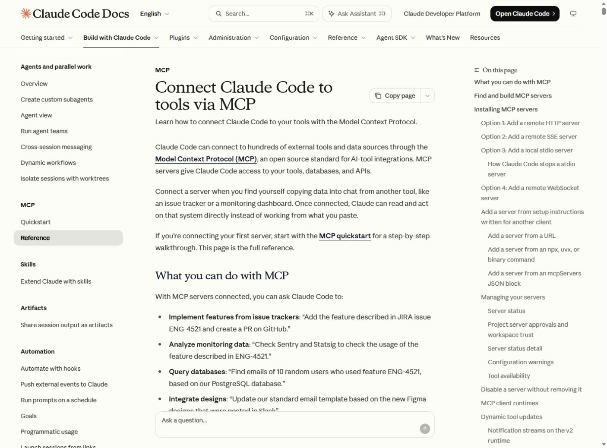</a><figcaption>그림 3-1. 직접 접속한 공식 웹페이지 화면. 새 설치·로그인 성공 화면과 구분한다. · 실제 캡처 2026-11-10<br>출처: <a href="https://code.claude.com/docs/en/mcp">https://code.claude.com/docs/en/mcp</a> · 클릭하면 원본 크기로 열림</figcaption></figure>

<figure><a href="../08_화면캡처/03_PLAYMCP_공식홈.jpg">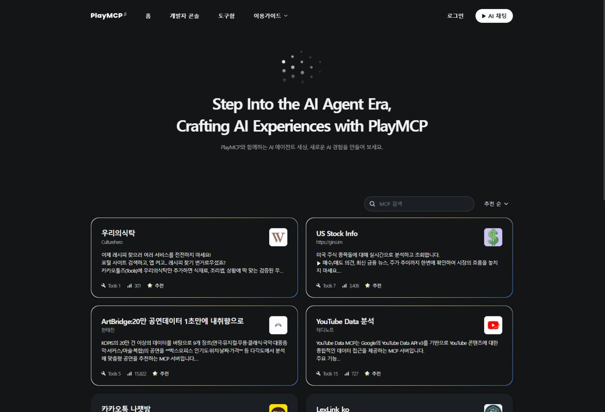</a><figcaption>그림 3-2. PLAYMCP 공식 홈의 실제 화면 · 실제 캡처 2026-11-10<br>출처: <a href="https://playmcp.kakao.com/">https://playmcp.kakao.com/</a> · 클릭하면 원본 크기로 열림</figcaption></figure>

## 5. 단계별 실습

### 단계 1. 비교하기

스킬=작업 방법, 플러그인=제품용 묶음, MCP=실제 도구 연결이라는 차이를 표로 적는다. 같은 이름이 두 제품에 있다고 호환된다고 판단하지 않는다.

### 단계 2. 프로젝트 스킬 확인

.agents/skills와 .claude/skills에서 SKILL.md를 확인한다. 새 세션에서 인식되는지 확인해야 사용 준비가 된 것이다.

### 단계 3. 로컬 플러그인 예제

09_제작도구/classroom-plugin에 교재용 로컬 플러그인을 제공한다. claude plugin validate로 매니페스트를 검사하고 --plugin-dir로 해당 세션에만 로드한다. 전역 마켓플레이스를 바꾸지 않는다.

### 단계 4. PLAYMCP 소개

https://playmcp.kakao.com/ 에 접속하여 MCP 검색, 도구함, 이용가이드 메뉴를 확인한다. 원하는 도구의 제공자와 기능·조건을 확인한 뒤 지원되는 연결 경로를 따른다. 수업에서는 조회 예제를 우선하며 카카오톡 전송 등 외부 작업은 별도 명시적 요청과 검토 후 실행한다. 본 소개에서는 계정 연결이나 메시지 전송을 새로 수행하지 않았다.

### 단계 5. 문서 MCP 등록

현재 실습에서는 공용 servers.json에만 서버를 기록하고 sync_mcp.py로 양쪽에 반영함. 설정 백업과 미리보기를 먼저 확인함. 이전 공개 엔드포인트 시험 결과와 현재 공용 동기화 여부를 구분함.

### 단계 6. 연결과 호출 구분

MCP 도구 목록이 보이면 문서 검색을 한 번 실행한다. 연결 성공만으로 검색 결과를 얻었다고 기록하지 않는다.

### 단계 7. 해제와 비교

Claude Code의 mcp remove 도움말로 범위를 확인한 뒤 실습 서버를 제거할 수 있다. 플러그인은 --plugin-dir 없이 시작한 세션에서는 사용되지 않는다.

**입력 위치: Windows PowerShell.** 주석과 경로를 읽고 필요한 명령만 실행한다. `/help` 등 세션 명령은 설명된 에이전트 안에서 입력한다.

```powershell
# 이 PC에 제공된 공용 관리 도구를 사용함
# .agents\mcp\servers.json에만 서버 항목을 추가하거나 수정함
# 사용자 지정 목록에 비밀값을 적지 않음
python "$env:USERPROFILE\.agents\tools\sync_mcp.py"
# 계획과 설정 백업을 확인한 뒤 적용함
python "$env:USERPROFILE\.agents\tools\sync_mcp.py" --apply
# 양쪽 목록과 실제 연결을 별도로 확인함
claude mcp list
codex mcp list
```

## 6. 복사 가능한 프롬프트 입력 예시

입력 위치는 이용이 허용된 Codex 또는 교사의 Claude Code 세션이다. 스킬 이름이 들어간 예시는 해당 스킬이 인식된 상태에서 사용한다. 아래는 입력 예시이며 실제 서비스에서 자동으로 실행된 응답을 뜻하지 않는다.

### 예시 3-1. 기본 요청

```text
현재 프로젝트에서 인식하는 스킬과 플러그인, 연결된 MCP를 구분해서 알려줘. 파일만 존재하는 상태와 실제 호출 성공을 구분해줘.
```

확인: 요청한 파일 또는 비교 결과가 실제로 나왔는지 확인한다.

### 예시 3-2. 수정·보완 요청

```text
수업 점검 스킬을 사용해서 오늘 목표와 결과 파일, 실제 시험 결과를 확인할 체크리스트를 만들어줘. 미실행 항목을 완료로 바꾸지 마.
```

확인: 기존 요구사항이 유지되고 추가 조건이 반영되었는지 확인한다.

### 예시 3-3. 확인·검증 요청

```text
OpenAI Docs MCP가 연결되어 있다면 Codex의 프로젝트 스킬 관련 공식 문서를 검색하고 제목과 URL을 알려줘. 연결되어 있지 않으면 도구를 사용했다고 말하지 말고 상태를 알려줘.
```

확인: 기대 결과와 실제 실행 여부가 구분되었는지 확인한다.

## 7. 정상 결과와 확인 방법

교재용 로컬 플러그인은 claude plugin validate 검사에 통과했다. OpenAI Docs MCP 공개 엔드포인트의 initialize·tools/list·search_openai_docs 실제 호출은 HTTP 200으로 응답했다. 이는 프로토콜 직접 시험이며 에이전트 UI에 새로 등록·연결한 화면과 다르다. 새 세션의 플러그인 호출은 별도 확인 항목이다.

## 8. 오류와 해결

연결 오류는 URL, transport, 프록시, 네트워크와 인증 요구를 순서대로 확인한다. 문서 MCP는 키가 필요 없는 예제로 선택했다. 네트워크 실패를 파일 권한 문제로 단정하지 않는다.

## 9. 과제와 확인 문항

기본: 세 기능의 차이를 한 문장씩 작성. 확장: 프로젝트 한정 ‘실습 결과 점검’ 스킬의 SKILL.md 읽기.

질문: 도구 목록이 보이면 문서 조회까지 성공한 것인가? 답: 아니다. 실제 검색 또는 조회 호출과 반환 결과가 있어야 한다.

## 10. 교사 시연과 설명

프로토콜 통신 기록과 에이전트 설정 UI를 구분해 설명한다. 설치하지 않은 플러그인의 메뉴를 보여 주었다고 표현하지 않는다.

시연 순서는 목표 안내 5분 → 작업과 설명 15분 → 학생 활동·관찰 20분 → 결과 비교 7분 → 기록 3분을 기본으로 한다. 장시간 모듈은 각 차시마다 이를 반복한다. 막힌 학생은 계정 공유 대신 실행 예제와 요청문 비교 활동을 사용한다.

관찰 기록: 목표 달성 여부 / 학생이 확인한 근거 / 발생 오류 / 다음 시간 보완 사항. 수업 실시 전에는 실제 학생 반응을 채우지 않는다.

## 출처

- [https://code.claude.com/docs/en/mcp](https://code.claude.com/docs/en/mcp) · 확인일 2026-11-10
- 상세 실행 상태: [검증 현황](../07_검증및출처/검증현황.md)


---

# 모듈 4. Prompt Master 설치와 프롬프트 작성

기준일 2026-11-10 · 예상 50분 · 교사용

## 1. 학습 목표

Prompt Master 원본을 사용자 공용 .agents에 설치하고 두 앱에서 요청하여 프롬프트를 작성함.

## 2. 핵심 개념

Prompt Master는 대상 AI 도구에 맞는 프롬프트 작성·개선 요청에 사용하는 스킬이다. 프롬프트 작성 요청과 실제 게임 개발 요청은 별개이다. 대상을 Codex 또는 Claude Code로 명시하고 입력 자료·기능·제약·완료 기준을 제공한다.

## 3. 준비물과 이용 조건

Node.js와 Skills CLI, 사용이 허용된 Codex 또는 교사의 Claude Code 환경. 원본 저장소의 README·SKILL.md·references를 함께 확인한다. 현재 실습은 사용자 공용 원본을 사용하며 기존 원본이 있으면 재설치하지 않고 출처와 연결을 확인함.

## 4. 실제 웹 경로와 화면

**이동 경로:** GitHub 원본 → README 설치·사용 안내 → 사용자 공용 스킬 설치 → 새 세션 호출

**직접 주소:** [https://github.com/nidhinjs/prompt-master](https://github.com/nidhinjs/prompt-master)

<figure><a href="../08_화면캡처/04_PromptMaster_원본저장소.jpg">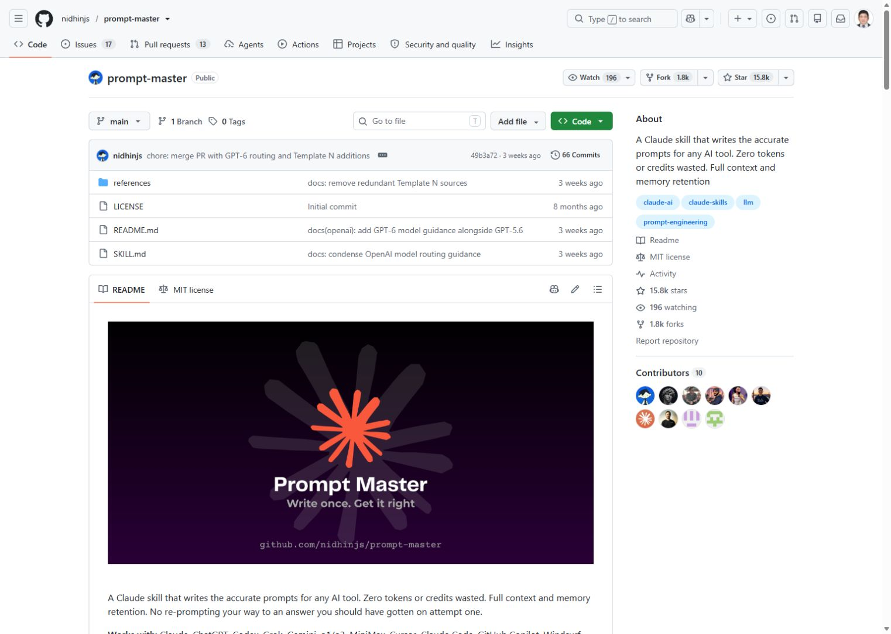</a><figcaption>그림 4-1. 직접 접속한 공식 웹페이지 화면. 새 설치·로그인 성공 화면과 구분한다. · 실제 캡처 2026-11-10<br>출처: <a href="https://github.com/nidhinjs/prompt-master">https://github.com/nidhinjs/prompt-master</a> · 클릭하면 원본 크기로 열림</figcaption></figure>

<figure><a href="../08_화면캡처/04_PromptMaster_설치실제기록.jpg">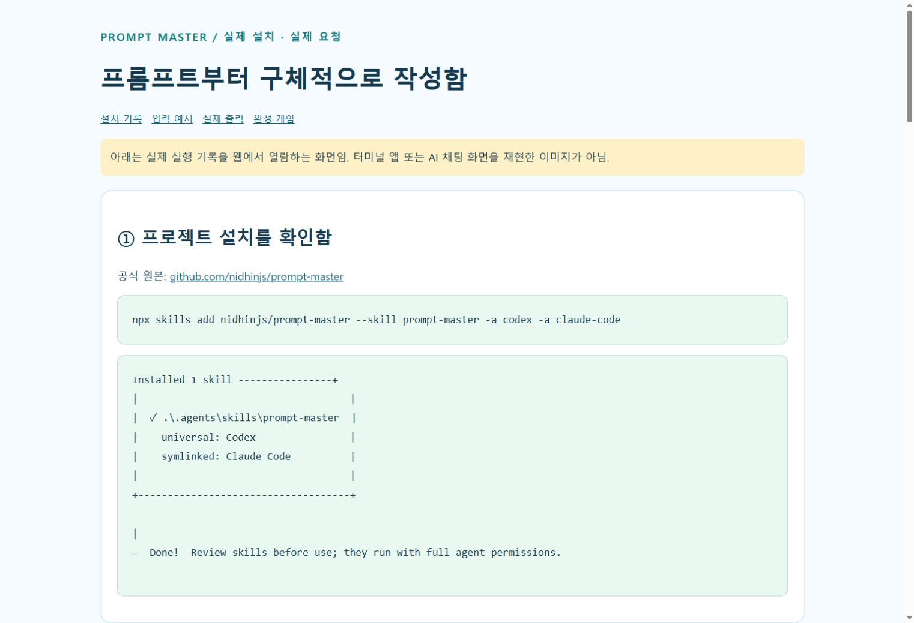</a><figcaption>그림 4-2. 실제 설치 출력의 웹 열람 화면. 터미널 앱 UI가 아님. · 실제 캡처 2026-11-10<br>출처: <a href="https://github.com/nidhinjs/prompt-master">https://github.com/nidhinjs/prompt-master</a> · 클릭하면 원본 크기로 열림</figcaption></figure>

<figure><a href="../08_화면캡처/04_PromptMaster_사용실제기록.jpg">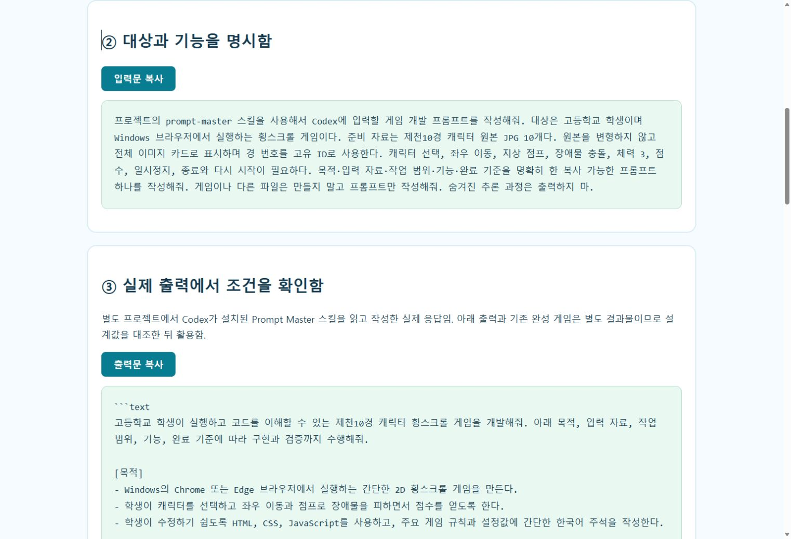</a><figcaption>그림 4-3. 실제 입력·출력의 웹 열람 화면. AI 채팅 UI가 아님. · 실제 캡처 2026-11-10<br>출처: <a href="../10_Canva발표자료/프롬프트_실습.html">../10_Canva발표자료/프롬프트_실습.html</a> · 클릭하면 원본 크기로 열림</figcaption></figure>

## 5. 단계별 실습

### 단계 1. 원본 확인

nidhinjs/prompt-master 저장소에서 README, SKILL.md, references와 LICENSE를 확인한다. README의 브라우저 업로드 방식과 아래 프로젝트 CLI 방식은 별도 경로다.

### 단계 2. 프로젝트 폴더 생성

문서 폴더에 고교AI실습 폴더를 만들고 PowerShell을 해당 폴더에서 연다. 기존 같은 이름의 스킬이 있다면 출처를 확인하고 무조건 덮어쓰지 않는다.

### 단계 3. 공용 원본 설치

사용자 .agents/skills/prompt-master에 단일 원본을 두고 consolidate_skills.py의 미리보기를 확인함. 계획과 백업을 검토한 뒤 --apply로 Claude 연결을 맞춤. 이전 공용 원본 설치 로그는 과거 실행 기록으로 구분함.

### 단계 4. 파일·세션 확인

SKILL.md와 references가 존재하는지 확인한 뒤 해당 프로젝트에서 새 에이전트 세션을 연다. 파일 복사, 세션 인식, 실제 요청 성공을 구분한다.

### 단계 5. 프롬프트 작성 요청

prompt-master 스킬을 사용해 Codex용 프롬프트를 작성해 달라고 명시한다. 게임을 바로 만들라는 요청과 혼동하지 않는다. 본 제작에서는 실제 Codex 세션에서 원본 스킬을 읽고 프롬프트를 출력하는 예제를 실행했다.

### 단계 6. 출력 검토와 적용

생성된 요청문에 입력 자료·작업 범위·게임 규칙·완료 기준이 있는지 확인한다. 출력 전문은 복사용 웹페이지에서 제공한다. 기존 게임과 설계값이 다르면 수정한 뒤 별도 개발 세션에 입력한다.

**입력 위치: Windows PowerShell.** 주석과 경로를 읽고 필요한 명령만 실행한다. `/help` 등 세션 명령은 설명된 에이전트 안에서 입력한다.

```powershell
# 이 PC의 공용 도구가 준비되어 있는지 먼저 확인함
Test-Path "$env:USERPROFILE\.agents\tools\consolidate_skills.py"
# 새 원본이 없는 경우에만 실행함. 이미 있으면 원본과 출처를 확인함
$skillRoot = Join-Path $env:USERPROFILE '.agents\skills'
New-Item -ItemType Directory -Force -Path $skillRoot | Out-Null
if (-not (Test-Path (Join-Path $skillRoot 'prompt-master'))) {
    git clone https://github.com/nidhinjs/prompt-master (Join-Path $skillRoot 'prompt-master')
}
# 먼저 변경 계획을 확인함
python "$env:USERPROFILE\.agents\tools\consolidate_skills.py"
# 백업과 연결 계획을 검토한 뒤 적용함
python "$env:USERPROFILE\.agents\tools\consolidate_skills.py" --apply
# 양쪽 앱에서 새 세션을 열어 별도로 인식 여부를 확인함
```

## 6. 복사 가능한 프롬프트 입력 예시

입력 위치는 이용이 허용된 Codex 또는 교사의 Claude Code 세션이다. 스킬 이름이 들어간 예시는 해당 스킬이 인식된 상태에서 사용한다. 아래는 입력 예시이며 실제 서비스에서 자동으로 실행된 응답을 뜻하지 않는다.

### 예시 4-1. 기본 요청

```text
prompt-master 스킬을 사용해서 Codex에 입력할 게임 개발 프롬프트를 작성해줘. 대상은 고등학생이고 Windows 브라우저에서 실행할 거야. 제천10경 캐릭터 원본 JPG 10개를 변형 없이 전체 이미지 카드로 사용하고 경 번호를 ID로 구분해줘. 캐릭터 선택, 좌우 이동, 지상 점프, 장애물 충돌, 체력 3, 점수, 일시정지, 종료와 다시 시작이 필요해. 프롬프트만 작성하고 게임 파일은 아직 만들지 마.
```

확인: 요청한 파일 또는 비교 결과가 실제로 나왔는지 확인한다.

### 예시 4-2. 수정·보완 요청

```text
방금 작성한 프롬프트에서 가정한 값을 정리해줘. 점수는 이동 거리와 수집 스탬프로 계산하고 장애물은 고정 배치하며 카메라가 이동하는 방식으로 명시해줘. 기존 원본 JPG는 수정하지 않는 조건을 유지해줘.
```

확인: 기존 요구사항이 유지되고 추가 조건이 반영되었는지 확인한다.

### 예시 4-3. 확인·검증 요청

```text
완성된 프롬프트에 목적, 입력 자료, 작업 범위, 필수 기능, 제약, 완료 기준이 있는지 점검해줘. 실제 게임 실행 결과와 프롬프트 문장 검토를 구분하고 부족한 부분만 보완해줘.
```

확인: 기대 결과와 실제 실행 여부가 구분되었는지 확인한다.

## 7. 정상 결과와 확인 방법

이전 실행 기록: 별도 실습프로젝트에서 Skills CLI 설치가 성공했음. 이어 실제 Codex 요청을 실행하여 prompt-master의 SKILL.md를 읽고 게임 개발용 프롬프트를 출력했다. 원본 출력과 설치 로그를 보관했다. 이 출력은 별도 요청의 실제 응답이며 기존 완성 게임이 이 출력에서 새로 생성되었다는 의미는 아니다.

## 8. 오류와 해결

스킬이 인식되지 않으면 현재 프로젝트 경로, SKILL.md 및 references, 새 세션 여부를 확인한다. 다른 스킬과 이름이 같으면 출처를 명시한다. 대상을 정하지 않아 질문이 나오면 Codex 등 사용할 도구를 먼저 알려준다.

## 9. 과제와 확인 문항

기본: 모호한 요청과 개선된 요청 비교. 확장: 룰렛·셔틀 노선도·게임·보고서용 프롬프트를 각각 작성.

질문: 프롬프트 작성이 끝나면 게임도 완성된 것인가? 답: 아니다. 개발 세션에서 실행하고 실제 결과를 시험해야 한다.

## 10. 교사 시연과 설명

원본 저장소, 실제 설치 기록, 입력문, 실제 출력문을 순서대로 보여준다. 긴 입력문은 슬라이드에서 읽지 않고 복사용 웹페이지를 사용한다.

시연 순서는 목표 안내 5분 → 작업과 설명 15분 → 학생 활동·관찰 20분 → 결과 비교 7분 → 기록 3분을 기본으로 한다. 장시간 모듈은 각 차시마다 이를 반복한다. 막힌 학생은 계정 공유 대신 실행 예제와 요청문 비교 활동을 사용한다.

관찰 기록: 목표 달성 여부 / 학생이 확인한 근거 / 발생 오류 / 다음 시간 보완 사항. 수업 실시 전에는 실제 학생 반응을 채우지 않는다.

## 출처

- [https://github.com/nidhinjs/prompt-master](https://github.com/nidhinjs/prompt-master) · 확인일 2026-11-10
- 상세 실행 상태: [검증 현황](../07_검증및출처/검증현황.md)


---

# 모듈 5. GitHub와 find-skills 사용

기준일 2026-11-10 · 예상 50분 · 교사용

## 1. 학습 목표

원본 저장소와 SKILL.md 위치를 확인하고 사용자 공용 원본으로 스킬을 탐색하고 설치함.

## 2. 핵심 개념

GitHub 저장소는 코드·문서의 원본 위치다. README는 안내, SKILL.md는 에이전트 지침, LICENSE는 이용 조건이다. Skills CLI와 find-skills 스킬은 관련이 있지만 같은 실행 파일이 아니다.

## 3. 준비물과 이용 조건

현재 CLI 문서 기준 Node.js 22.20 이상, npm, Git. 제작 PC Node.js v24.18.0, npm 11.16.0. 교사 PC에서 한 번 검증하고 수업 전 배포한다.

## 4. 실제 웹 경로와 화면

**이동 경로:** vercel-labs/skills → skills → find-skills → SKILL.md

**직접 주소:** [https://github.com/vercel-labs/skills](https://github.com/vercel-labs/skills)

<figure><a href="../08_화면캡처/05_findskills_원본.jpg">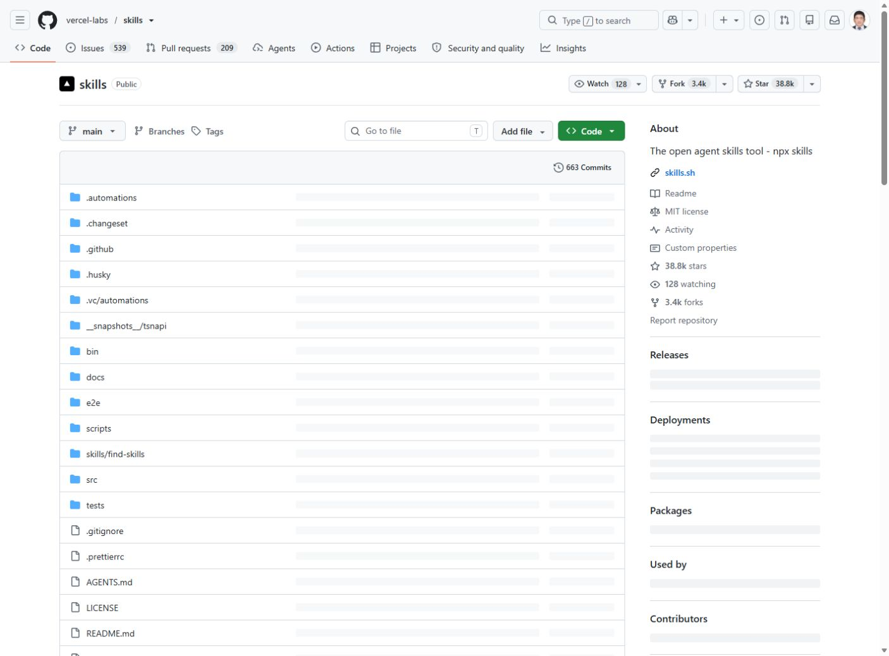</a><figcaption>그림 5-1. 직접 접속한 공식 웹페이지 화면. 새 설치·로그인 성공 화면과 구분한다. · 실제 캡처 2026-11-10<br>출처: <a href="https://github.com/vercel-labs/skills">https://github.com/vercel-labs/skills</a> · 클릭하면 원본 크기로 열림</figcaption></figure>

## 5. 단계별 실습

### 단계 1. 원본 읽기

저장소 소유자와 주소를 확인하고 README, SKILL.md, 라이선스, 수정 내역을 읽는다. 인기 수치만으로 안전성을 단정하지 않는다.

### 단계 2. ZIP과 clone

Code 메뉴의 Download ZIP은 특정 시점의 사본을 받는다. git clone은 저장소 이력과 업데이트 관리에 적합하다. 다운로드만 했다고 에이전트에 설치된 것은 아니다.

### 단계 3. Node 확인

node --version과 npm --version을 실행한다. 학교 정책에 맞는 설치본을 사용하고 CLI 문서의 최소 버전을 확인한다.

### 단계 4. 공용 원본 설치

find-skills의 SKILL.md 하위 폴더를 사용자 공용 스킬 경로에 연결함. consolidate_skills.py의 계획을 검토한 뒤 적용하고 두 앱에서 새 세션으로 확인함.

### 단계 5. 검색

phaser 또는 platformer로 검색하고 실제 결과의 원본 저장소를 연다. 이번 검색에서는 Phaser 공식 저장소와 두 커뮤니티 후보가 확인되었다.

### 단계 6. 인식과 제거

npx skills list와 파일 위치를 확인한다. 제거는 현재 도움말을 확인하고 프로젝트 스킬에만 적용한다. 업데이트는 전체 학급 실습 전에 교사가 먼저 검증한다.

**입력 위치: Windows PowerShell.** 주석과 경로를 읽고 필요한 명령만 실행한다. `/help` 등 세션 명령은 설명된 에이전트 안에서 입력한다.

```powershell
# 후보 검색 명령임. 설치 완료를 의미하지 않음
npx skills find prompt
npx skills find phaser game
# 저장소 원본과 공용 스킬 연결을 구분함
$repoRoot = Join-Path $env:USERPROFILE '.agents\repositories'
New-Item -ItemType Directory -Force -Path $repoRoot | Out-Null
$repo = Join-Path $repoRoot 'vercel-skills'
if (-not (Test-Path $repo)) {
    git clone https://github.com/vercel-labs/skills $repo
}
$source = Join-Path $repo 'skills\find-skills'
$shared = Join-Path $env:USERPROFILE '.agents\skills\find-skills'
# 기존 원본이 있으면 덮어쓰지 않고 출처와 연결을 먼저 확인함
if ((Test-Path (Join-Path $source 'SKILL.md')) -and (-not (Test-Path $shared))) {
    New-Item -ItemType Junction -Path $shared -Target $source
}
python "$env:USERPROFILE\.agents\tools\consolidate_skills.py"
# 변경 계획과 원본 보존을 확인한 뒤 적용함
python "$env:USERPROFILE\.agents\tools\consolidate_skills.py" --apply
```

## 6. 복사 가능한 프롬프트 입력 예시

입력 위치는 이용이 허용된 Codex 또는 교사의 Claude Code 세션이다. 스킬 이름이 들어간 예시는 해당 스킬이 인식된 상태에서 사용한다. 아래는 입력 예시이며 실제 서비스에서 자동으로 실행된 응답을 뜻하지 않는다.

### 예시 5-1. 기본 요청

```text
find-skills를 사용해 2D 횡스크롤 게임에 도움이 되는 스킬을 찾아줘. 원본 저장소, 라이선스, 지원 에이전트, 설치 방법을 비교하고 자동으로 전역 설치하지 마.
```

확인: 요청한 파일 또는 비교 결과가 실제로 나왔는지 확인한다.

### 예시 5-2. 수정·보완 요청

```text
검색 결과 중 공식 Phaser 저장소의 game-setup-and-config가 실제로 있는지 확인하고 어떤 버전과 작업을 다루는지 SKILL.md를 읽어 정리해줘.
```

확인: 기존 요구사항이 유지되고 추가 조건이 반영되었는지 확인한다.

### 예시 5-3. 확인·검증 요청

```text
설치된 find-skills의 파일 위치와 이름을 확인해줘. 파일 존재, 새 세션에서의 인식, 실제 검색 실행 여부를 구분해서 알려줘.
```

확인: 기대 결과와 실제 실행 여부가 구분되었는지 확인한다.

## 7. 정상 결과와 확인 방법

이전 실행에서는 프로젝트 .agents/skills/find-skills와 Claude Code 연결을 확인했음. 현재 설치 기준은 사용자 공용 .agents 원본임. 본 제작에서 CLI 설치는 성공했으며 로그를 07_검증및출처/install-find.txt에 보관했다.

## 8. 오류와 해결

검색 결과가 없으면 엔진명·기능명으로 좁힌다. 저장소가 바뀌었으면 원본에서 현재 위치를 확인한다. npx 설치 확인 대화와 에이전트 권한 승인을 혼동하지 않는다.

## 9. 과제와 확인 문항

기본: 후보 2개 비교표. 확장: 게임 외 보고서·접근성 관련 스킬 탐색.

질문: ZIP 파일을 내려받았으면 스킬 설치 완료인가? 답: 올바른 경로에 SKILL.md와 자원을 두고 에이전트가 인식해야 한다.

## 10. 교사 시연과 설명

명령의 각 옵션을 읽게 한다. -g의 의미를 모른 채 전체 PC에 설치하는 습관을 피한다.

시연 순서는 목표 안내 5분 → 작업과 설명 15분 → 학생 활동·관찰 20분 → 결과 비교 7분 → 기록 3분을 기본으로 한다. 장시간 모듈은 각 차시마다 이를 반복한다. 막힌 학생은 계정 공유 대신 실행 예제와 요청문 비교 활동을 사용한다.

관찰 기록: 목표 달성 여부 / 학생이 확인한 근거 / 발생 오류 / 다음 시간 보완 사항. 수업 실시 전에는 실제 학생 반응을 채우지 않는다.

## 출처

- [https://github.com/vercel-labs/skills](https://github.com/vercel-labs/skills) · 확인일 2026-11-10
- 상세 실행 상태: [검증 현황](../07_검증및출처/검증현황.md)


---

# 모듈 6. 게임 개발 스킬 선정과 설치

기준일 2026-11-10 · 예상 50분 · 교사용

## 1. 학습 목표

기존 도구를 근거 있게 선정하고 작은 이동·점프 예제를 실행한다.

## 2. 핵심 개념

Phaser는 게임을 실행하는 JavaScript 라이브러리이고 game-setup-and-config는 AI가 Phaser 설정을 이해하도록 돕는 스킬이다. 라이브러리 설치와 스킬 설치를 별도로 기록한다.

## 3. 준비물과 이용 조건

Phaser 공식 저장소와 본 프로젝트의 로컬 엔진 4.2.1. 엔진을 vendor에 포함했으므로 완성 게임은 실행 시 CDN 다운로드를 요구하지 않는다. Node는 CLI와 시험에, Python은 로컬 서버와 보고서에 사용한다.

## 4. 실제 웹 경로와 화면

**이동 경로:** Phaser 공식 GitHub → 스킬 목록(설치 CLI에서 확인) → game-setup-and-config

**직접 주소:** [https://github.com/phaserjs/phaser](https://github.com/phaserjs/phaser)

<figure><a href="../08_화면캡처/06_Phaser_공식저장소.jpg">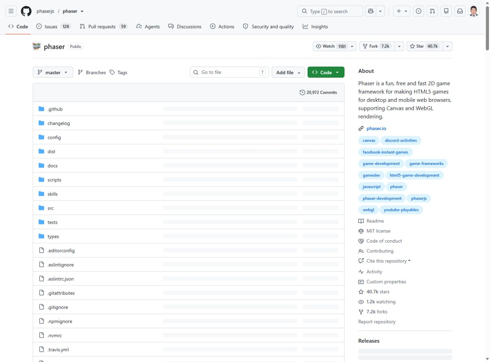</a><figcaption>그림 6-1. 직접 접속한 공식 웹페이지 화면. 새 설치·로그인 성공 화면과 구분한다. · 실제 캡처 2026-11-10<br>출처: <a href="https://github.com/phaserjs/phaser">https://github.com/phaserjs/phaser</a> · 클릭하면 원본 크기로 열림</figcaption></figure>

## 5. 단계별 실습

### 단계 1. 후보 비교

공식 phaserjs/phaser의 game-setup-and-config, gamedev-skills/awesome-gamedev-agent-skills의 phaser-core, PlayableIntelligence/game-creator를 조사한다. 후보 목록은 별도 비교표에 제공한다.

### 단계 2. 선정

설정 예제가 명확하고 Phaser 4를 직접 다루는 공식 스킬을 선정했다. 커뮤니티 플러그인을 전부 설치하지 않는다.

### 단계 3. 설치

아래 명령을 프로젝트 폴더에서 실행한다. 이번 제작에서 Codex용 .agents 경로와 Claude Code 연결이 생성되었다.

### 단계 4. 내용 확인

SKILL.md의 Phaser.Game, renderer, pixelArt, FIT 설정을 읽는다. Canvas 렌더러와 고정 논리 해상도를 사용해 수업 예제의 설정을 단순하게 했다.

### 단계 5. 이동·점프

05_게임실습/단계1_이동과 점프/시작.html을 연다. 캐릭터 선택 UI 뒤에서 기본 도형이 움직인다. 완성 단계와 같은 규칙 파일을 공유한다.

### 단계 6. 설치와 실행 기록

스킬 CLI 로그와 엔진 버전 기록, 실제 브라우저 캡처를 함께 확인한다. 새 에이전트 세션의 인식 여부는 별도로 점검한다.

**입력 위치: Windows PowerShell.** 주석과 경로를 읽고 필요한 명령만 실행한다. `/help` 등 세션 명령은 설명된 에이전트 안에서 입력한다.

```powershell
# 검색과 공용 설치를 구분함
npx skills find phaser game
# 선정한 저장소의 SKILL.md 위치와 사용 조건을 확인함
# 스킬 원본은 사용자 .agents\skills에 하나만 둠
# 하위 폴더형 저장소는 공용 원본에서 해당 폴더로 junction을 연결함
python "$env:USERPROFILE\.agents\tools\consolidate_skills.py"
# 계획을 검토한 뒤 적용함
python "$env:USERPROFILE\.agents\tools\consolidate_skills.py" --apply
# 게임 실행은 실습 프로젝트 폴더에서 진행함
python -m http.server 18465 --bind 127.0.0.1
```

## 6. 복사 가능한 프롬프트 입력 예시

입력 위치는 이용이 허용된 Codex 또는 교사의 Claude Code 세션이다. 스킬 이름이 들어간 예시는 해당 스킬이 인식된 상태에서 사용한다. 아래는 입력 예시이며 실제 서비스에서 자동으로 실행된 응답을 뜻하지 않는다.

### 예시 6-1. 기본 요청

```text
game-setup-and-config 스킬을 읽고 Phaser 4의 Canvas 렌더러, 고정 크기 960×450, FIT 확대 방식으로 빈 게임을 구성해줘. 라이브러리는 로컬 vendor 파일을 사용해줘.
```

확인: 요청한 파일 또는 비교 결과가 실제로 나왔는지 확인한다.

### 예시 6-2. 수정·보완 요청

```text
기본 도형을 방향키로 좌우 이동하고 Space로 점프하게 만들어줘. 중력과 바닥 착지를 넣고 지상에서만 점프하게 해줘. 이미지와 장애물은 아직 넣지 마.
```

확인: 기존 요구사항이 유지되고 추가 조건이 반영되었는지 확인한다.

### 예시 6-3. 확인·검증 요청

```text
도형의 이동, 왼쪽 경계, 점프, 공중 추가 점프 차단, 착지를 각각 시험해줘. 실제 화면 시험과 규칙 함수 시험을 구분해줘.
```

확인: 기대 결과와 실제 실행 여부가 구분되었는지 확인한다.

## 7. 정상 결과와 확인 방법

엔진 버전은 4.2.1이며 실제 게임 캡처에 표시된다. 스킬 설치 성공, 엔진 파일 확보, 브라우저 실행을 각각 기록했다.

## 8. 오류와 해결

file://에서 로딩 문제가 발생하면 로컬 서버 주소로 접속한다. 포트 접근 거부 또는 충돌이면 학교 보안을 변경하지 말고 허용되는 다른 포트를 사용한다.

## 9. 과제와 확인 문항

기본: 이동 속도 205를 180으로 바꾼 사본 비교. 확장: 논리 해상도와 화면 표시 크기의 차이 설명.

질문: Phaser만 설치하면 AI 스킬도 설치되는가? 답: 아니다. 라이브러리와 SKILL.md 설치는 별도다.

## 10. 교사 시연과 설명

이동 속도를 바꾸기 전에 기존 값을 기록한다. 화면에 보이는 픽셀과 월드 좌표가 다른 이유를 설명한다.

시연 순서는 목표 안내 5분 → 작업과 설명 15분 → 학생 활동·관찰 20분 → 결과 비교 7분 → 기록 3분을 기본으로 한다. 장시간 모듈은 각 차시마다 이를 반복한다. 막힌 학생은 계정 공유 대신 실행 예제와 요청문 비교 활동을 사용한다.

관찰 기록: 목표 달성 여부 / 학생이 확인한 근거 / 발생 오류 / 다음 시간 보완 사항. 수업 실시 전에는 실제 학생 반응을 채우지 않는다.

## 출처

- [https://github.com/phaserjs/phaser](https://github.com/phaserjs/phaser) · 확인일 2026-11-10
- 상세 실행 상태: [검증 현황](../07_검증및출처/검증현황.md)


---

# 모듈 7. 제천10경 캐릭터 게임 제작

기준일 2026-11-10 · 예상 150분 / 3차시 · 교사용

## 1. 학습 목표

캐릭터 10개를 구분하고 이동·점프·충돌·점수·종료를 갖춘 한 스테이지를 완성한다.

## 2. 핵심 개념

요구사항은 기능의 목록이며 시험 기준은 그 기능이 작동했는지 판단하는 조건이다. 경 번호는 고유 ID다. 같은 이름의 제6경·제7경을 구분하는 데 사용한다. 스프라이트는 화면 오브젝트이며 정지 JPG가 자동으로 자세별 애니메이션이 되는 것은 아니다.

## 3. 준비물과 이용 조건

사용자 제공 제천10경케릭터 JPG 10개, 공식 페이지와 이용 조건, 완성 예제. 원본 바이트는 그대로 복사하고 크롭·배경 제거·도트 변환을 하지 않았다. 출처표시·상업적 이용금지·변경금지 조건을 교재와 게임에 표시한다.

## 4. 실제 웹 경로와 화면

**이동 경로:** 제천시 → 제천소개 → 제천시소개 → 공공저작물 → 제천시 홍보 디자인 → 제천10경 캐릭터

**직접 주소:** [https://www.jecheon.go.kr/www/contents.do?key=48579](https://www.jecheon.go.kr/www/contents.do?key=48579)

<figure><a href="../08_화면캡처/07_게임_캐릭터선택.jpg">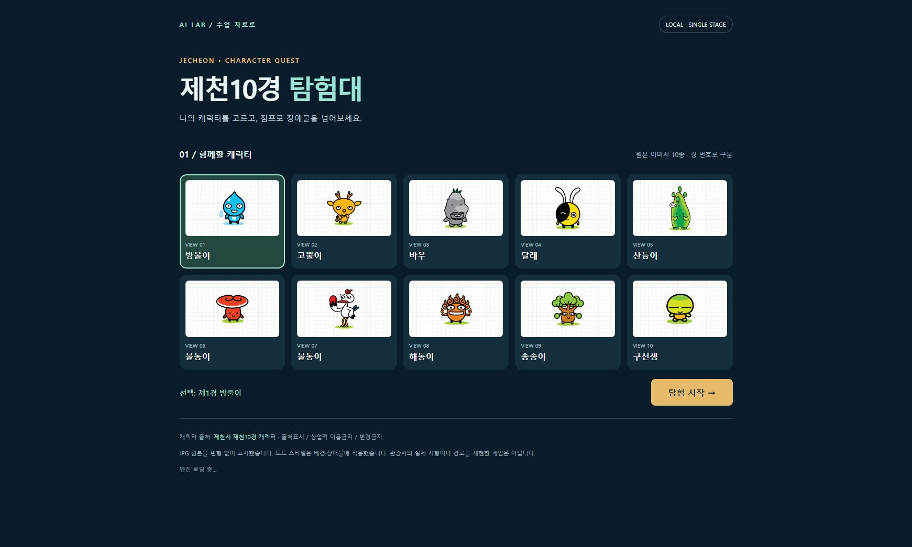</a><figcaption>그림 7-1. 직접 실행한 게임 화면 · 실제 캡처 2026-11-10<br>출처: <a href="http://127.0.0.1:18465/05_게임실습/완성게임/index.html">http://127.0.0.1:18465/05_게임실습/완성게임/index.html</a> · 클릭하면 원본 크기로 열림</figcaption></figure>

<figure><a href="../08_화면캡처/07_게임_플레이.jpg"></a><figcaption>그림 7-2. 제1경 캐릭터가 반영된 실제 초기 플레이 화면 · 실제 캡처 2026-11-10<br>출처: <a href="http://127.0.0.1:18465/05_게임실습/완성게임/index.html">http://127.0.0.1:18465/05_게임실습/완성게임/index.html</a> · 클릭하면 원본 크기로 열림</figcaption></figure>

<figure><a href="../08_화면캡처/07_게임_점프.jpg">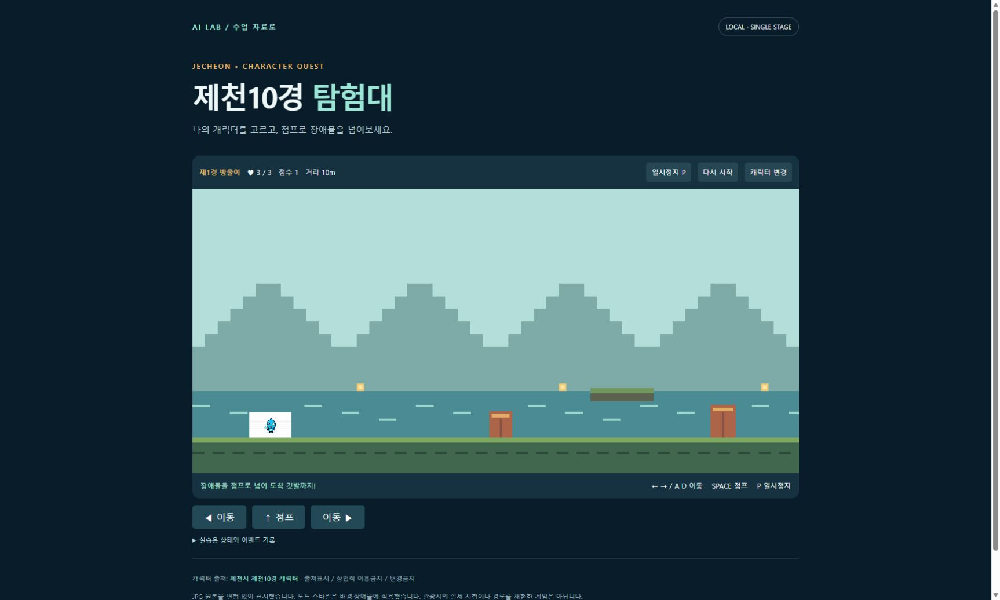</a><figcaption>그림 7-3. 점프 입력 직후 실제 게임 화면 · 실제 캡처 2026-11-10<br>출처: <a href="http://127.0.0.1:18465/05_게임실습/완성게임/index.html">http://127.0.0.1:18465/05_게임실습/완성게임/index.html</a> · 클릭하면 원본 크기로 열림</figcaption></figure>

<figure><a href="../08_화면캡처/07_게임_충돌종료.jpg">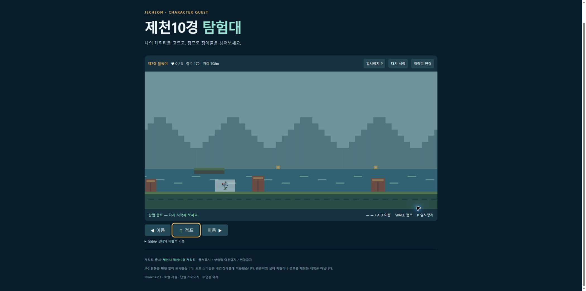</a><figcaption>그림 7-4. 실제 플레이 중 3회 피격 후 체력 0과 탐험 종료를 확인한 화면 · 실제 캡처 2026-11-10<br>출처: <a href="http://127.0.0.1:18465/05_게임실습/완성게임/index.html">http://127.0.0.1:18465/05_게임실습/완성게임/index.html</a> · 클릭하면 원본 크기로 열림</figcaption></figure>

<figure><a href="../08_화면캡처/07_게임_재시작.jpg">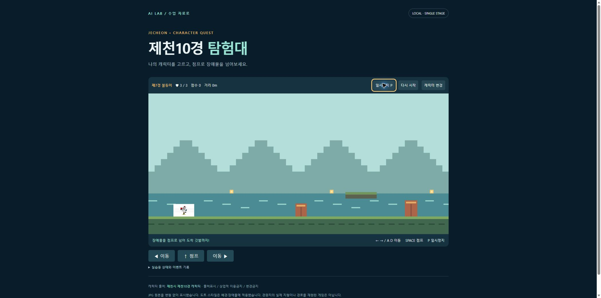</a><figcaption>그림 7-5. 제7경을 유지하면서 체력과 점수가 초기화된 실제 재시작 화면 · 실제 캡처 2026-11-10<br>출처: <a href="http://127.0.0.1:18465/05_게임실습/완성게임/index.html">http://127.0.0.1:18465/05_게임실습/완성게임/index.html</a> · 클릭하면 원본 크기로 열림</figcaption></figure>

## 5. 단계별 실습

### 단계 1. 자산 조사

원본 JPG 10개의 크기는 각각 275×165다. 파일명을 경 번호 순서로 정리하고 ID 1~10을 부여한다. 제6경·제7경 모두 불동이라는 파일명을 그대로 보존한다.

### 단계 2. 선택 화면

10개 선택 카드 중 하나만 강조되게 하고 선택 ID를 플레이 상태에 전달한다. 같은 이름 대신 ID로 이미지 파일을 찾는다.

### 단계 3. 규칙 분리

rules.js는 위치·속도·중력·체력·점수를 계산한다. game.js는 Phaser 화면, 키 입력, 버튼, 화면 상태를 담당한다. 화면과 규칙을 분리하면 같은 조건으로 시험하기 쉽다.

### 단계 4. 장애물·발판

장애물 6개와 발판 3개를 배치한다. 점프 중 장애물 위를 지나갈 수 있고 발판은 위에서 내려올 때만 착지한다. 체력 3, 피격 후 1.25초 보호, 체력 소진 시 종료다.

### 단계 5. 점수와 종료

이동 거리에 따라 점수를 늘리고 스탬프를 수집한다. 오른쪽 끝에 도착하면 성공이다. 일시정지·재시작·캐릭터 변경을 별도 상태로 구현한다.

### 단계 6. 검증과 기록

각 캐릭터의 선택 상태를 확인하고 게임에 전달되는 ID를 상태 기록에서 확인한다. 공중 점프 방지, 피격, 종료, 재시작은 규칙 시험표와 실제 화면 점검을 구분한다. 새로운 창으로 전환하면 게임은 자동 일시정지한다.

**입력 위치: Windows PowerShell.** 주석과 경로를 읽고 필요한 명령만 실행한다. `/help` 등 세션 명령은 설명된 에이전트 안에서 입력한다.

```powershell
# 프로젝트 루트에서 규칙 시험
node '.\09_제작도구\test_rules.cjs'
# 완성 게임 주소
# http://127.0.0.1:18465/05_게임실습/완성게임/index.html
# 단계2: ?lesson=2 / 도형+충돌
# 단계3: ?lesson=3 / 원본 캐릭터+완성 기능
```

## 6. 복사 가능한 프롬프트 입력 예시

입력 위치는 이용이 허용된 Codex 또는 교사의 Claude Code 세션이다. 스킬 이름이 들어간 예시는 해당 스킬이 인식된 상태에서 사용한다. 아래는 입력 예시이며 실제 서비스에서 자동으로 실행된 응답을 뜻하지 않는다.

### 예시 7-1. 기본 요청

```text
제천10경케릭터 폴더의 JPG 10개를 원본 그대로 사용해 선택 화면을 만들어줘. 제6경과 제7경 이름이 같아도 ID로 구분하고 원본 파일을 덮어쓰지 마. 선택한 ID가 실제 플레이에 반영되게 해줘.
```

확인: 요청한 파일 또는 비교 결과가 실제로 나왔는지 확인한다.

### 예시 7-2. 수정·보완 요청

```text
장애물과 발판을 넣어줘. 지상에서만 점프하고 발판 위에서 다시 점프할 수 있게 해줘. 피격 시 체력을 1 줄이고 잠시 중복 피해를 막아줘. 체력 소진 시 이동을 멈추고 재시작 버튼을 제공해줘.
```

확인: 기존 요구사항이 유지되고 추가 조건이 반영되었는지 확인한다.

### 예시 7-3. 확인·검증 요청

```text
캐릭터 선택 전달, 점프·착지, 장애물 충돌, 일시정지, 재시작 초기화, 도착 성공을 시험표로 확인해줘. 실제 수행한 시험의 방법과 결과를 적고 화면 미확인 항목은 따로 표시해줘.
```

확인: 기대 결과와 실제 실행 여부가 구분되었는지 확인한다.

## 7. 정상 결과와 확인 방법

브라우저에서 10종 각각의 선택 ID가 게임에 전달됨을 확인했다. 제7경으로 이동·점프·피격 후 체력 0 및 종료, 재시작 후 ID 유지·체력 3·점수 0, 일시정지 중 위치 유지·재개를 확인했다. Node 규칙 시험은 17/17 통과했다. 도착 성공까지의 브라우저 전체 플레이는 미실행이며 해당 판정은 규칙 시험에서 확인했다.

## 8. 오류와 해결

이미지가 안 보이면 assets.js의 상대경로와 대소문자, 서버 요청을 확인한다. JPG 격자 배경은 원본의 일부로 제거하지 않았다. 빠른 이동에서 충돌이 누락되면 시간 간격과 속도·경계 판정을 함께 살핀다.

## 9. 과제와 확인 문항

기본: 시험표를 직접 채운다. 확장: 이용 허락을 받은 별도 이미지 또는 직접 그린 캐릭터로 자세별 프레임을 제작한다. 10개 스테이지는 추가 과제이다.

질문: 파일명이 같은 이름이면 하나로 합쳐도 되는가? 답: 경 번호가 다른 별도 자료다. ID를 유지한다.

## 10. 교사 시연과 설명

3차시는 규칙·도형, 캐릭터·화면, 검증·개선으로 나눈다. 공식 관광지의 지형을 구현한 게임이라고 설명하지 않는다.

시연 순서는 목표 안내 5분 → 작업과 설명 15분 → 학생 활동·관찰 20분 → 결과 비교 7분 → 기록 3분을 기본으로 한다. 장시간 모듈은 각 차시마다 이를 반복한다. 막힌 학생은 계정 공유 대신 실행 예제와 요청문 비교 활동을 사용한다.

관찰 기록: 목표 달성 여부 / 학생이 확인한 근거 / 발생 오류 / 다음 시간 보완 사항. 수업 실시 전에는 실제 학생 반응을 채우지 않는다.

## 출처

- [https://www.jecheon.go.kr/www/contents.do?key=48579](https://www.jecheon.go.kr/www/contents.do?key=48579) · 확인일 2026-11-10
- 상세 실행 상태: [검증 현황](../07_검증및출처/검증현황.md)


---

# 모듈 8. 지정 HWPX 스킬 설치와 첫 문서

기준일 2026-11-10 · 예상 50분 · 교사용

## 1. 학습 목표

사용자 지정 스킬과 템플릿으로 실제 HWPX 문서를 생성한다.

## 2. 핵심 개념

HWP는 기존 바이너리 형식이며 HWPX는 XML 등으로 구성된 ZIP 패키지다. 확장자를 바꾸는 것으로 변환되지 않는다. 양식 편집에서는 문단·표·스타일·이미지 관계를 유지해야 한다.

## 3. 준비물과 이용 조건

Python, 지정 저장소의 assets/report-template.hwpx, 프로젝트 가상환경과 python-hwpx. 한컴오피스 한글이 설치된 교사 PC에서는 실제 열림·PDF 내보내기까지 확인한다.

## 4. 실제 웹 경로와 화면

**이동 경로:** Canine89/gonggong_hwpxskills → SKILL.md / assets / scripts

**직접 주소:** [https://github.com/Canine89/gonggong_hwpxskills](https://github.com/Canine89/gonggong_hwpxskills)

<figure><a href="../08_화면캡처/08_HWPX_지정저장소.jpg">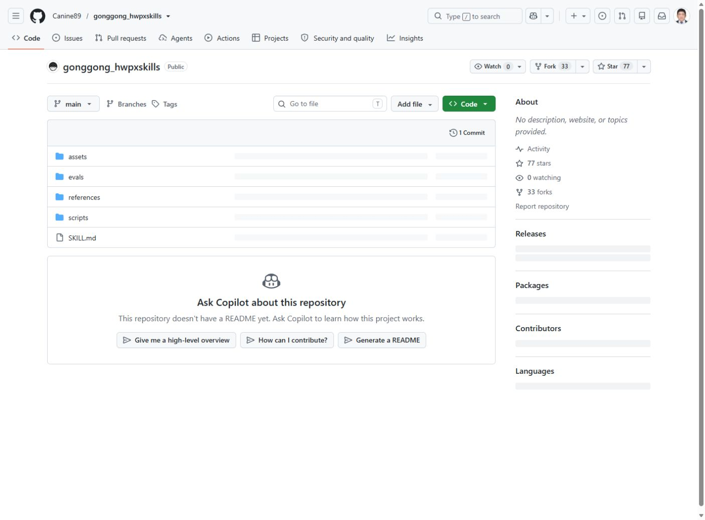</a><figcaption>그림 8-1. 직접 접속한 공식 웹페이지 화면. 새 설치·로그인 성공 화면과 구분한다. · 실제 캡처 2026-11-10<br>출처: <a href="https://github.com/Canine89/gonggong_hwpxskills">https://github.com/Canine89/gonggong_hwpxskills</a> · 클릭하면 원본 크기로 열림</figcaption></figure>

## 5. 단계별 실습

### 단계 1. 출처 고정

다른 hwpx 스킬과 혼동하지 않고 사용자가 지정한 저장소를 확인한다. 본 프로젝트에는 원본 전체를 09_제작도구/sources/gonggong_hwpxskills에 보관했다.

### 단계 2. 공용 원본 설치

.agents/skills/hwpx와 .claude/skills/hwpx에 자원을 복사했다. 같은 이름의 전역 스킬은 수정하지 않았다. 새 세션에서는 출처 경로까지 명시한다.

### 단계 3. 가상환경

실습용 venv를 만들고 해당 Python으로 의존성을 설치한다. Linux의 --break-system-packages를 Windows 기본 명령에 넣지 않는다.

### 단계 4. 양식 선택

사용자 제공 양식이 있으면 우선 사용하고 없으면 저장소의 report-template.hwpx를 복사한다. 이번 예제는 이 보고서 템플릿의 스타일·페이지 설정을 유지하고 내용을 재구성했다.

### 단계 5. 입력과 생성

목적·활동·확인 결과를 구분해 첫 보고서를 작성한다. 한 페이지 예제는 수업 목표와 파일·시험 기록 등 확인 가능한 내용만 넣는다.

### 단계 6. 열림·서식 검사

ZIP/XML 구조, 실제 한글 열림, PDF 페이지·표·그림을 별도로 확인한다. 본 제작의 보고서 검증 결과는 별도 JSON 기록과 PDF에 제공한다.

**입력 위치: Windows PowerShell.** 주석과 경로를 읽고 필요한 명령만 실행한다. `/help` 등 세션 명령은 설명된 에이전트 안에서 입력한다.

```powershell
# 공용 원본이 없는 경우에만 설치함
$skillRoot = Join-Path $env:USERPROFILE '.agents\skills'
New-Item -ItemType Directory -Force -Path $skillRoot | Out-Null
if (-not (Test-Path (Join-Path $skillRoot 'hwpx'))) {
    git clone https://github.com/Canine89/gonggong_hwpxskills (Join-Path $skillRoot 'hwpx')
}
python "$env:USERPROFILE\.agents\tools\consolidate_skills.py"
# 계획과 백업을 확인한 뒤 적용함
python "$env:USERPROFILE\.agents\tools\consolidate_skills.py" --apply
# 문서 생성에 필요한 Python 패키지는 실습별 가상환경에 설치함
python -m venv .venv-hwpx
.\.venv-hwpx\Scripts\python.exe -m pip install python-hwpx
```

## 6. 복사 가능한 프롬프트 입력 예시

입력 위치는 이용이 허용된 Codex 또는 교사의 Claude Code 세션이다. 스킬 이름이 들어간 예시는 해당 스킬이 인식된 상태에서 사용한다. 아래는 입력 예시이며 실제 서비스에서 자동으로 실행된 응답을 뜻하지 않는다.

### 예시 8-1. 기본 요청

```text
이 프로젝트의 .agents/skills/hwpx가 Canine89/gonggong_hwpxskills 출처인지 확인하고 그 스킬을 사용해줘. 제공 양식이 없으면 assets/report-template.hwpx를 사용해 AI 활용 실습 결과 한 페이지 보고서를 만들어줘. 실제 확인한 파일과 활동만 적어줘.
```

확인: 요청한 파일 또는 비교 결과가 실제로 나왔는지 확인한다.

### 예시 8-2. 수정·보완 요청

```text
보고서의 제목, 목적, 활동 내용, 결과를 구분하고 날짜를 제작일로 표시해줘. 아직 수업이 열리지 않았다면 학생 만족도나 학습 효과를 만들지 마.
```

확인: 기존 요구사항이 유지되고 추가 조건이 반영되었는지 확인한다.

### 예시 8-3. 확인·검증 요청

```text
생성한 HWPX의 ZIP/XML 구조를 검사하고 실제 한글 또는 뷰어에서 열리는지도 확인해줘. 구조 검사와 화면 검증을 구분해서 결과를 알려줘.
```

확인: 기대 결과와 실제 실행 여부가 구분되었는지 확인한다.

## 7. 정상 결과와 확인 방법

원본 양식과 생성된 실제 HWPX가 존재해야 한다. 문서 열림과 PDF 렌더 검증 결과를 07_검증및출처에서 확인한다.

## 8. 오류와 해결

텍스트가 끊겨 있으면 단순 문자열 치환으로 누락될 수 있다. 표 안 텍스트와 분할된 run을 조사한다. 빈 문서처럼 보이면 네임스페이스·관계·프로그램 열림 결과를 순서대로 확인한다.

## 9. 과제와 확인 문항

기본: 한 페이지 보고서에 실제 파일명 추가. 확장: 제공 양식에 동일 내용을 넣되 원본 서식을 유지.

질문: ZIP 검사가 통과하면 한글 화면도 정상인가? 답: 아니다. 실제 프로그램 열림과 레이아웃 검사가 필요하다.

## 10. 교사 시연과 설명

원본 양식, 입력 자료, 생성 코드, 출력 HWPX를 함께 보여준다. 문서를 다시 생성해도 동일 결과를 추적할 수 있게 한다.

시연 순서는 목표 안내 5분 → 작업과 설명 15분 → 학생 활동·관찰 20분 → 결과 비교 7분 → 기록 3분을 기본으로 한다. 장시간 모듈은 각 차시마다 이를 반복한다. 막힌 학생은 계정 공유 대신 실행 예제와 요청문 비교 활동을 사용한다.

관찰 기록: 목표 달성 여부 / 학생이 확인한 근거 / 발생 오류 / 다음 시간 보완 사항. 수업 실시 전에는 실제 학생 반응을 채우지 않는다.

## 출처

- [https://github.com/Canine89/gonggong_hwpxskills](https://github.com/Canine89/gonggong_hwpxskills) · 확인일 2026-11-10
- 상세 실행 상태: [검증 현황](../07_검증및출처/검증현황.md)


---

# 모듈 9. 게임 개발·수업 운영 보고서 작성

기준일 2026-11-10 · 예상 50분 · 교사용

## 1. 학습 목표

근거 자료와 시험 기록을 바탕으로 편집 가능한 HWPX 보고서를 작성한다.

## 2. 핵심 개념

개발 보고서는 무엇을 만들었고 어떻게 확인했는지 설명한다. 수업 운영 전에는 운영 결과를 확정할 수 없다. 교사용 예시는 운영 설계와 제작·사전 점검 결과를 적고 실제 수업 결과 입력란을 분리한다.

## 3. 준비물과 이용 조건

게임 코드·자산출처.json·game-rule-tests.json·실제 캡처. 학생용 개발 보고서와 교사용 운영 결과 보고서 작성 예시를 제공한다. 실제 수업 관찰과 만족도는 입력하지 않았다.

## 4. 실제 웹 경로와 화면

**이동 경로:** 지정 스킬 → 보고서 템플릿 → 입력 자료 조사 → 생성 → 열림·렌더 검사

**직접 주소:** [https://github.com/Canine89/gonggong_hwpxskills/blob/main/SKILL.md](https://github.com/Canine89/gonggong_hwpxskills/blob/main/SKILL.md)

<figure><a href="../08_화면캡처/07_게임_플레이.jpg"></a><figcaption>그림 9-1. 직접 실행한 게임 화면 · 실제 캡처 2026-11-10<br>출처: <a href="http://127.0.0.1:18465/05_게임실습/완성게임/index.html">http://127.0.0.1:18465/05_게임실습/완성게임/index.html</a> · 클릭하면 원본 크기로 열림</figcaption></figure>

## 5. 단계별 실습

### 단계 1. 자료수집

개발 목적·요구사항·파일 목록·실제 시험 로그를 모은다. 캡처는 문서의 주장과 연결한다.

### 단계 2. 분류

확인된 사실, 설계값, 실제 시험, 미검증 항목, 향후 계획을 구분한다. 예: 체력 3은 설계값이며 학생 만족도는 미조사다.

### 단계 3. 학생 보고서

배경·목적→자료 및 환경→설계·구현→시험 방법과 결과→한계·개선→결론→참고자료·AI 활용 내역으로 작성한다.

### 단계 4. 교사 보고서

수업 목적과 차시, 준비·운영 방법, 산출물 평가, 제작·사전 점검 결과를 기록한다. 실제 학생 수·운영일·만족도는 실시 후 작성란으로 남긴다.

### 단계 5. 표와 그림

기능 시험표, 10종 자산 목록, 실제 선택·플레이 화면을 넣는다. 개념도와 실제 실행 캡처를 구분하고 출처를 달아준다.

### 단계 6. 검증과 제출

HWPX·PDF·원문·입력 자료를 대조한다. 원문에 없는 수치가 문서에 추가되지 않았는지 확인하고 실제 열림·페이지 결과를 기록한다.

**입력 위치: Windows PowerShell.** 주석과 경로를 읽고 필요한 명령만 실행한다. `/help` 등 세션 명령은 설명된 에이전트 안에서 입력한다.

```powershell
# 실제 시험 기록 확인
Get-Content -LiteralPath '.\07_검증및출처\game-rule-tests.json' -Encoding UTF8
# 생성 보고서 폴더
Get-ChildItem -LiteralPath '.\06_HWPX보고서예시' 
```

## 6. 복사 가능한 프롬프트 입력 예시

입력 위치는 이용이 허용된 Codex 또는 교사의 Claude Code 세션이다. 스킬 이름이 들어간 예시는 해당 스킬이 인식된 상태에서 사용한다. 아래는 입력 예시이며 실제 서비스에서 자동으로 실행된 응답을 뜻하지 않는다.

### 예시 9-1. 기본 요청

```text
지정 HWPX 스킬과 보고서 템플릿으로 ‘제천10경 캐릭터 기반 횡스크롤 게임 개발 보고서’를 작성해줘. 실제 코드, 자산 목록, 시험 로그, 캡처를 근거로 작성하고 실제 시험과 계획을 구분해줘.
```

확인: 요청한 파일 또는 비교 결과가 실제로 나왔는지 확인한다.

### 예시 9-2. 수정·보완 요청

```text
기능, 시험 방법, 기대 결과, 실제 결과, 판정 열로 시험 결과표를 넣어줘. Node 규칙 시험과 브라우저 화면 시험을 구분하고 미실행 항목을 통과로 표시하지 마.
```

확인: 기존 요구사항이 유지되고 추가 조건이 반영되었는지 확인한다.

### 예시 9-3. 확인·검증 요청

```text
교사용 수업 운영 보고서 작성 예시를 만들어줘. 아직 수업이 열리지 않았으므로 사전 준비·제작·검증 결과를 작성하고 실제 운영일·학생 수·학습 효과는 실시 후 기록란으로 남겨줘. HWPX와 PDF의 표·그림을 확인해줘.
```

확인: 기대 결과와 실제 실행 여부가 구분되었는지 확인한다.

## 7. 정상 결과와 확인 방법

보고서 원문과 HWPX·PDF가 일치하고 캡처·시험 근거를 추적할 수 있다. 실제 수업 성과는 포함하지 않는다.

## 8. 오류와 해결

표가 길어지면 글자를 무리하게 줄이지 말고 열 수·문장 길이·페이지 배치를 조정한다. 예시 데이터는 본문과 표 모두에서 표시한다.

## 9. 과제와 확인 문항

기본: 자신의 수정 사항과 시험 1개를 추가. 확장: 다른 모둠의 재현 시험 결과를 별도 표로 추가.

질문: 통과 17/17이면 학생 학습 효과도 검증된 것인가? 답: 게임 규칙 시험 결과일 뿐이다. 별도의 수업 평가 자료가 필요하다.

## 10. 교사 시연과 설명

결과 보고서가 좋아 보이는 것보다 근거와 주장 범위가 일치하는지를 평가한다. AI 활용 내역과 학생의 직접 검토 내용을 분리한다.

시연 순서는 목표 안내 5분 → 작업과 설명 15분 → 학생 활동·관찰 20분 → 결과 비교 7분 → 기록 3분을 기본으로 한다. 장시간 모듈은 각 차시마다 이를 반복한다. 막힌 학생은 계정 공유 대신 실행 예제와 요청문 비교 활동을 사용한다.

관찰 기록: 목표 달성 여부 / 학생이 확인한 근거 / 발생 오류 / 다음 시간 보완 사항. 수업 실시 전에는 실제 학생 반응을 채우지 않는다.

## 출처

- [https://github.com/Canine89/gonggong_hwpxskills/blob/main/SKILL.md](https://github.com/Canine89/gonggong_hwpxskills/blob/main/SKILL.md) · 확인일 2026-11-10
- 상세 실행 상태: [검증 현황](../07_검증및출처/검증현황.md)


## 부록: 실제 HWPX 작성 예시 열람

[HWPX·PDF 3종과 전체 페이지 보기](../06_HWPX보고서예시/보고서_안내.html)

<figure><a href="../08_화면캡처/09_보고서_교사용_AI수업운영_보고서작성예시_p01.png">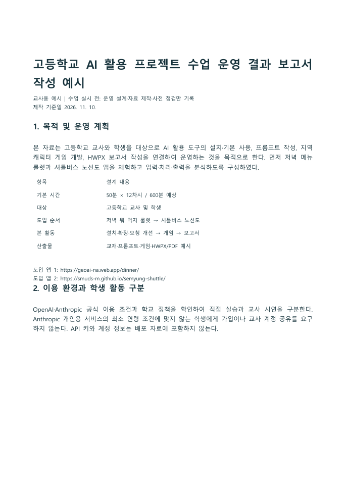</a><figcaption>실제 한글에서 열어 PDF로 내보낸 보고서 첫 페이지: 교사용_AI수업운영_보고서작성예시.hwpx · 실제 캡처 2026-11-10<br>출처: <a href="../06_HWPX보고서예시/교사용_AI수업운영_보고서작성예시.pdf">../06_HWPX보고서예시/교사용_AI수업운영_보고서작성예시.pdf</a> · 클릭하면 원본 크기로 열림</figcaption></figure>

<figure><a href="../08_화면캡처/09_보고서_첫실습_AI활용결과_한페이지_p01.png">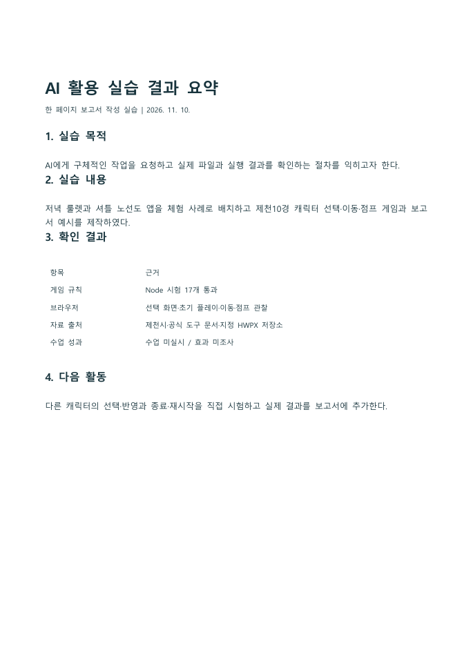</a><figcaption>실제 한글에서 열어 PDF로 내보낸 보고서 첫 페이지: 첫실습_AI활용결과_한페이지.hwpx · 실제 캡처 2026-11-10<br>출처: <a href="../06_HWPX보고서예시/첫실습_AI활용결과_한페이지.pdf">../06_HWPX보고서예시/첫실습_AI활용결과_한페이지.pdf</a> · 클릭하면 원본 크기로 열림</figcaption></figure>

<figure><a href="../08_화면캡처/09_보고서_학생용_제천10경게임_개발보고서_p01.png">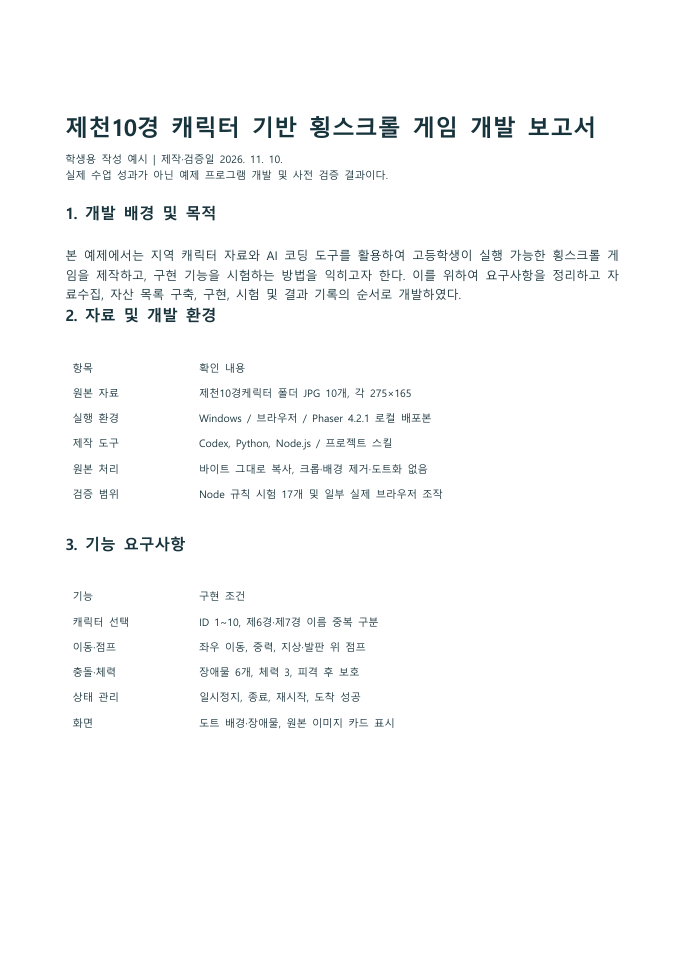</a><figcaption>실제 한글에서 열어 PDF로 내보낸 보고서 첫 페이지: 학생용_제천10경게임_개발보고서.hwpx · 실제 캡처 2026-11-10<br>출처: <a href="../06_HWPX보고서예시/학생용_제천10경게임_개발보고서.pdf">../06_HWPX보고서예시/학생용_제천10경게임_개발보고서.pdf</a> · 클릭하면 원본 크기로 열림</figcaption></figure>
