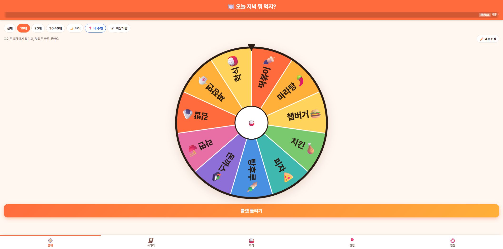
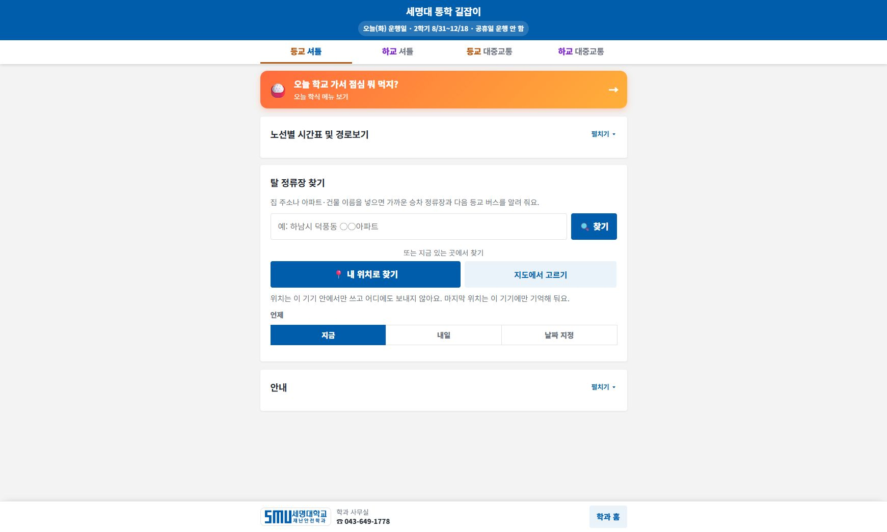

# 먼저 체험하기: 우리가 만들 수 있는 앱

두 앱을 먼저 사용하고 ‘무엇을 입력하면 무엇이 나오는가’를 관찰한다. 이후 AI로 작은 기능을 구현하고 검증하는 과정을 배운다. 기존 운영 앱을 수정하거나 새로 배포하는 실습은 포함하지 않는다.

## 체험 1. 저녁 뭐 먹지 룰렛 · 5분

1. 아래 주소로 접속하고 룰렛과 메뉴 선택 영역을 찾는다.
2. 메뉴 선택 동작을 한 번 실행한다. 외부 주문·결제는 진행하지 않는다.
3. 입력, 처리, 출력을 활동지에 적는다. 예: 메뉴 후보 → 임의 선택 → 선택된 메뉴 표시.
4. ‘같은 메뉴가 너무 자주 나오지 않게 하려면 무엇을 기록해야 할까?’를 이야기한다. 실제 확률이나 추천 효과를 측정하지 않고 단정하지 않는다.

**하단 웹주소: [https://geoai-na.web.app/dinner/](https://geoai-na.web.app/dinner/)**

<figure><a href="../08_화면캡처/00_저녁뭐먹지_룰렛.jpg"></a><figcaption>그림 0-1. 운영 중인 저녁 메뉴 룰렛의 실제 접속 화면. 기능 분석을 위한 체험 사례이며 성능 검증 결과가 아니다. · 실제 캡처 2026-11-10<br>출처: <a href="https://geoai-na.web.app/dinner/">https://geoai-na.web.app/dinner/</a> · 클릭하면 원본 크기로 열림</figcaption></figure>

AI 채팅 입력 예시:

```text
저녁 메뉴를 고르는 작은 룰렛 웹페이지를 만들어줘. 후보는 김밥, 비빔밥, 돈가스, 우동, 볶음밥, 샌드위치 6개야. 버튼을 누르면 하나를 무작위로 고르고 글자로도 결과를 보여줘. 외부 주문이나 결제 기능은 넣지 말고 HTML 파일 하나로 실행되게 해줘.
```

```text
룰렛 결과가 나왔을 때 어떤 후보에서 선택했는지 함께 표시해줘. 결과를 다시 뽑기 전에 후보를 편집할 수 있게 하고, 후보가 비어 있으면 안내문을 보여줘.
```

```text
후보가 0개, 1개, 6개인 경우를 구분해서 확인할 시험표를 만들어줘. 실제 실행한 결과만 기록하고 무작위 선택이 공정하다는 결론은 충분한 시험 없이 내리지 마.
```

## 체험 2. 셔틀버스 노선도 앱 · 7분

1. 아래 주소로 접속하여 학교 셔틀, 노선 또는 정류장 정보 영역을 찾는다.
2. 노선과 정류장을 선택했을 때 표시가 어떻게 바뀌는지 관찰한다. 위치 권한은 이 수업에 필수가 아니다.
3. 지도에 표시되는 위치, 시간표, 실시간 정보의 차이를 구분한다. 통학 전에는 학교의 최신 공지와 시간표를 확인한다.
4. ‘정류장 목록과 지도 표시를 일치시키려면 어떤 ID가 필요할까?’를 생각한다. 이것을 이후 캐릭터 ID와 연결한다.

**하단 웹주소: [https://smuds-m.github.io/semyung-shuttle/](https://smuds-m.github.io/semyung-shuttle/)**

<figure><a href="../08_화면캡처/00_셔틀버스_노선도앱.jpg"></a><figcaption>그림 0-2. 세명대 통학 길잡이의 실제 접속 화면. 버스 도착·위치·시간표 전체의 정확성을 검증한 결과는 아니다. · 실제 캡처 2026-11-10<br>출처: <a href="https://smuds-m.github.io/semyung-shuttle/">https://smuds-m.github.io/semyung-shuttle/</a> · 클릭하면 원본 크기로 열림</figcaption></figure>

AI 채팅 입력 예시:

```text
가상의 학교 셔틀 노선도 연습 앱을 만들어줘. 정류장은 학교, 도서관, 터미널 3개이고 각각 고유 ID를 부여해줘. 정류장을 선택하면 노선도에서 강조하고 옆에 설명을 보여줘. 데이터는 모두 교육용 가상 자료라고 표시하고 실제 위치·시간표로 오해되지 않게 해줘.
```

```text
정류장 이름이 같아도 ID가 다르면 별도로 선택되게 수정해줘. 이름으로만 비교하는 코드가 있는지 확인하고 수정한 이유를 설명해줘.
```

```text
정류장 선택, 선택 해제, 데이터 없음, 잘못된 ID를 시험해줘. 기대 결과와 실제 결과를 분리해서 표로 작성해줘. 실제 운영 셔틀 앱은 수정하지 마.
```

## 체험 기록

|앱|내가 조작한 입력|화면에서 관찰한 출력|AI로 바꾸고 싶은 기능|확인할 시험|
|---|---|---|---|---|
|메뉴 룰렛|직접 작성|직접 작성|직접 작성|직접 작성|
|셔틀 노선도|직접 작성|직접 작성|직접 작성|직접 작성|

이후 학습은 설치 → 작은 요청 → 확장 기능 → 게임 → 보고서 순서로 진행한다.
