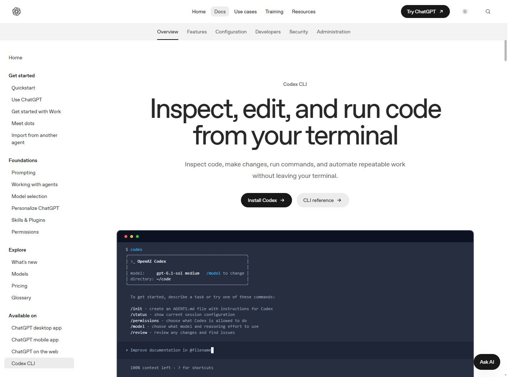

# 모듈 1. Codex 설치와 첫 웹페이지

기준일 2026-11-10 · 예상 50분 · 학생용

## 1. 학습 목표

작업 폴더를 지정하고 AI가 생성한 실제 파일을 실행·수정한다.

## 2. 핵심 개념

채팅은 요청을 전달하는 곳이고, 프로젝트 폴더는 파일을 저장하는 곳이다. Codex 앱·CLI·IDE는 같은 목적의 서로 다른 사용 경로이다. 이 수업은 설치된 앱에서 폴더를 선택하는 경로를 우선하고 CLI를 함께 안내한다.

## 3. 준비물과 이용 조건

교사 PC 또는 이용 조건에 맞는 학습자 계정, Windows PowerShell, 브라우저. OpenAI 개인용 서비스는 원칙적으로 13세 이상이며 18세 미만은 보호자 허락이 필요하다. 국가별 최소 연령과 학교 정책을 추가로 확인한다. API 키 입력은 기본 실습에 필요하지 않다.

## 4. 실제 웹 경로와 화면

**이동 경로:** 공식 문서 → Codex → CLI 또는 Desktop 안내 → 해당 운영체제 설치

**직접 주소:** [https://learn.chatgpt.com/docs/codex/cli](https://learn.chatgpt.com/docs/codex/cli)

<figure><a href="../08_화면캡처/01_Codex_공식CLI안내.jpg"></a><figcaption>그림 1-1. 직접 접속한 공식 웹페이지 화면. 새 설치·로그인 성공 화면과 구분한다. · 실제 캡처 2026-11-10<br>출처: <a href="https://learn.chatgpt.com/docs/codex/cli">https://learn.chatgpt.com/docs/codex/cli</a> · 클릭하면 원본 크기로 열림</figcaption></figure>

## 5. 단계별 실습

### 단계 1. 설치 경로 선택

https://openai.com/codex/ 에서 제공하는 공식 앱 진입 경로를 확인한다. 학교 PC에 이미 설치되어 있으면 중복 설치하지 않는다. 이 제작 PC에는 앱과 CLI가 이미 설치되어 있어 새 설치 화면은 확보하지 않았다.

### 단계 2. PowerShell과 실습 폴더

시작 메뉴에서 PowerShell을 연다. 아래 명령으로 문서 폴더 안에 실습 폴더를 만들고 이동한다. 경로는 작은따옴표 또는 큰따옴표로 감싼다.

### 단계 3. CLI 보조 경로

Node.js와 npm을 이용하는 경로를 선택한 경우 공식 패키지 @openai/codex를 설치하고 새 터미널에서 codex --version을 확인한다. 설치 방식별 선행 조건은 공식 문서를 따른다.

### 단계 4. 첫 세션

앱에서는 새 작업에서 실습 폴더를 선택한다. CLI는 해당 폴더에서 codex를 실행하고 본인에게 허용된 방식으로 로그인한다. 계정 화면·인증 코드는 교재에 캡처하지 않는다.

### 단계 5. 요청과 확인

자기소개 페이지 요청문을 입력한다. 생성된 index.html을 브라우저로 열어 제목·본문·관심 분야가 있는지 확인한다. 설명만 받았으면 실제 파일 생성과 저장 위치를 요청한다.

### 단계 6. 수정과 검토

수정 요청을 입력하고 변경 파일을 확인한다. 원본을 보존하려면 수정 전 복사본을 만들거나 Git의 변경 내역을 사용한다. 터미널 작업 중단은 Ctrl+C, 세션 재시작은 같은 폴더에서 실행한다.

**입력 위치: Windows PowerShell.** 주석과 경로를 읽고 필요한 명령만 실행한다. `/help` 등 세션 명령은 설명된 에이전트 안에서 입력한다.

```powershell
$lessonRoot = Join-Path ([Environment]::GetFolderPath('MyDocuments')) '고교AI실습'
New-Item -ItemType Directory -Path $lessonRoot -Force
Set-Location -LiteralPath $lessonRoot
Get-Location
# CLI 보조 설치 경로를 선택한 교사만 실행
npm install -g @openai/codex
codex --version
codex
```

## 6. 복사 가능한 프롬프트 입력 예시

입력 위치는 이용이 허용된 Codex 또는 교사의 Claude Code 세션이다. 스킬 이름이 들어간 예시는 해당 스킬이 인식된 상태에서 사용한다. 아래는 입력 예시이며 실제 서비스에서 자동으로 실행된 응답을 뜻하지 않는다.

### 예시 1-1. 기본 요청

```text
현재 실습 폴더 안에 index.html과 style.css로 자기소개 페이지를 만들어줘. 이름은 AI 탐험가로 하고 관심 분야 3개와 배우고 싶은 것을 넣어줘. 실명이나 연락처는 넣지 마. 만든 파일과 실행 방법을 알려줘.
```

확인: 요청한 파일 또는 비교 결과가 실제로 나왔는지 확인한다.

### 예시 1-2. 수정·보완 요청

```text
기존 자기소개 내용은 유지하고 글씨 크기를 18px 이상으로 조정해줘. 휴대전화 폭에서도 가로 스크롤 없이 읽을 수 있게 수정하고 변경 파일을 알려줘.
```

확인: 기존 요구사항이 유지되고 추가 조건이 반영되었는지 확인한다.

### 예시 1-3. 확인·검증 요청

```text
파일을 실제로 열어 제목, 본문, 관심 분야가 표시되는지 확인해줘. 직접 화면을 확인할 수 없으면 실행 방법과 내가 확인할 항목을 알려주고 완료로 단정하지 마.
```

확인: 기대 결과와 실제 실행 여부가 구분되었는지 확인한다.

## 7. 정상 결과와 확인 방법

index.html이 실제로 존재하고 브라우저에서 내용이 표시된다. 제작 PC 버전 확인: codex-cli 0.167.0-alpha.3.2. 학생 PC와 버전이 다를 수 있다.

## 8. 오류와 해결

명령을 찾지 못하면 설치 완료 후 터미널을 다시 열고 PATH와 설치 경로를 확인한다. PowerShell 정책 오류는 무조건 정책을 낮추지 말고 npm.cmd 등 실제 설치된 명령 경로와 학교 정책을 확인한다.

## 9. 과제와 확인 문항

기본: 관심 분야 한 개 추가. 확장: 배경색 변경 버튼과 클릭 횟수 표시.

질문: 설명만 나온 것과 파일이 생성된 것은 어떻게 구분하는가? 답: 저장 위치와 파일 존재를 확인한 뒤 실제 브라우저 출력을 확인한다.

## 출처

- [https://learn.chatgpt.com/docs/codex/cli](https://learn.chatgpt.com/docs/codex/cli) · 확인일 2026-11-10
- 상세 실행 상태: [검증 현황](../07_검증및출처/검증현황.md)
