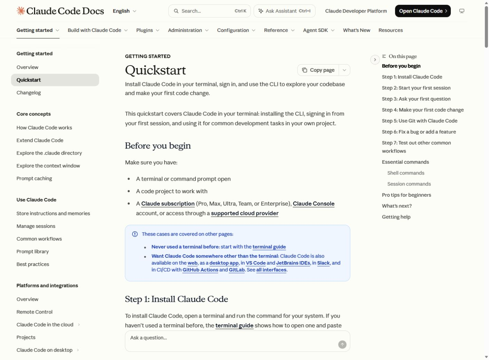

# 모듈 2. Claude Code 설치와 수정 요청

기준일 2026-11-10 · 예상 50분 · 학생용

## 1. 학습 목표

Claude Code의 터미널 세션에서 프로젝트를 읽고 수정한다.

## 2. 핵심 개념

Claude 웹 채팅과 Claude Code는 사용 환경이 다르다. Claude Code는 프로젝트의 파일을 읽고 도구를 실행한다. CLAUDE.md는 Claude Code의 프로젝트 지침이며 Codex의 AGENTS.md와 적용 범위가 다르다.

## 3. 준비물과 이용 조건

Windows PowerShell과 학교가 허용한 교사 계정. Anthropic 개인용 서비스는 18세 이상을 요구한다. 연령 조건에 맞지 않는 학생에게 가입·계정 공유를 시키지 않는다. 해당 단원은 교사 시연과 프롬프트 설계 활동으로 운영한다. Claude Code의 지원 구독 또는 API 비용 경로는 별도로 확인한다.

## 4. 실제 웹 경로와 화면

**이동 경로:** Claude Code Docs → Getting started → Quickstart → Step 1: Install Claude Code

**직접 주소:** [https://code.claude.com/docs/en/quickstart](https://code.claude.com/docs/en/quickstart)

<figure><a href="../08_화면캡처/02_ClaudeCode_공식설치.jpg"></a><figcaption>그림 2-1. 직접 접속한 공식 웹페이지 화면. 새 설치·로그인 성공 화면과 구분한다. · 실제 캡처 2026-11-10<br>출처: <a href="https://code.claude.com/docs/en/quickstart">https://code.claude.com/docs/en/quickstart</a> · 클릭하면 원본 크기로 열림</figcaption></figure>

## 5. 단계별 실습

### 단계 1. 공식 설치 안내 열기

PowerShell용 명령과 CMD·WSL용 명령을 구분한다. 아래 명령은 교사가 출처를 확인한 후 실행한다. 설치된 PC에서는 버전 확인부터 진행한다.

### 단계 2. 설치 확인

새 PowerShell에서 claude --version을 실행한다. 이 제작 PC에는 2.1.316이 설치되어 있었다. 명령어가 인식되는 것과 로그인·요청 성공은 별도이다.

### 단계 3. 프로젝트 시작

모듈 1의 실습 폴더로 이동해 claude를 실행한다. 첫 인증은 교사가 직접 완료한다. /help로 현재 세션의 도움말을 확인한다.

### 단계 4. 읽기부터 요청

어떤 파일이 있고 각 파일이 무슨 역할인지 먼저 물어본다. 아직 수정하지 않도록 범위를 명시한다.

### 단계 5. 한 가지 변경

색상·글자 크기 등 한 가지 목표를 요청한다. 승인창이 있으면 작업 경로와 실행 명령을 읽고 판단한다.

### 단계 6. 검토와 종료

수정 전후 페이지를 비교한다. 세션 안에서 /exit를 입력하거나 현재 도움말의 종료 방법을 따른다. 저장된 파일이 유지되는지 확인한다.

**입력 위치: Windows PowerShell.** 주석과 경로를 읽고 필요한 명령만 실행한다. `/help` 등 세션 명령은 설명된 에이전트 안에서 입력한다.

```powershell
# 새 설치가 필요한 교사가 공식 주소 확인 후 실행
irm https://claude.ai/install.ps1 | iex
# 설치 후 새 터미널에서
claude --version
Set-Location -LiteralPath $lessonRoot
claude
# 아래는 Claude Code 세션 안에서 입력
/help
```

## 6. 복사 가능한 프롬프트 입력 예시

입력 위치는 이용이 허용된 Codex 또는 교사의 Claude Code 세션이다. 스킬 이름이 들어간 예시는 해당 스킬이 인식된 상태에서 사용한다. 아래는 입력 예시이며 실제 서비스에서 자동으로 실행된 응답을 뜻하지 않는다.

### 예시 2-1. 기본 요청

```text
현재 폴더의 자기소개 페이지 파일을 읽고 파일별 역할과 실행 방법을 설명해줘. 아직 파일은 수정하지 마.
```

확인: 요청한 파일 또는 비교 결과가 실제로 나왔는지 확인한다.

### 예시 2-2. 수정·보완 요청

```text
자기소개 페이지에 수업 목표 영역을 추가해줘. 목표는 AI에게 구체적으로 요청하기, 실행 결과 확인하기, 오류를 근거로 수정하기야. 기존 내용을 보존해줘.
```

확인: 기존 요구사항이 유지되고 추가 조건이 반영되었는지 확인한다.

### 예시 2-3. 확인·검증 요청

```text
방금 수정한 파일과 바뀐 내용을 정리해줘. 브라우저 표시를 실제로 확인했는지, 코드만 검토했는지 구분해서 알려줘.
```

확인: 기대 결과와 실제 실행 여부가 구분되었는지 확인한다.

## 7. 정상 결과와 확인 방법

파일 목록과 수정 내용이 실제 폴더와 일치한다. 교사 계정으로 한 요청이 성공해야 인증·사용이 확인된 것이다. 본 제작에서는 CLI 버전·도움말을 확인했고 별도 유료 요청은 실행하지 않았다.

## 8. 오류와 해결

설치 명령에 && 관련 오류가 나면 CMD 예제를 PowerShell에 붙여 넣었는지 확인한다. Git for Windows는 공식 안내에 따라 선택하며 WSL을 모든 PC에 필수로 설치하지 않는다.

## 9. 과제와 확인 문항

기본: 교사 시연을 관찰하고 수정 요청문 작성. 확장: 기존 내용을 보존하도록 CLAUDE.md 지침 초안 작성.

질문: 학생이 교사 계정으로 돌아가며 로그인해도 되는가? 답: 계정을 공유하지 않는다. 이용 조건에 맞는 환경 또는 교사 시연을 사용한다.

## 출처

- [https://code.claude.com/docs/en/quickstart](https://code.claude.com/docs/en/quickstart) · 확인일 2026-11-10
- 상세 실행 상태: [검증 현황](../07_검증및출처/검증현황.md)
