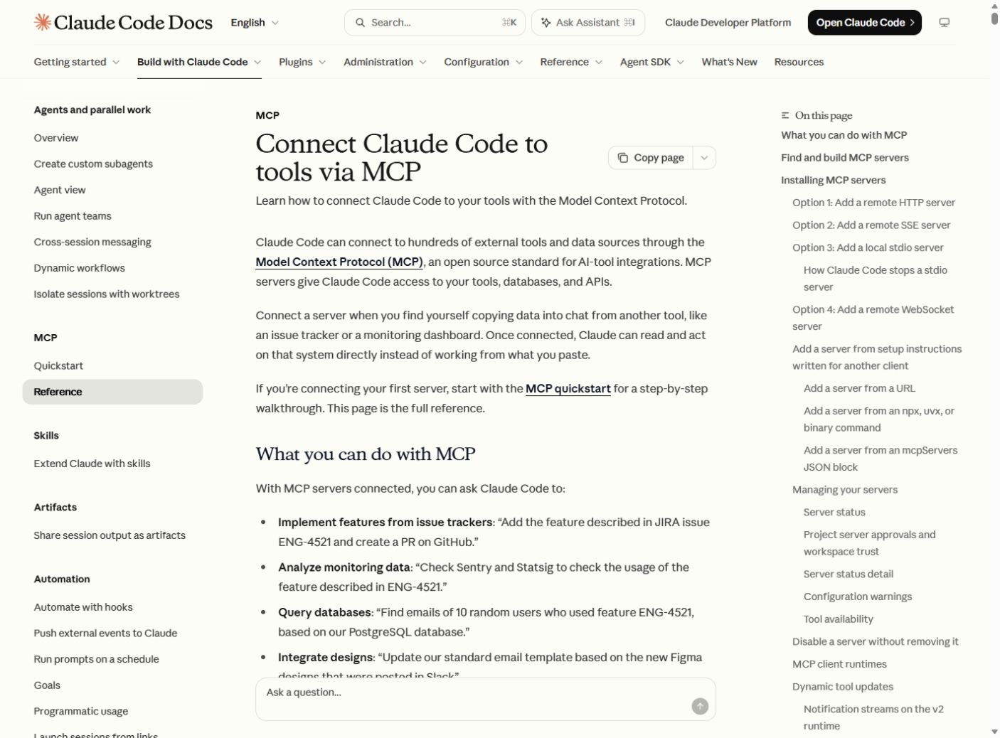
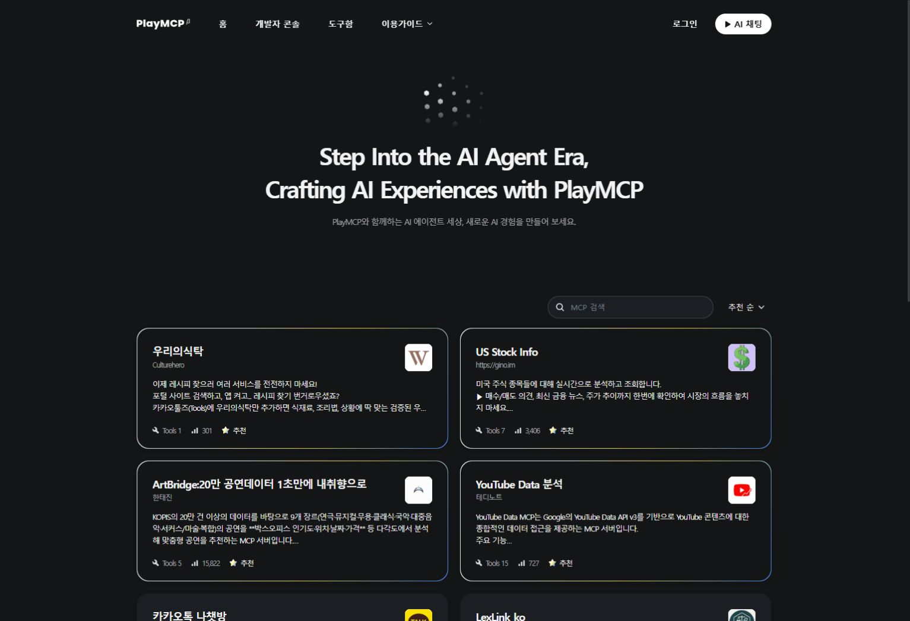

> 공용 설치 개정: 스킬은 사용자 .agents의 단일 원본, 플러그인은 양쪽 별도 등록, MCP는 공용 목록으로 관리함. https://youngwoo-m.github.io/highschool-ai-prompt-master/shared-install/

# 모듈 3. 스킬·플러그인·MCP 연결

기준일 2026-11-10 · 예상 50분 · 학생용

## 1. 학습 목표

재사용 지침과 확장 묶음, 외부 도구 연결을 구분한다.

## 2. 핵심 개념

스킬은 SKILL.md와 필요한 자원으로 구성된 재사용 지침이다. 플러그인은 제품에 맞게 스킬·도구 등을 묶는 확장 형식이다. MCP는 도구 목록과 호출을 연결하는 프로토콜이며 스킬 파일 자체와 다르다.

PLAYMCP는 카카오가 운영하는 MCP 도구 탐색·활용 서비스다. 공식 홈에서 도구를 검색하고 도구 설명·제공자·필요 권한·지원 연결 경로를 확인한다. 사이트 방문, 로그인, 도구 연결, 실제 호출은 각각 다른 상태다.


|구분|핵심 구성|설치·연결 위치 예|확인할 결과|
|---|---|---|---|
|스킬|SKILL.md·참조 파일|프로젝트 .agents/skills 또는 .claude/skills|새 세션에서 인식·실제 적용|
|플러그인|제품용 매니페스트·스킬·도구|Claude의 --plugin-dir 등 제품별 경로|매니페스트 검사와 실제 세션 로드|
|MCP|서버·도구 목록·호출 규약|제품별 서버 설정·HTTP 또는 stdio|연결 이후 실제 도구 호출|


## 3. 준비물과 이용 조건

본인에게 허용된 에이전트 환경. 개인 전역 설정 대신 프로젝트 또는 세션 한정 설정을 우선한다. 외부 서비스는 최소 기능만 연결한다.

## 4. 실제 웹 경로와 화면

**이동 경로:** Claude Code Docs → Configuration 또는 확장 기능 → MCP

**직접 주소:** [https://code.claude.com/docs/en/mcp](https://code.claude.com/docs/en/mcp)

<figure><a href="../08_화면캡처/03_MCP_공식안내.jpg"></a><figcaption>그림 3-1. 직접 접속한 공식 웹페이지 화면. 새 설치·로그인 성공 화면과 구분한다. · 실제 캡처 2026-11-10<br>출처: <a href="https://code.claude.com/docs/en/mcp">https://code.claude.com/docs/en/mcp</a> · 클릭하면 원본 크기로 열림</figcaption></figure>

<figure><a href="../08_화면캡처/03_PLAYMCP_공식홈.jpg"></a><figcaption>그림 3-2. PLAYMCP 공식 홈의 실제 화면 · 실제 캡처 2026-11-10<br>출처: <a href="https://playmcp.kakao.com/">https://playmcp.kakao.com/</a> · 클릭하면 원본 크기로 열림</figcaption></figure>

## 5. 단계별 실습

### 단계 1. 비교하기

스킬=작업 방법, 플러그인=제품용 묶음, MCP=실제 도구 연결이라는 차이를 표로 적는다. 같은 이름이 두 제품에 있다고 호환된다고 판단하지 않는다.

### 단계 2. 프로젝트 스킬 확인

.agents/skills와 .claude/skills에서 SKILL.md를 확인한다. 새 세션에서 인식되는지 확인해야 사용 준비가 된 것이다.

### 단계 3. 로컬 플러그인 예제

09_제작도구/classroom-plugin에 교재용 로컬 플러그인을 제공한다. claude plugin validate로 매니페스트를 검사하고 --plugin-dir로 해당 세션에만 로드한다. 전역 마켓플레이스를 바꾸지 않는다.

### 단계 4. PLAYMCP 소개

https://playmcp.kakao.com/ 에 접속하여 MCP 검색, 도구함, 이용가이드 메뉴를 확인한다. 원하는 도구의 제공자와 기능·조건을 확인한 뒤 지원되는 연결 경로를 따른다. 수업에서는 조회 예제를 우선하며 카카오톡 전송 등 외부 작업은 별도 명시적 요청과 검토 후 실행한다. 본 소개에서는 계정 연결이나 메시지 전송을 새로 수행하지 않았다.

### 단계 5. 문서 MCP 등록

현재 실습에서는 공용 servers.json에만 서버를 기록하고 sync_mcp.py로 양쪽에 반영함. 설정 백업과 미리보기를 먼저 확인함. 이전 공개 엔드포인트 시험 결과와 현재 공용 동기화 여부를 구분함.

### 단계 6. 연결과 호출 구분

MCP 도구 목록이 보이면 문서 검색을 한 번 실행한다. 연결 성공만으로 검색 결과를 얻었다고 기록하지 않는다.

### 단계 7. 해제와 비교

Claude Code의 mcp remove 도움말로 범위를 확인한 뒤 실습 서버를 제거할 수 있다. 플러그인은 --plugin-dir 없이 시작한 세션에서는 사용되지 않는다.

**입력 위치: Windows PowerShell.** 주석과 경로를 읽고 필요한 명령만 실행한다. `/help` 등 세션 명령은 설명된 에이전트 안에서 입력한다.

```powershell
# 이 PC에 제공된 공용 관리 도구를 사용함
# .agents\mcp\servers.json에만 서버 항목을 추가하거나 수정함
# 사용자 지정 목록에 비밀값을 적지 않음
python "$env:USERPROFILE\.agents\tools\sync_mcp.py"
# 계획과 설정 백업을 확인한 뒤 적용함
python "$env:USERPROFILE\.agents\tools\sync_mcp.py" --apply
# 양쪽 목록과 실제 연결을 별도로 확인함
claude mcp list
codex mcp list
```

## 6. 복사 가능한 프롬프트 입력 예시

입력 위치는 이용이 허용된 Codex 또는 교사의 Claude Code 세션이다. 스킬 이름이 들어간 예시는 해당 스킬이 인식된 상태에서 사용한다. 아래는 입력 예시이며 실제 서비스에서 자동으로 실행된 응답을 뜻하지 않는다.

### 예시 3-1. 기본 요청

```text
현재 프로젝트에서 인식하는 스킬과 플러그인, 연결된 MCP를 구분해서 알려줘. 파일만 존재하는 상태와 실제 호출 성공을 구분해줘.
```

확인: 요청한 파일 또는 비교 결과가 실제로 나왔는지 확인한다.

### 예시 3-2. 수정·보완 요청

```text
수업 점검 스킬을 사용해서 오늘 목표와 결과 파일, 실제 시험 결과를 확인할 체크리스트를 만들어줘. 미실행 항목을 완료로 바꾸지 마.
```

확인: 기존 요구사항이 유지되고 추가 조건이 반영되었는지 확인한다.

### 예시 3-3. 확인·검증 요청

```text
OpenAI Docs MCP가 연결되어 있다면 Codex의 프로젝트 스킬 관련 공식 문서를 검색하고 제목과 URL을 알려줘. 연결되어 있지 않으면 도구를 사용했다고 말하지 말고 상태를 알려줘.
```

확인: 기대 결과와 실제 실행 여부가 구분되었는지 확인한다.

## 7. 정상 결과와 확인 방법

교재용 로컬 플러그인은 claude plugin validate 검사에 통과했다. OpenAI Docs MCP 공개 엔드포인트의 initialize·tools/list·search_openai_docs 실제 호출은 HTTP 200으로 응답했다. 이는 프로토콜 직접 시험이며 에이전트 UI에 새로 등록·연결한 화면과 다르다. 새 세션의 플러그인 호출은 별도 확인 항목이다.

## 8. 오류와 해결

연결 오류는 URL, transport, 프록시, 네트워크와 인증 요구를 순서대로 확인한다. 문서 MCP는 키가 필요 없는 예제로 선택했다. 네트워크 실패를 파일 권한 문제로 단정하지 않는다.

## 9. 과제와 확인 문항

기본: 세 기능의 차이를 한 문장씩 작성. 확장: 프로젝트 한정 ‘실습 결과 점검’ 스킬의 SKILL.md 읽기.

질문: 도구 목록이 보이면 문서 조회까지 성공한 것인가? 답: 아니다. 실제 검색 또는 조회 호출과 반환 결과가 있어야 한다.

## 출처

- [https://code.claude.com/docs/en/mcp](https://code.claude.com/docs/en/mcp) · 확인일 2026-11-10
- 상세 실행 상태: [검증 현황](../07_검증및출처/검증현황.md)
