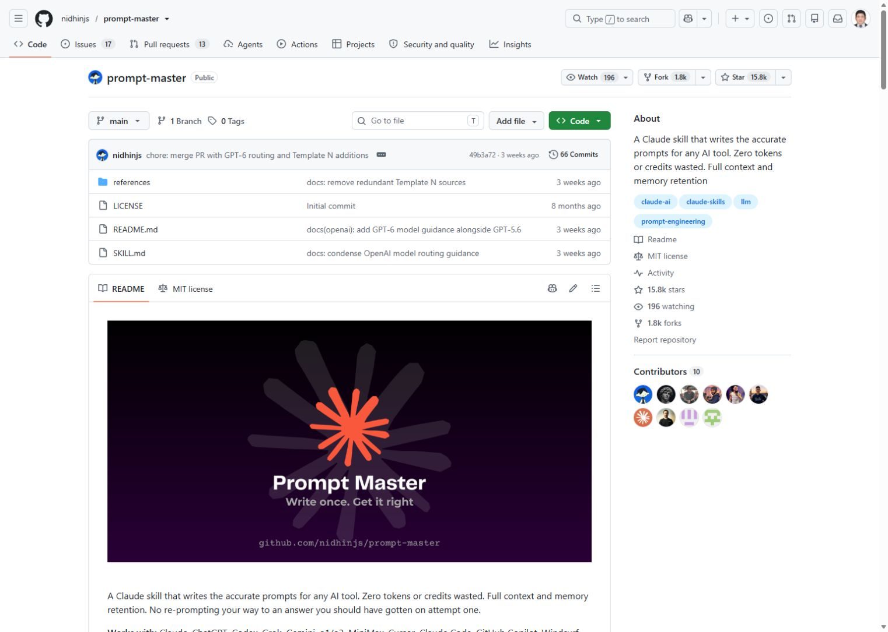
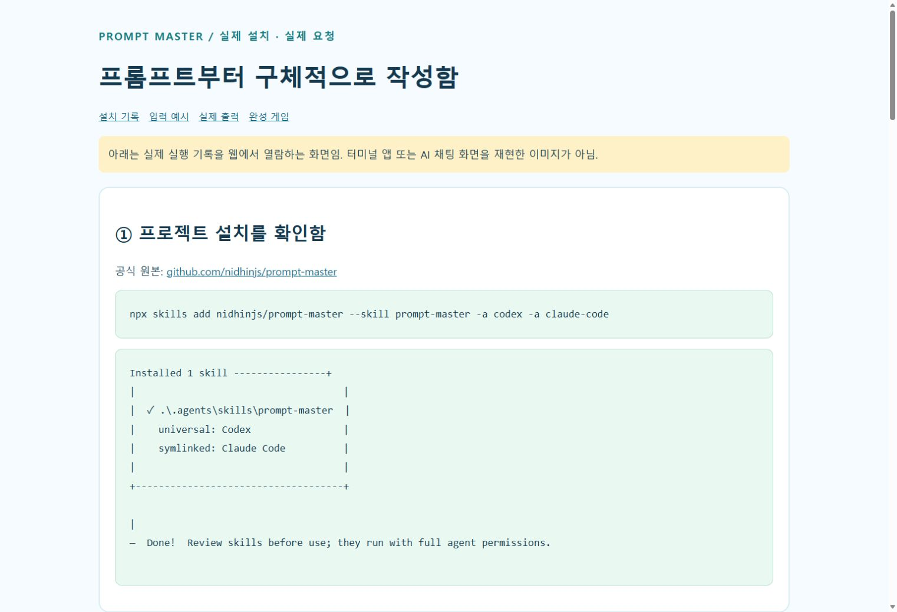
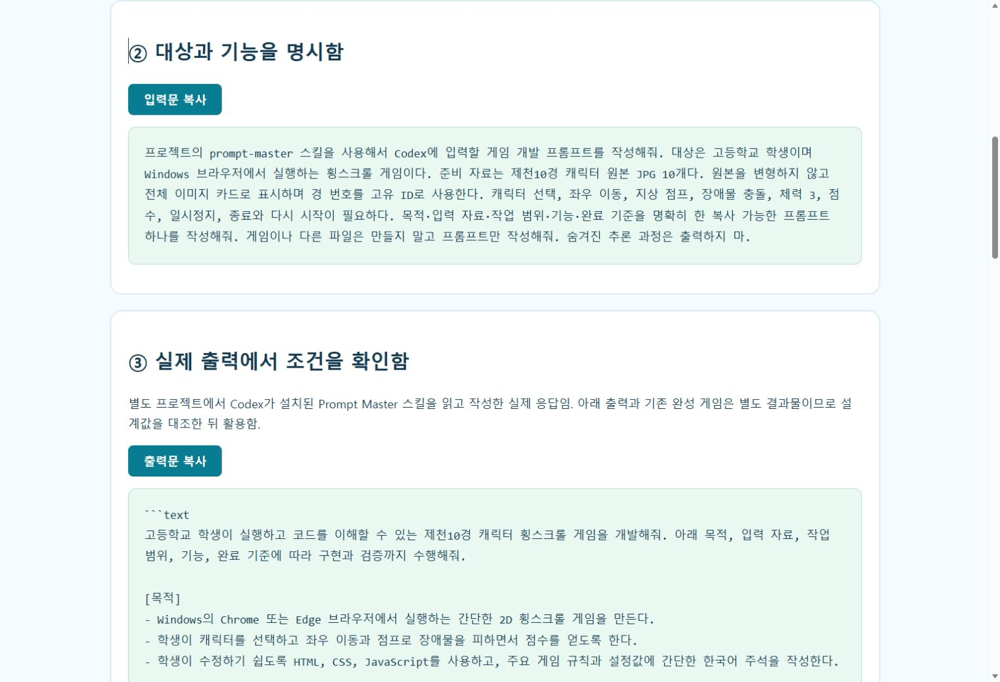

# 모듈 4. Prompt Master 설치와 프롬프트 작성

기준일 2026-11-10 · 예상 50분 · 학생용

## 1. 학습 목표

Prompt Master를 프로젝트에 설치하고 실제 요청을 실행하여 프롬프트를 작성한다.

## 2. 핵심 개념

Prompt Master는 대상 AI 도구에 맞는 프롬프트 작성·개선 요청에 사용하는 스킬이다. 프롬프트 작성 요청과 실제 게임 개발 요청은 별개이다. 대상을 Codex 또는 Claude Code로 명시하고 입력 자료·기능·제약·완료 기준을 제공한다.

## 3. 준비물과 이용 조건

Node.js와 Skills CLI, 사용이 허용된 Codex 또는 교사의 Claude Code 환경. 원본 저장소의 README·SKILL.md·references를 함께 확인한다. 본 실습은 프로젝트 범위에 설치하여 기존 전역 스킬을 보존한다.

## 4. 실제 웹 경로와 화면

**이동 경로:** GitHub 원본 → README 설치·사용 안내 → 프로젝트 스킬 설치 → 새 세션 호출

**직접 주소:** [https://github.com/nidhinjs/prompt-master](https://github.com/nidhinjs/prompt-master)

<figure><a href="../08_화면캡처/04_PromptMaster_원본저장소.jpg"></a><figcaption>그림 4-1. 직접 접속한 공식 웹페이지 화면. 새 설치·로그인 성공 화면과 구분한다. · 실제 캡처 2026-11-10<br>출처: <a href="https://github.com/nidhinjs/prompt-master">https://github.com/nidhinjs/prompt-master</a> · 클릭하면 원본 크기로 열림</figcaption></figure>

<figure><a href="../08_화면캡처/04_PromptMaster_설치실제기록.jpg"></a><figcaption>그림 4-2. 실제 설치 출력의 웹 열람 화면. 터미널 앱 UI가 아님. · 실제 캡처 2026-11-10<br>출처: <a href="https://github.com/nidhinjs/prompt-master">https://github.com/nidhinjs/prompt-master</a> · 클릭하면 원본 크기로 열림</figcaption></figure>

<figure><a href="../08_화면캡처/04_PromptMaster_사용실제기록.jpg"></a><figcaption>그림 4-3. 실제 입력·출력의 웹 열람 화면. AI 채팅 UI가 아님. · 실제 캡처 2026-11-10<br>출처: <a href="../10_Canva발표자료/프롬프트_실습.html">../10_Canva발표자료/프롬프트_실습.html</a> · 클릭하면 원본 크기로 열림</figcaption></figure>

## 5. 단계별 실습

### 단계 1. 원본 확인

nidhinjs/prompt-master 저장소에서 README, SKILL.md, references와 LICENSE를 확인한다. README의 브라우저 업로드 방식과 아래 프로젝트 CLI 방식은 별도 경로다.

### 단계 2. 프로젝트 폴더 생성

문서 폴더에 고교AI실습 폴더를 만들고 PowerShell을 해당 폴더에서 연다. 기존 같은 이름의 스킬이 있다면 출처를 확인하고 무조건 덮어쓰지 않는다.

### 단계 3. 프로젝트 설치

npx skills add 명령으로 prompt-master를 선택하고 Codex와 Claude Code를 대상으로 지정한다. -g 없이 프로젝트 범위로 설치한다. 실제 설치 로그에서 .agents 경로와 Claude Code 연결이 생성됨을 확인했다.

### 단계 4. 파일·세션 확인

SKILL.md와 references가 존재하는지 확인한 뒤 해당 프로젝트에서 새 에이전트 세션을 연다. 파일 복사, 세션 인식, 실제 요청 성공을 구분한다.

### 단계 5. 프롬프트 작성 요청

prompt-master 스킬을 사용해 Codex용 프롬프트를 작성해 달라고 명시한다. 게임을 바로 만들라는 요청과 혼동하지 않는다. 본 제작에서는 실제 Codex 세션에서 원본 스킬을 읽고 프롬프트를 출력하는 예제를 실행했다.

### 단계 6. 출력 검토와 적용

생성된 요청문에 입력 자료·작업 범위·게임 규칙·완료 기준이 있는지 확인한다. 출력 전문은 복사용 웹페이지에서 제공한다. 기존 게임과 설계값이 다르면 수정한 뒤 별도 개발 세션에 입력한다.

**입력 위치: Windows PowerShell.** 주석과 경로를 읽고 필요한 명령만 실행한다. `/help` 등 세션 명령은 설명된 에이전트 안에서 입력한다.

```powershell
# 새 프로젝트에서 실행
npx skills add nidhinjs/prompt-master --skill prompt-master -a codex -a claude-code
npx skills list
Get-Content -LiteralPath '.agents/skills/prompt-master/SKILL.md' -TotalCount 4 -Encoding UTF8
# 설치 후 해당 폴더에서 새 Codex 세션 시작
codex
```

## 6. 복사 가능한 프롬프트 입력 예시

입력 위치는 이용이 허용된 Codex 또는 교사의 Claude Code 세션이다. 스킬 이름이 들어간 예시는 해당 스킬이 인식된 상태에서 사용한다. 아래는 입력 예시이며 실제 서비스에서 자동으로 실행된 응답을 뜻하지 않는다.

### 예시 4-1. 기본 요청

```text
prompt-master 스킬을 사용해서 Codex에 입력할 게임 개발 프롬프트를 작성해줘. 대상은 고등학생이고 Windows 브라우저에서 실행할 거야. 제천10경 캐릭터 원본 JPG 10개를 변형 없이 전체 이미지 카드로 사용하고 경 번호를 ID로 구분해줘. 캐릭터 선택, 좌우 이동, 지상 점프, 장애물 충돌, 체력 3, 점수, 일시정지, 종료와 다시 시작이 필요해. 프롬프트만 작성하고 게임 파일은 아직 만들지 마.
```

확인: 요청한 파일 또는 비교 결과가 실제로 나왔는지 확인한다.

### 예시 4-2. 수정·보완 요청

```text
방금 작성한 프롬프트에서 가정한 값을 정리해줘. 점수는 이동 거리와 수집 스탬프로 계산하고 장애물은 고정 배치하며 카메라가 이동하는 방식으로 명시해줘. 기존 원본 JPG는 수정하지 않는 조건을 유지해줘.
```

확인: 기존 요구사항이 유지되고 추가 조건이 반영되었는지 확인한다.

### 예시 4-3. 확인·검증 요청

```text
완성된 프롬프트에 목적, 입력 자료, 작업 범위, 필수 기능, 제약, 완료 기준이 있는지 점검해줘. 실제 게임 실행 결과와 프롬프트 문장 검토를 구분하고 부족한 부분만 보완해줘.
```

확인: 기대 결과와 실제 실행 여부가 구분되었는지 확인한다.

## 7. 정상 결과와 확인 방법

별도 실습프로젝트에서 Skills CLI 설치가 성공했다. 이어 실제 Codex 요청을 실행하여 prompt-master의 SKILL.md를 읽고 게임 개발용 프롬프트를 출력했다. 원본 출력과 설치 로그를 보관했다. 이 출력은 별도 요청의 실제 응답이며 기존 완성 게임이 이 출력에서 새로 생성되었다는 의미는 아니다.

## 8. 오류와 해결

스킬이 인식되지 않으면 현재 프로젝트 경로, SKILL.md 및 references, 새 세션 여부를 확인한다. 다른 스킬과 이름이 같으면 출처를 명시한다. 대상을 정하지 않아 질문이 나오면 Codex 등 사용할 도구를 먼저 알려준다.

## 9. 과제와 확인 문항

기본: 모호한 요청과 개선된 요청 비교. 확장: 룰렛·셔틀 노선도·게임·보고서용 프롬프트를 각각 작성.

질문: 프롬프트 작성이 끝나면 게임도 완성된 것인가? 답: 아니다. 개발 세션에서 실행하고 실제 결과를 시험해야 한다.

## 출처

- [https://github.com/nidhinjs/prompt-master](https://github.com/nidhinjs/prompt-master) · 확인일 2026-11-10
- 상세 실행 상태: [검증 현황](../07_검증및출처/검증현황.md)
