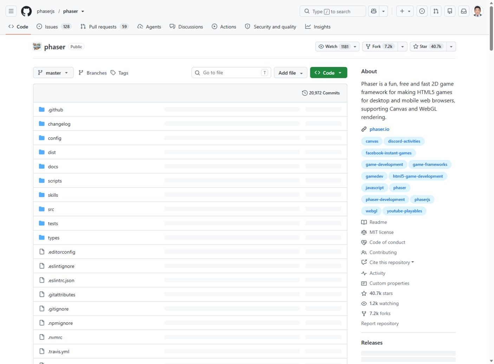

# 모듈 6. 게임 개발 스킬 선정과 설치

기준일 2026-11-10 · 예상 50분 · 학생용

## 1. 학습 목표

기존 도구를 근거 있게 선정하고 작은 이동·점프 예제를 실행한다.

## 2. 핵심 개념

Phaser는 게임을 실행하는 JavaScript 라이브러리이고 game-setup-and-config는 AI가 Phaser 설정을 이해하도록 돕는 스킬이다. 라이브러리 설치와 스킬 설치를 별도로 기록한다.

## 3. 준비물과 이용 조건

Phaser 공식 저장소와 본 프로젝트의 로컬 엔진 4.2.1. 엔진을 vendor에 포함했으므로 완성 게임은 실행 시 CDN 다운로드를 요구하지 않는다. Node는 CLI와 시험에, Python은 로컬 서버와 보고서에 사용한다.

## 4. 실제 웹 경로와 화면

**이동 경로:** Phaser 공식 GitHub → 스킬 목록(설치 CLI에서 확인) → game-setup-and-config

**직접 주소:** [https://github.com/phaserjs/phaser](https://github.com/phaserjs/phaser)

<figure><a href="../08_화면캡처/06_Phaser_공식저장소.jpg"></a><figcaption>그림 6-1. 직접 접속한 공식 웹페이지 화면. 새 설치·로그인 성공 화면과 구분한다. · 실제 캡처 2026-11-10<br>출처: <a href="https://github.com/phaserjs/phaser">https://github.com/phaserjs/phaser</a> · 클릭하면 원본 크기로 열림</figcaption></figure>

## 5. 단계별 실습

### 단계 1. 후보 비교

공식 phaserjs/phaser의 game-setup-and-config, gamedev-skills/awesome-gamedev-agent-skills의 phaser-core, PlayableIntelligence/game-creator를 조사한다. 후보 목록은 별도 비교표에 제공한다.

### 단계 2. 선정

설정 예제가 명확하고 Phaser 4를 직접 다루는 공식 스킬을 선정했다. 커뮤니티 플러그인을 전부 설치하지 않는다.

### 단계 3. 설치

아래 명령을 프로젝트 폴더에서 실행한다. 이번 제작에서 Codex용 .agents 경로와 Claude Code 연결이 생성되었다.

### 단계 4. 내용 확인

SKILL.md의 Phaser.Game, renderer, pixelArt, FIT 설정을 읽는다. Canvas 렌더러와 고정 논리 해상도를 사용해 수업 예제의 설정을 단순하게 했다.

### 단계 5. 이동·점프

05_게임실습/단계1_이동과 점프/시작.html을 연다. 캐릭터 선택 UI 뒤에서 기본 도형이 움직인다. 완성 단계와 같은 규칙 파일을 공유한다.

### 단계 6. 설치와 실행 기록

스킬 CLI 로그와 엔진 버전 기록, 실제 브라우저 캡처를 함께 확인한다. 새 에이전트 세션의 인식 여부는 별도로 점검한다.

**입력 위치: Windows PowerShell.** 주석과 경로를 읽고 필요한 명령만 실행한다. `/help` 등 세션 명령은 설명된 에이전트 안에서 입력한다.

```powershell
npx skills add phaserjs/phaser --skill game-setup-and-config -a codex -a claude-code
npx skills list
# 교육 프로젝트 루트에서 로컬 서버 실행. 포트 사용 중이면 다른 포트 선택
python -m http.server 18465 --bind 127.0.0.1
# 브라우저: http://127.0.0.1:18465/05_게임실습/완성게임/index.html?lesson=1
```

## 6. 복사 가능한 프롬프트 입력 예시

입력 위치는 이용이 허용된 Codex 또는 교사의 Claude Code 세션이다. 스킬 이름이 들어간 예시는 해당 스킬이 인식된 상태에서 사용한다. 아래는 입력 예시이며 실제 서비스에서 자동으로 실행된 응답을 뜻하지 않는다.

### 예시 6-1. 기본 요청

```text
game-setup-and-config 스킬을 읽고 Phaser 4의 Canvas 렌더러, 고정 크기 960×450, FIT 확대 방식으로 빈 게임을 구성해줘. 라이브러리는 로컬 vendor 파일을 사용해줘.
```

확인: 요청한 파일 또는 비교 결과가 실제로 나왔는지 확인한다.

### 예시 6-2. 수정·보완 요청

```text
기본 도형을 방향키로 좌우 이동하고 Space로 점프하게 만들어줘. 중력과 바닥 착지를 넣고 지상에서만 점프하게 해줘. 이미지와 장애물은 아직 넣지 마.
```

확인: 기존 요구사항이 유지되고 추가 조건이 반영되었는지 확인한다.

### 예시 6-3. 확인·검증 요청

```text
도형의 이동, 왼쪽 경계, 점프, 공중 추가 점프 차단, 착지를 각각 시험해줘. 실제 화면 시험과 규칙 함수 시험을 구분해줘.
```

확인: 기대 결과와 실제 실행 여부가 구분되었는지 확인한다.

## 7. 정상 결과와 확인 방법

엔진 버전은 4.2.1이며 실제 게임 캡처에 표시된다. 스킬 설치 성공, 엔진 파일 확보, 브라우저 실행을 각각 기록했다.

## 8. 오류와 해결

file://에서 로딩 문제가 발생하면 로컬 서버 주소로 접속한다. 포트 접근 거부 또는 충돌이면 학교 보안을 변경하지 말고 허용되는 다른 포트를 사용한다.

## 9. 과제와 확인 문항

기본: 이동 속도 205를 180으로 바꾼 사본 비교. 확장: 논리 해상도와 화면 표시 크기의 차이 설명.

질문: Phaser만 설치하면 AI 스킬도 설치되는가? 답: 아니다. 라이브러리와 SKILL.md 설치는 별도다.

## 출처

- [https://github.com/phaserjs/phaser](https://github.com/phaserjs/phaser) · 확인일 2026-11-10
- 상세 실행 상태: [검증 현황](../07_검증및출처/검증현황.md)
