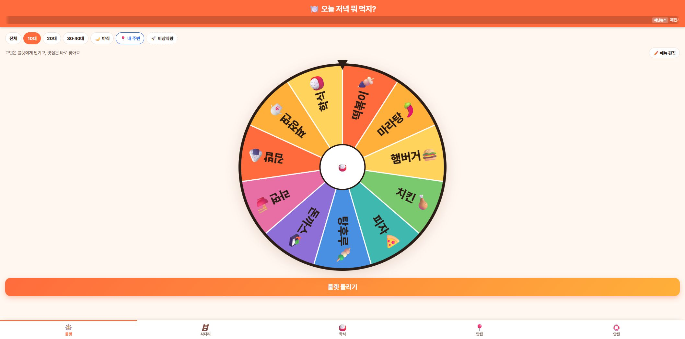
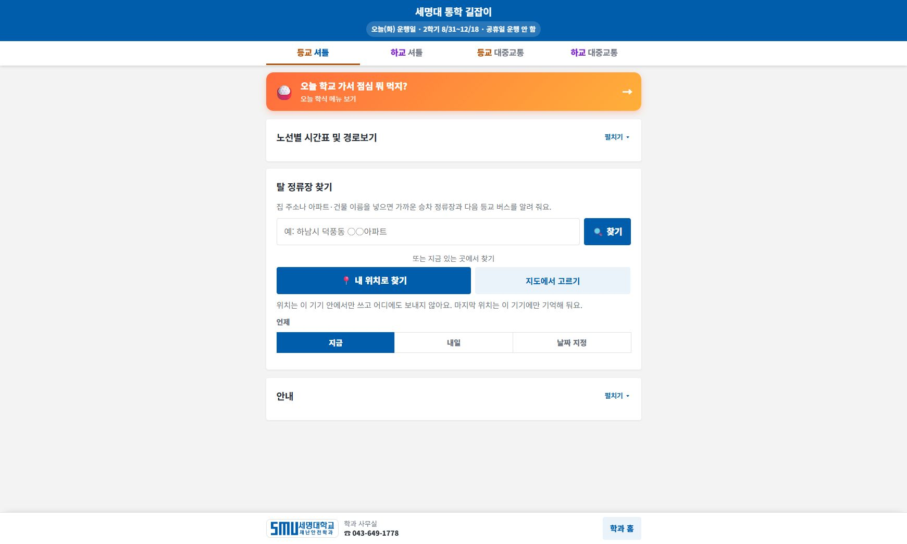

# 수업용 프롬프트 모음

모든 문장은 AI 채팅 입력 예시다. PowerShell 명령과 구분한다. 학생의 이용 조건에 맞는 도구에서 사용한다.

# 먼저 체험하기: 우리가 만들 수 있는 앱

두 앱을 먼저 사용하고 ‘무엇을 입력하면 무엇이 나오는가’를 관찰한다. 이후 AI로 작은 기능을 구현하고 검증하는 과정을 배운다. 기존 운영 앱을 수정하거나 새로 배포하는 실습은 포함하지 않는다.

## 체험 1. 저녁 뭐 먹지 룰렛 · 5분

1. 아래 주소로 접속하고 룰렛과 메뉴 선택 영역을 찾는다.
2. 메뉴 선택 동작을 한 번 실행한다. 외부 주문·결제는 진행하지 않는다.
3. 입력, 처리, 출력을 활동지에 적는다. 예: 메뉴 후보 → 임의 선택 → 선택된 메뉴 표시.
4. ‘같은 메뉴가 너무 자주 나오지 않게 하려면 무엇을 기록해야 할까?’를 이야기한다. 실제 확률이나 추천 효과를 측정하지 않고 단정하지 않는다.

**하단 웹주소: [https://geoai-na.web.app/dinner/](https://geoai-na.web.app/dinner/)**

<figure><a href="../08_화면캡처/00_저녁뭐먹지_룰렛.jpg"></a><figcaption>그림 0-1. 운영 중인 저녁 메뉴 룰렛의 실제 접속 화면. 기능 분석을 위한 체험 사례이며 성능 검증 결과가 아니다. · 실제 캡처 2026-11-10<br>출처: <a href="https://geoai-na.web.app/dinner/">https://geoai-na.web.app/dinner/</a> · 클릭하면 원본 크기로 열림</figcaption></figure>

AI 채팅 입력 예시:

```text
저녁 메뉴를 고르는 작은 룰렛 웹페이지를 만들어줘. 후보는 김밥, 비빔밥, 돈가스, 우동, 볶음밥, 샌드위치 6개야. 버튼을 누르면 하나를 무작위로 고르고 글자로도 결과를 보여줘. 외부 주문이나 결제 기능은 넣지 말고 HTML 파일 하나로 실행되게 해줘.
```

```text
룰렛 결과가 나왔을 때 어떤 후보에서 선택했는지 함께 표시해줘. 결과를 다시 뽑기 전에 후보를 편집할 수 있게 하고, 후보가 비어 있으면 안내문을 보여줘.
```

```text
후보가 0개, 1개, 6개인 경우를 구분해서 확인할 시험표를 만들어줘. 실제 실행한 결과만 기록하고 무작위 선택이 공정하다는 결론은 충분한 시험 없이 내리지 마.
```

## 체험 2. 셔틀버스 노선도 앱 · 7분

1. 아래 주소로 접속하여 학교 셔틀, 노선 또는 정류장 정보 영역을 찾는다.
2. 노선과 정류장을 선택했을 때 표시가 어떻게 바뀌는지 관찰한다. 위치 권한은 이 수업에 필수가 아니다.
3. 지도에 표시되는 위치, 시간표, 실시간 정보의 차이를 구분한다. 통학 전에는 학교의 최신 공지와 시간표를 확인한다.
4. ‘정류장 목록과 지도 표시를 일치시키려면 어떤 ID가 필요할까?’를 생각한다. 이것을 이후 캐릭터 ID와 연결한다.

**하단 웹주소: [https://smuds-m.github.io/semyung-shuttle/](https://smuds-m.github.io/semyung-shuttle/)**

<figure><a href="../08_화면캡처/00_셔틀버스_노선도앱.jpg"></a><figcaption>그림 0-2. 세명대 통학 길잡이의 실제 접속 화면. 버스 도착·위치·시간표 전체의 정확성을 검증한 결과는 아니다. · 실제 캡처 2026-11-10<br>출처: <a href="https://smuds-m.github.io/semyung-shuttle/">https://smuds-m.github.io/semyung-shuttle/</a> · 클릭하면 원본 크기로 열림</figcaption></figure>

AI 채팅 입력 예시:

```text
가상의 학교 셔틀 노선도 연습 앱을 만들어줘. 정류장은 학교, 도서관, 터미널 3개이고 각각 고유 ID를 부여해줘. 정류장을 선택하면 노선도에서 강조하고 옆에 설명을 보여줘. 데이터는 모두 교육용 가상 자료라고 표시하고 실제 위치·시간표로 오해되지 않게 해줘.
```

```text
정류장 이름이 같아도 ID가 다르면 별도로 선택되게 수정해줘. 이름으로만 비교하는 코드가 있는지 확인하고 수정한 이유를 설명해줘.
```

```text
정류장 선택, 선택 해제, 데이터 없음, 잘못된 ID를 시험해줘. 기대 결과와 실제 결과를 분리해서 표로 작성해줘. 실제 운영 셔틀 앱은 수정하지 마.
```

## 체험 기록

|앱|내가 조작한 입력|화면에서 관찰한 출력|AI로 바꾸고 싶은 기능|확인할 시험|
|---|---|---|---|---|
|메뉴 룰렛|직접 작성|직접 작성|직접 작성|직접 작성|
|셔틀 노선도|직접 작성|직접 작성|직접 작성|직접 작성|

이후 학습은 설치 → 작은 요청 → 확장 기능 → 게임 → 보고서 순서로 진행한다.

## 모듈 1. Codex 설치와 첫 웹페이지

### 1-1

```text
현재 실습 폴더 안에 index.html과 style.css로 자기소개 페이지를 만들어줘. 이름은 AI 탐험가로 하고 관심 분야 3개와 배우고 싶은 것을 넣어줘. 실명이나 연락처는 넣지 마. 만든 파일과 실행 방법을 알려줘.
```

### 1-2

```text
기존 자기소개 내용은 유지하고 글씨 크기를 18px 이상으로 조정해줘. 휴대전화 폭에서도 가로 스크롤 없이 읽을 수 있게 수정하고 변경 파일을 알려줘.
```

### 1-3

```text
파일을 실제로 열어 제목, 본문, 관심 분야가 표시되는지 확인해줘. 직접 화면을 확인할 수 없으면 실행 방법과 내가 확인할 항목을 알려주고 완료로 단정하지 마.
```

## 모듈 2. Claude Code 설치와 수정 요청

### 2-1

```text
현재 폴더의 자기소개 페이지 파일을 읽고 파일별 역할과 실행 방법을 설명해줘. 아직 파일은 수정하지 마.
```

### 2-2

```text
자기소개 페이지에 수업 목표 영역을 추가해줘. 목표는 AI에게 구체적으로 요청하기, 실행 결과 확인하기, 오류를 근거로 수정하기야. 기존 내용을 보존해줘.
```

### 2-3

```text
방금 수정한 파일과 바뀐 내용을 정리해줘. 브라우저 표시를 실제로 확인했는지, 코드만 검토했는지 구분해서 알려줘.
```

## 모듈 3. 스킬·플러그인·MCP 연결

### 3-1

```text
현재 프로젝트에서 인식하는 스킬과 플러그인, 연결된 MCP를 구분해서 알려줘. 파일만 존재하는 상태와 실제 호출 성공을 구분해줘.
```

### 3-2

```text
수업 점검 스킬을 사용해서 오늘 목표와 결과 파일, 실제 시험 결과를 확인할 체크리스트를 만들어줘. 미실행 항목을 완료로 바꾸지 마.
```

### 3-3

```text
OpenAI Docs MCP가 연결되어 있다면 Codex의 프로젝트 스킬 관련 공식 문서를 검색하고 제목과 URL을 알려줘. 연결되어 있지 않으면 도구를 사용했다고 말하지 말고 상태를 알려줘.
```

## 모듈 4. Prompt Master 설치와 프롬프트 작성

### 4-1

```text
prompt-master 스킬을 사용해서 Codex에 입력할 게임 개발 프롬프트를 작성해줘. 대상은 고등학생이고 Windows 브라우저에서 실행할 거야. 제천10경 캐릭터 원본 JPG 10개를 변형 없이 전체 이미지 카드로 사용하고 경 번호를 ID로 구분해줘. 캐릭터 선택, 좌우 이동, 지상 점프, 장애물 충돌, 체력 3, 점수, 일시정지, 종료와 다시 시작이 필요해. 프롬프트만 작성하고 게임 파일은 아직 만들지 마.
```

### 4-2

```text
방금 작성한 프롬프트에서 가정한 값을 정리해줘. 점수는 이동 거리와 수집 스탬프로 계산하고 장애물은 고정 배치하며 카메라가 이동하는 방식으로 명시해줘. 기존 원본 JPG는 수정하지 않는 조건을 유지해줘.
```

### 4-3

```text
완성된 프롬프트에 목적, 입력 자료, 작업 범위, 필수 기능, 제약, 완료 기준이 있는지 점검해줘. 실제 게임 실행 결과와 프롬프트 문장 검토를 구분하고 부족한 부분만 보완해줘.
```

## 모듈 5. GitHub와 find-skills 사용

### 5-1

```text
find-skills를 사용해 2D 횡스크롤 게임에 도움이 되는 스킬을 찾아줘. 원본 저장소, 라이선스, 지원 에이전트, 설치 방법을 비교하고 자동으로 전역 설치하지 마.
```

### 5-2

```text
검색 결과 중 공식 Phaser 저장소의 game-setup-and-config가 실제로 있는지 확인하고 어떤 버전과 작업을 다루는지 SKILL.md를 읽어 정리해줘.
```

### 5-3

```text
설치된 find-skills의 파일 위치와 이름을 확인해줘. 파일 존재, 새 세션에서의 인식, 실제 검색 실행 여부를 구분해서 알려줘.
```

## 모듈 6. 게임 개발 스킬 선정과 설치

### 6-1

```text
game-setup-and-config 스킬을 읽고 Phaser 4의 Canvas 렌더러, 고정 크기 960×450, FIT 확대 방식으로 빈 게임을 구성해줘. 라이브러리는 로컬 vendor 파일을 사용해줘.
```

### 6-2

```text
기본 도형을 방향키로 좌우 이동하고 Space로 점프하게 만들어줘. 중력과 바닥 착지를 넣고 지상에서만 점프하게 해줘. 이미지와 장애물은 아직 넣지 마.
```

### 6-3

```text
도형의 이동, 왼쪽 경계, 점프, 공중 추가 점프 차단, 착지를 각각 시험해줘. 실제 화면 시험과 규칙 함수 시험을 구분해줘.
```

## 모듈 7. 제천10경 캐릭터 게임 제작

### 7-1

```text
제천10경케릭터 폴더의 JPG 10개를 원본 그대로 사용해 선택 화면을 만들어줘. 제6경과 제7경 이름이 같아도 ID로 구분하고 원본 파일을 덮어쓰지 마. 선택한 ID가 실제 플레이에 반영되게 해줘.
```

### 7-2

```text
장애물과 발판을 넣어줘. 지상에서만 점프하고 발판 위에서 다시 점프할 수 있게 해줘. 피격 시 체력을 1 줄이고 잠시 중복 피해를 막아줘. 체력 소진 시 이동을 멈추고 재시작 버튼을 제공해줘.
```

### 7-3

```text
캐릭터 선택 전달, 점프·착지, 장애물 충돌, 일시정지, 재시작 초기화, 도착 성공을 시험표로 확인해줘. 실제 수행한 시험의 방법과 결과를 적고 화면 미확인 항목은 따로 표시해줘.
```

## 모듈 8. 지정 HWPX 스킬 설치와 첫 문서

### 8-1

```text
이 프로젝트의 .agents/skills/hwpx가 Canine89/gonggong_hwpxskills 출처인지 확인하고 그 스킬을 사용해줘. 제공 양식이 없으면 assets/report-template.hwpx를 사용해 AI 활용 실습 결과 한 페이지 보고서를 만들어줘. 실제 확인한 파일과 활동만 적어줘.
```

### 8-2

```text
보고서의 제목, 목적, 활동 내용, 결과를 구분하고 날짜를 제작일로 표시해줘. 아직 수업이 열리지 않았다면 학생 만족도나 학습 효과를 만들지 마.
```

### 8-3

```text
생성한 HWPX의 ZIP/XML 구조를 검사하고 실제 한글 또는 뷰어에서 열리는지도 확인해줘. 구조 검사와 화면 검증을 구분해서 결과를 알려줘.
```

## 모듈 9. 게임 개발·수업 운영 보고서 작성

### 9-1

```text
지정 HWPX 스킬과 보고서 템플릿으로 ‘제천10경 캐릭터 기반 횡스크롤 게임 개발 보고서’를 작성해줘. 실제 코드, 자산 목록, 시험 로그, 캡처를 근거로 작성하고 실제 시험과 계획을 구분해줘.
```

### 9-2

```text
기능, 시험 방법, 기대 결과, 실제 결과, 판정 열로 시험 결과표를 넣어줘. Node 규칙 시험과 브라우저 화면 시험을 구분하고 미실행 항목을 통과로 표시하지 마.
```

### 9-3

```text
교사용 수업 운영 보고서 작성 예시를 만들어줘. 아직 수업이 열리지 않았으므로 사전 준비·제작·검증 결과를 작성하고 실제 운영일·학생 수·학습 효과는 실시 후 기록란으로 남겨줘. HWPX와 PDF의 표·그림을 확인해줘.
```
