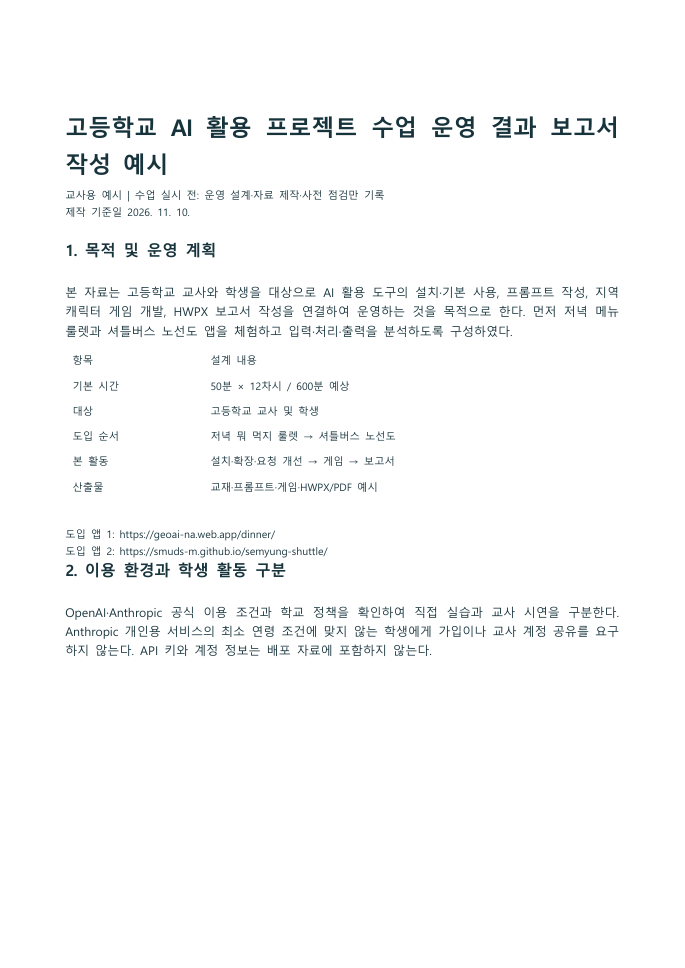
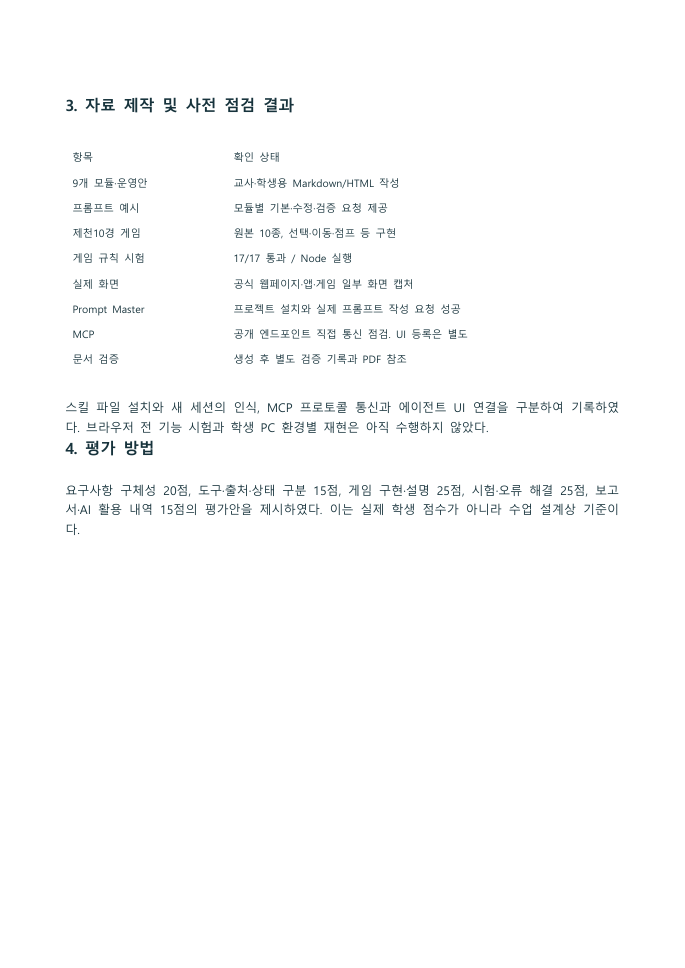
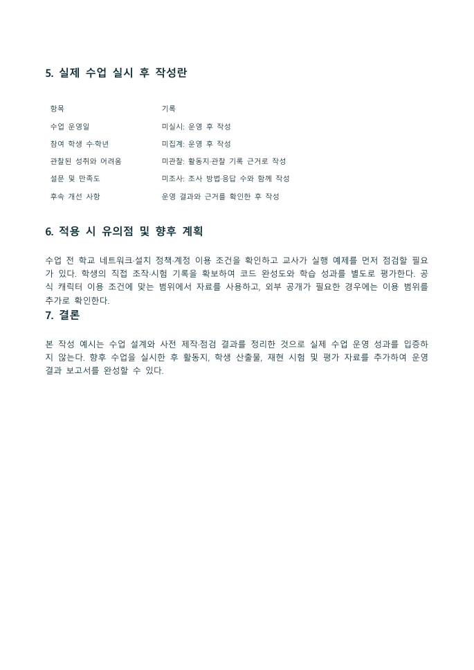
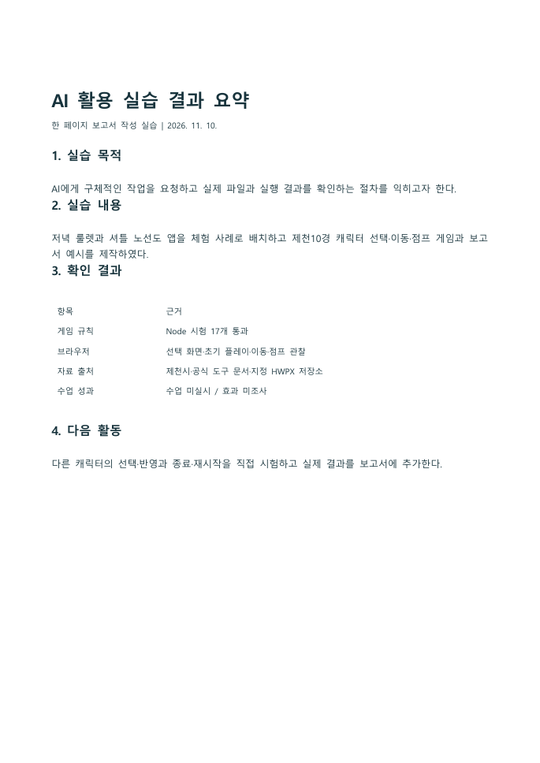
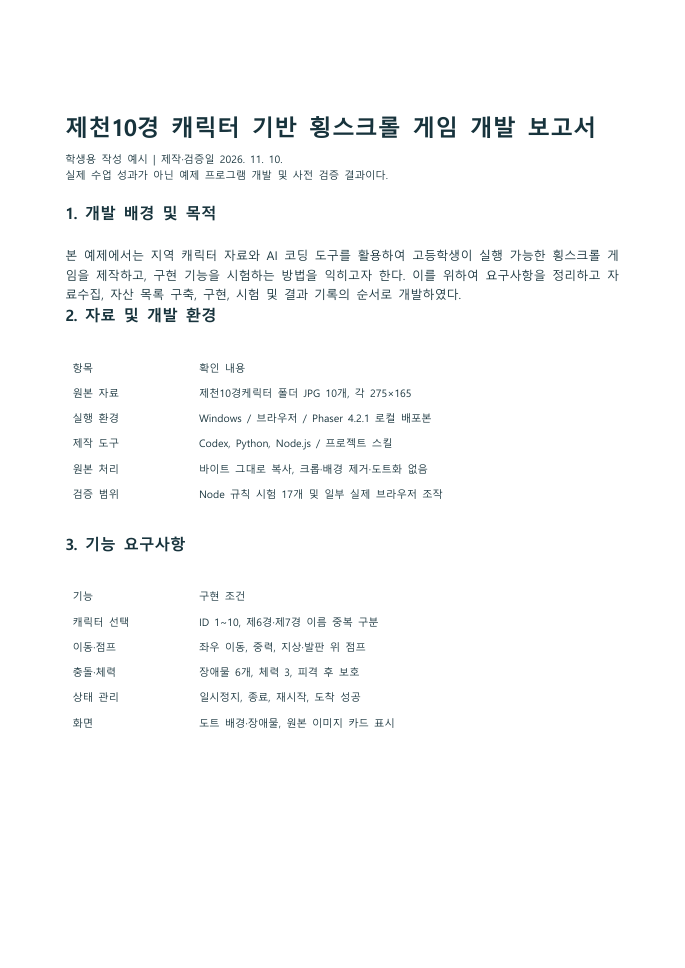
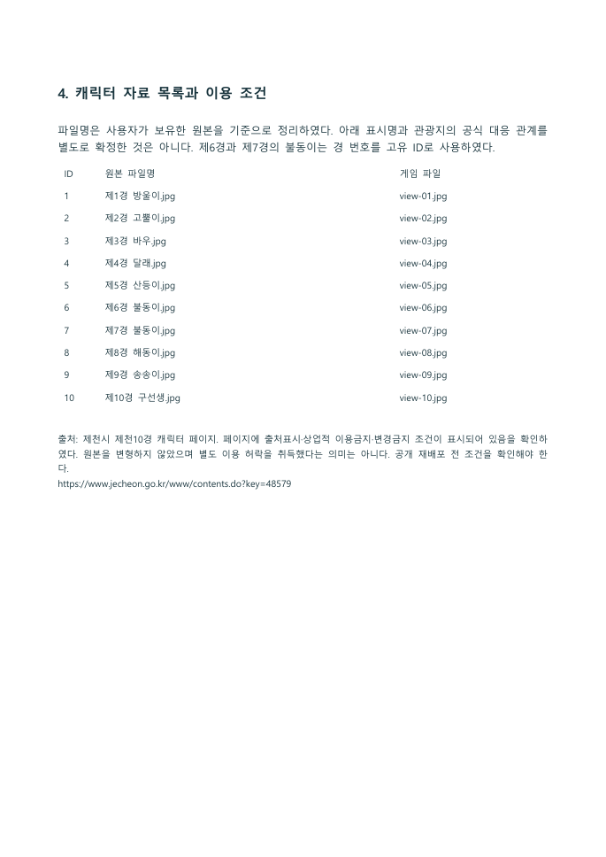
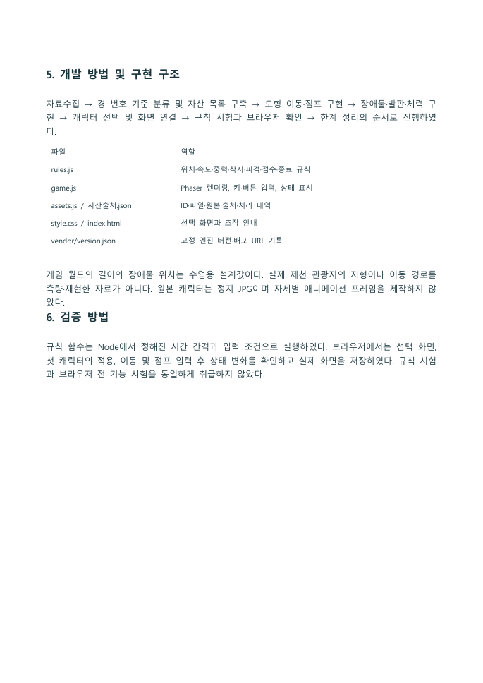
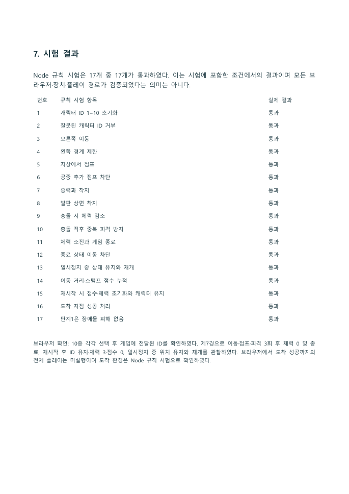
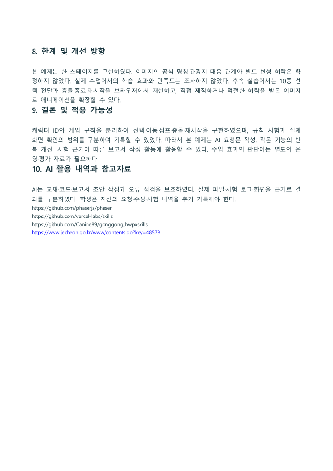
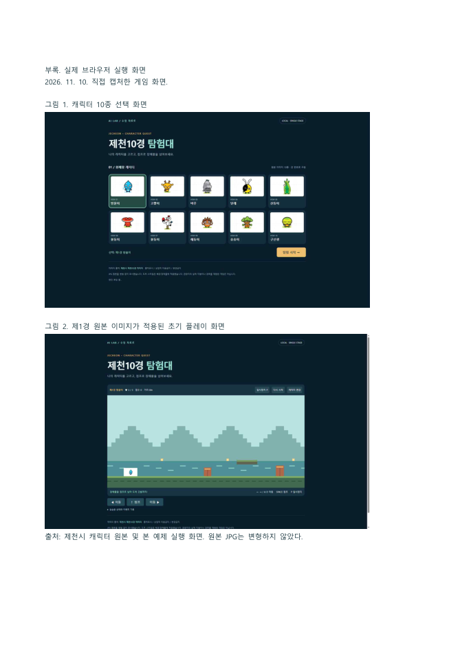

# HWPX 보고서 예시와 열람 안내

사용자 지정 gonggong_hwpxskills의 assets/report-template.hwpx를 원본 양식으로 사용했다. 원본은 보존하고 새 문서에 문단과 표를 구성하였다. 학생용에는 실제 게임 화면 2개를 삽입했다.

|보고서|HWPX|PDF|실제 페이지|
|---|---|---|---:|
|교사용_AI수업운영_보고서작성예시|[교사용_AI수업운영_보고서작성예시.hwpx](교사용_AI수업운영_보고서작성예시.hwpx)|[교사용_AI수업운영_보고서작성예시.pdf](교사용_AI수업운영_보고서작성예시.pdf)|3|
|첫실습_AI활용결과_한페이지|[첫실습_AI활용결과_한페이지.hwpx](첫실습_AI활용결과_한페이지.hwpx)|[첫실습_AI활용결과_한페이지.pdf](첫실습_AI활용결과_한페이지.pdf)|1|
|학생용_제천10경게임_개발보고서|[학생용_제천10경게임_개발보고서.hwpx](학생용_제천10경게임_개발보고서.hwpx)|[학생용_제천10경게임_개발보고서.pdf](학생용_제천10경게임_개발보고서.pdf)|6|

## 문서 검증

세 파일은 ZIP/XML 구조 검사와 실제 한글 열림·PDF 저장을 확인했다. 학생용 6쪽·교사용 3쪽·첫 실습 1쪽이며 한글 PageCount와 PDF 페이지 수가 일치한다. 학생용과 교사용 문서는 작성 예시이며 실제 수업 효과를 측정한 보고서가 아니다.

## 실제 문서 렌더

아래 이미지는 실제 한글에서 PDF로 내보낸 결과다. 설명용으로 새로 그린 문서 화면이 아니다. 한글 앱 UI 전체 캡처와는 구분한다.

### 교사용_AI수업운영_보고서작성예시

<figure><figcaption>실제 한글 PDF 변환 결과: 09_보고서_교사용_AI수업운영_보고서작성예시_p01.png · 실제 캡처 2026-11-10 출처: <a href="../06_HWPX보고서예시/교사용_AI수업운영_보고서작성예시.pdf">../06_HWPX보고서예시/교사용_AI수업운영_보고서작성예시.pdf</a> · 클릭하면 원본 크기로 열림</figcaption></figure>

<figure><figcaption>실제 한글 PDF 변환 결과: 09_보고서_교사용_AI수업운영_보고서작성예시_p02.png · 실제 캡처 2026-11-10 출처: <a href="../06_HWPX보고서예시/교사용_AI수업운영_보고서작성예시.pdf">../06_HWPX보고서예시/교사용_AI수업운영_보고서작성예시.pdf</a> · 클릭하면 원본 크기로 열림</figcaption></figure>

<figure><figcaption>실제 한글 PDF 변환 결과: 09_보고서_교사용_AI수업운영_보고서작성예시_p03.png · 실제 캡처 2026-11-10 출처: <a href="../06_HWPX보고서예시/교사용_AI수업운영_보고서작성예시.pdf">../06_HWPX보고서예시/교사용_AI수업운영_보고서작성예시.pdf</a> · 클릭하면 원본 크기로 열림</figcaption></figure>

### 첫실습_AI활용결과_한페이지

<figure><figcaption>실제 한글 PDF 변환 결과: 09_보고서_첫실습_AI활용결과_한페이지_p01.png · 실제 캡처 2026-11-10 출처: <a href="../06_HWPX보고서예시/첫실습_AI활용결과_한페이지.pdf">../06_HWPX보고서예시/첫실습_AI활용결과_한페이지.pdf</a> · 클릭하면 원본 크기로 열림</figcaption></figure>

### 학생용_제천10경게임_개발보고서

<figure><figcaption>실제 한글 PDF 변환 결과: 09_보고서_학생용_제천10경게임_개발보고서_p01.png · 실제 캡처 2026-11-10 출처: <a href="../06_HWPX보고서예시/학생용_제천10경게임_개발보고서.pdf">../06_HWPX보고서예시/학생용_제천10경게임_개발보고서.pdf</a> · 클릭하면 원본 크기로 열림</figcaption></figure>

<figure><figcaption>실제 한글 PDF 변환 결과: 09_보고서_학생용_제천10경게임_개발보고서_p02.png · 실제 캡처 2026-11-10 출처: <a href="../06_HWPX보고서예시/학생용_제천10경게임_개발보고서.pdf">../06_HWPX보고서예시/학생용_제천10경게임_개발보고서.pdf</a> · 클릭하면 원본 크기로 열림</figcaption></figure>

<figure><figcaption>실제 한글 PDF 변환 결과: 09_보고서_학생용_제천10경게임_개발보고서_p03.png · 실제 캡처 2026-11-10 출처: <a href="../06_HWPX보고서예시/학생용_제천10경게임_개발보고서.pdf">../06_HWPX보고서예시/학생용_제천10경게임_개발보고서.pdf</a> · 클릭하면 원본 크기로 열림</figcaption></figure>

<figure><figcaption>실제 한글 PDF 변환 결과: 09_보고서_학생용_제천10경게임_개발보고서_p04.png · 실제 캡처 2026-11-10 출처: <a href="../06_HWPX보고서예시/학생용_제천10경게임_개발보고서.pdf">../06_HWPX보고서예시/학생용_제천10경게임_개발보고서.pdf</a> · 클릭하면 원본 크기로 열림</figcaption></figure>

<figure><figcaption>실제 한글 PDF 변환 결과: 09_보고서_학생용_제천10경게임_개발보고서_p05.png · 실제 캡처 2026-11-10 출처: <a href="../06_HWPX보고서예시/학생용_제천10경게임_개발보고서.pdf">../06_HWPX보고서예시/학생용_제천10경게임_개발보고서.pdf</a> · 클릭하면 원본 크기로 열림</figcaption></figure>

<figure><figcaption>실제 한글 PDF 변환 결과: 09_보고서_학생용_제천10경게임_개발보고서_p06.png · 실제 캡처 2026-11-10 출처: <a href="../06_HWPX보고서예시/학생용_제천10경게임_개발보고서.pdf">../06_HWPX보고서예시/학생용_제천10경게임_개발보고서.pdf</a> · 클릭하면 원본 크기로 열림</figcaption></figure>

## 원문과 생성 과정

각 문서의 _원문.md, 생성내역.json, 09_제작도구/build_reports.py 및 verify_reports.py를 제공한다. 재생성하면 교재용 출력 파일이 갱신되므로 학생이 수정한 보고서는 별도 이름으로 보존한다. 원문 Markdown의 표는 파이프 구분 기록이며 편집용 표 구조는 HWPX에 포함되어 있다.
